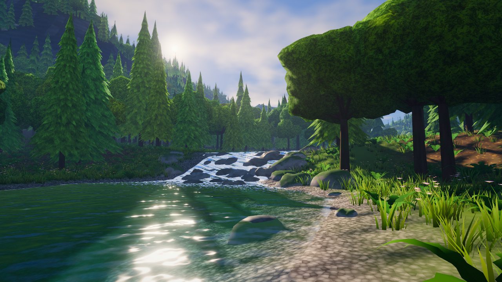
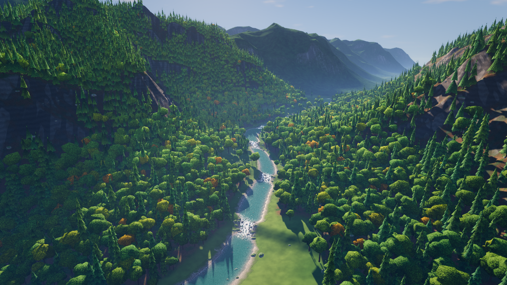
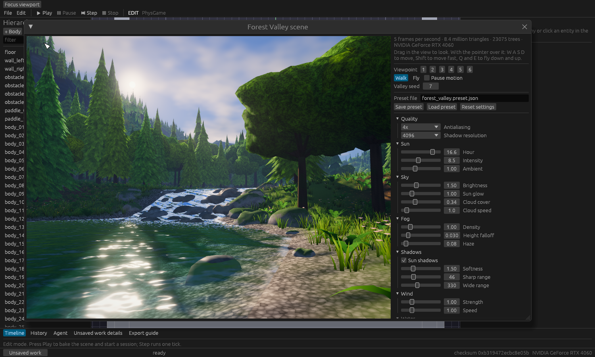

# Orrery

결정론 롤백 ECS 게임엔진입니다. Rust로 작성했고, 에디터와 게임 런타임, AI 에이전트용 명령 도구를 함께 제공합니다.

- 설계: [docs/design-v2.md](docs/design-v2.md), [docs/design-v1.md](docs/design-v1.md)
- 현재 상태와 다음 작업: [docs/progress.md](docs/progress.md)
- AI 에이전트 사용법: [AGENTS.md](AGENTS.md)

## 윈도우에서 바로 실행하기

준비물은 Rust 안정 버전(1.95 이상)과 Vulkan 또는 DirectX 12를 지원하는 그래픽 카드입니다. 아래 명령은 저장소 최상위 폴더에서 실행합니다.

### 1. 전체 빌드

```powershell
cargo build-all
```

에디터와 모든 게임 실행 파일이 `target\release\` 아래에 생깁니다. `build-all`은 `.cargo/config.toml`에 정의한 별칭이고, 에디터와 샘플 게임의 기능을 모두 켠 릴리스 빌드입니다. 처음에는 10분쯤 걸립니다. 아래 단계는 이 폴더의 실행 파일을 직접 실행합니다.

### 2. 에디터

```powershell
target\release\orr_editor.exe
```

기본 물리 씬이 열립니다. 다른 게임으로 열려면 `--game`을 붙입니다.

```powershell
target\release\orr_editor.exe --game arena
target\release\orr_editor.exe --game yard3d
```

### 3. 내 게임 프로젝트 만들기 (Room)

```powershell
target\release\orr_new_room.exe --output C:\Games\MyRoom --seed room-01
target\release\orr_editor.exe --room-project C:\Games\MyRoom
```

에디터 메뉴의 `File > New Room project…`와 `File > Open Room project…`로도 같은 일을 할 수 있습니다. 에디터에서 `Play`를 누르면 그 자리에서 게임이 돌아갑니다.

### 4. 게임 실행

```powershell
target\release\room_escape.exe --project C:\Games\MyRoom
target\release\coop_defense.exe
target\release\arena.exe
```

- `room_escape`: 방금 만든 Room 프로젝트를 창으로 실행합니다. `--headless --ticks 120 --capture out.png`를 붙이면 창 없이 실행하고 화면을 저장합니다.
- `coop_defense`: 협동 디펜스 게임 Stormglass Foundry입니다. Space 소환, U 강화, I 투자, P 일시정지, R 재시작입니다.
- `arena`: 롤백 넷코드 시험용 2인 아레나입니다. WASD 이동, Space 발사입니다.

### 5. 윈도우용 게임 폴더로 내보내기

에디터에서 Room 프로젝트를 저장한 뒤 `File > Export Windows game…`을 사용합니다. 명령으로는 다음과 같습니다.

```powershell
$rt = "target\release\room_escape.exe"
$hash = (Get-FileHash $rt -Algorithm SHA256).Hash.ToLower()
target\release\orr_export_windows.exe --project C:\Games\MyRoom --runtime (Resolve-Path $rt) --runtime-sha256 $hash --output C:\Games\MyRoomExport --trusted-runtime
C:\Games\MyRoomExport\run-room-escape.cmd
```

내보낸 폴더는 엔진 소스 없이 단독으로 실행됩니다. 자세한 내용은 [docs/windows-game-export.md](docs/windows-game-export.md)에 있습니다.

### 6. AI 에이전트 연결

```powershell
target\release\orr_editor.exe --erp 127.0.0.1:7777 --erp-dev
target\release\orr.exe status
```

`orr`는 실행 중인 에디터에 붙어 씬을 읽고 고치는 명령 도구입니다. 명령 목록은 `orr help`로 봅니다.

### 7. 숲과 계곡 장면 보기 (Forest Valley)

```powershell
target\release\forest_valley.exe
```

숲이 우거진 산골 계곡을 걸어 다니는 그래픽 시연입니다. 지형, 나무, 바위, 풀, 물이 모두 시드 하나에서 만들어집니다.




| 키 | 동작 |
|---|---|
| W A S D | 이동 (Shift를 누르면 빠르게) |
| 마우스 드래그 | 시선 돌리기 |
| F | 걷기와 날기 전환 (날 때 Q 내려가기, E 올라가기) |
| 1 ~ 6 | 준비된 시점으로 이동 |
| T / G | 시간을 늦게 / 이르게 (해의 높이와 방향이 바뀜) |
| Space | 바람과 물 멈춤 |
| Esc | 종료 |

명령 옵션은 `--seed 숫자`(다른 계곡), `--view 1..6`, `--hour 시각`, `--size 너비x높이`, `--no-vsync`(프레임률 확인), `--settings 프리셋.json`(에디터에서 저장한 설정 불러오기)입니다. `--capture out.png`를 붙이면 창 없이 한 장을 그려 PNG로 저장합니다.

#### 에디터에서 설정하기

에디터 메뉴 `Edit > Forest Valley scene…`을 누르면 장면 창이 열립니다. 왼쪽은 실시간 화면이고 오른쪽은 설정 패널입니다. 값을 바꾸면 다음 프레임에 바로 반영됩니다.



| 묶음 | 설정 |
|---|---|
| Quality | 안티에일리어싱(1x, 2x, 4x), 그림자 해상도 |
| Sun | 시각, 햇빛 세기, 그늘 밝기 |
| Sky | 하늘 밝기, 해 주변 빛, 구름 양, 구름 속도 |
| Fog | 안개 농도, 높이에 따른 감소, 옅은 연무 |
| Shadows | 그림자 켜기, 가장자리 부드러움, 가까운 범위, 먼 범위 |
| Wind | 바람 세기, 속도 |
| Water | 깊은 물 색, 투명도, 잔물결, 유속, 물거품, 햇빛 반짝임 |
| Vegetation | 잎 색조, 잎 투과광, 잎 무늬 대비, 단풍 비율, 풀 표시 거리, 나무 상세 거리 |
| Ground | 지면 요철, 물 바닥 빛 무늬 |
| Look | 자동 노출, 노출, 적응 속도, 블룸과 시작 밝기, 빛줄기, 채도, 대비, 비네트, 필름 입자 |

- `Valley seed`를 바꾸면 다른 계곡을 새로 만듭니다.
- `Save preset`은 시드, 품질, 모든 설정을 `Preset file`에 적힌 JSON 파일로 저장합니다. `Load preset`은 그 파일을 다시 읽습니다. 이 파일은 `forest_valley.exe --settings`로도 쓸 수 있습니다.
- `Reset settings`는 시드만 남기고 모든 값을 기본값으로 되돌립니다.
- 화면 위에서 드래그하면 시선이 돌고, 마우스가 화면 위에 있을 때 W A S D로 이동합니다.

렌더러는 `crates/orr_scenery`에 있습니다. 그림자 두 단계, HDR 다중 샘플 장면, 하늘과 안개, 물, 블룸, 빛줄기, 자동 노출, 톤 매핑 순서로 한 프레임을 그립니다. 셰이더가 쓰는 값은 모두 `orr_scenery::Settings`에서 오며, 범위와 설명은 `crates/orr_scenery/src/settings.rs`의 표 하나에 있습니다. 에디터 패널과 파일 읽기가 같은 표를 씁니다.

## 검증 명령

```powershell
cargo test --workspace --release
cargo clippy --workspace --all-targets
```

테스트나 `cargo build`를 실행하면 `target\release\`의 실행 파일이 최소 기능 빌드로 바뀝니다. 그 뒤에 에디터나 게임을 실행하려면 `cargo build-all`을 다시 실행합니다. 이때는 바뀐 부분만 다시 빌드합니다.

전체 테스트는 통합 테스트 실행 파일이 500개가 넘어서 한 시간 안팎이 걸립니다. 한 부분만 고쳤을 때는 `cargo test --release -p <크레이트> --test <테스트 파일>`로 좁혀서 실행합니다.

## 윈도우에서 아직 안 되는 것

아래 기능은 코드가 리눅스 전용으로 막혀 있습니다. 윈도우에서 실행하면 지원하지 않는다는 안내가 나옵니다.

- Arena 프로젝트와 Collect 프로젝트의 새로 만들기와 내보내기 (`orr_new_arena`, `orr_export_arena`, `orr_export_collect`)
- 게임 진행 저장 (Room, Collect, Stormglass의 이어하기)
- `orr_pkg`의 번들·웹 관련 하위 명령

## 저장소 구조

- `crates/orr_fp`, `orr_ecs`, `orr_sim`, `orr_session`: 시뮬레이션 코어 (고정소수점, ECS, 예측과 롤백)
- `crates/orr_editor`: 에디터
- `crates/orr_sample`: 게임 실행 파일과 프로젝트 생성·내보내기 도구
- `crates/orr_games`: 게임 규칙 (창과 GPU에 의존하지 않음)
- `crates/orr_scenery`: 야외 장면 렌더러와 Forest Valley 시연
- `crates/orr_remote`, `orr_cli`, `orr_mcp`: 에이전트 연결
- `examples/`: 사용자 게임 예제
