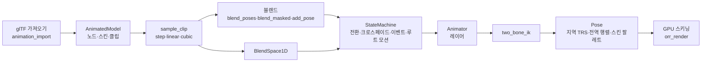

# 스켈레탈 애니메이션

갱신: 2026-11-14. 코드: `crates/orr_model/src/animation.rs`, `animation/graph.rs`, `animation/ik.rs` (기능 이름 `animation`). 테스트: `crates/orr_model/tests/animation_runtime.rs`, `animation_graph.rs`.

애니메이션은 화면 쪽 기능이다. 시뮬레이션에 들어가지 않고 `f32` 초 단위로 돈다. 그래서 롤백·리플레이·체크섬과 무관하다. 게임 규칙이 애니메이션 시점에 맞춰야 하면(공격 판정 등) 시뮬레이션 쪽에서 틱으로 따로 센다.

## 1. 구성



| 기능 | API | 비고 |
|---|---|---|
| 클립 샘플링 | `AnimatedModel::sample_clip(clip, time)` | glTF의 step, linear, cubic spline. 채널이 없는 노드는 기본 자세 |
| 클립 하나 재생 | `AnimationPlayer` | play, pause, resume, seek, advance, 한 번 또는 반복 |
| 두 자세 섞기 | `blend_poses(from, to, weight)` | 지역 TRS에서 위치·크기는 선형, 회전은 slerp |
| 본 마스크 | `BoneMask::all`, `BoneMask::subtree(model, "spine")` | 노드별 가중치 0~1 |
| 마스크 블렌드 | `blend_masked(base, over, weight, mask)` | 상체만 다른 동작 |
| 가산 블렌드 | `add_pose(base, additive, reference, weight, mask)` | `additive`가 `reference`에서 달라진 만큼 `base`에 더함 |
| 1D 블렌드 스페이스 | `BlendSpace1D::new(model, [(0.0, idle), (1.5, walk), (4.0, run)])` | 이웃한 두 클립을 같은 위상으로 샘플해 섞음. 주기 길이도 섞음 |
| 상태 머신 | `StateMachine` | 아래 2절 |
| 레이어 | `Animator { layers }`, `LayerBlend::{Override, Additive}` | 첫 레이어가 기본. 최대 8개 |
| 투 본 IK | `two_bone_ik(pose, "foot", target, pole)` | 아래 3절 |
| 스키닝 | `orr_render`의 스키닝 렌더러, 표면 셰이더 | `Pose::skin_matrices`를 올림 |

## 2. 상태 머신

```rust
use orr_model::animation::*;

let states = vec![
    AnimationState { name: "idle".into(), motion: Motion::Clip(0), looping: true, speed: 1.0 },
    AnimationState {
        name: "move".into(),
        motion: Motion::Blend { space: BlendSpace1D::new(&model, vec![(1.5, 1), (4.0, 2)])?, parameter: "speed".into() },
        looping: true,
        speed: 1.0,
    },
    AnimationState { name: "jump".into(), motion: Motion::Clip(3), looping: false, speed: 1.0 },
];
let transitions = vec![
    Transition { from: Some(0), to: 1, conditions: vec![Condition::Above("speed".into(), 0.1)], fade: 0.2, exit_time: None },
    Transition { from: Some(1), to: 0, conditions: vec![Condition::Below("speed".into(), 0.1)], fade: 0.3, exit_time: None },
    Transition { from: None, to: 2, conditions: vec![Condition::Trigger("jump".into())], fade: 0.1, exit_time: None },
    Transition { from: Some(2), to: 0, conditions: vec![], fade: 0.2, exit_time: Some(1.0) },
];
let events = vec![ClipEvent { clip: 1, time: 0.25, name: "footstep".into() }];
let mut machine = StateMachine::new(&model, states, transitions, events)?;
machine.extract_root_motion(&model, "hips")?;

// 매 프레임
machine.set_float("speed", speed);
if jump_pressed { machine.trigger("jump"); }
for event in machine.update(&model, frame_seconds)? { play_sound(&event); }
character_position += machine.take_root_motion();
let pose = machine.pose(&model)?;
```

- 파라미터는 float, bool, trigger 세 종류다. trigger는 그것을 시험한 전환이 일어나면 지워진다.
- `update`는 먼저 시간을 진행하고, 전환 목록에서 조건이 맞는 첫 전환을 택한다. `from: None`은 `to` 외의 모든 상태에서 갈 수 있다는 뜻이다.
- `exit_time`은 현재 주기의 몇 할이 지나야 나갈 수 있는지(0~1)다. 조건이 비어 있으면 그 시점에 바로 나간다.
- 크로스페이드 동안 이전 상태도 계속 진행하며, 두 자세를 경과 시간 비율로 섞는다.
- 클립 이벤트는 재생이 그 시각을 지날 때 한 번 보고된다. 반복 재생이 끝을 넘으면 끝 쪽 이벤트, 앞 쪽 이벤트 순으로 보고된다.
- 루트 모션: 지정한 노드의 수평 이동(x, z)을 자세에서 빼서 `take_root_motion`으로 돌려준다. 수직 이동(점프, 흔들림)은 자세에 남긴다. 반복 재생이 끝을 넘을 때도 이동량이 이어진다.
- 상태 속도는 0~16이다. 블렌드 스페이스는 위상(0~1)으로 진행해서 파라미터가 바뀌어도 걸음이 끊기지 않는다.

## 3. 투 본 IK

`two_bone_ik(pose, end, target, pole)`은 `end`의 부모(무릎, 팔꿈치)와 조부모(엉덩이, 어깨)의 지역 회전만 바꿔 `end`가 `target`에 닿게 한다. 좌표는 모델 공간이다.

1. 두 뼈 길이와 목표까지 거리로 가운데 관절 각도를 정하고, 폴이 있는 평면에서 굽힌다.
2. 뿌리 관절에서 사슬 전체를 목표 쪽으로 돌린다.
3. 뿌리에서 목표로 가는 축을 중심으로 비틀어 가운데 관절이 폴 쪽을 향하게 한다.

닿지 않는 목표는 그 방향으로 다리를 편다. 사슬에 크기가 고르지 않은(nonuniform) 스케일이 있으면 결과는 근사다.

## 4. 한계

- 블렌드 스페이스는 1D만 있다. 2D(방향 × 속도)는 없다.
- 모프 타깃(블렌드 셰이프)은 가져오지도 그리지도 않는다.
- 상태 머신과 레이어는 코드 API다. 에디터에서 그래프를 편집하는 화면과 씬 파일 형식은 아직 없다.
- 리타기팅(다른 뼈대로 클립 옮기기)은 없다.
- IK는 투 본만 있다. 룩앳, FABRIK 같은 다관절 IK는 없다.

## 5. 다른 문서

이전부터 있던 클립 도구와 에디터 경로는 기능별 문서에 있다: `animation-clip-extract.md`(잘라내기·속도·역재생), `animation-clip-sequence.md`, `animation-cubic-spline.md`, `animation-pose-bake.md`, `editor-animated-models.md`, `editor-animation-preview-step.md`.
