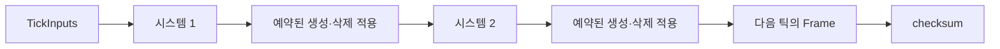
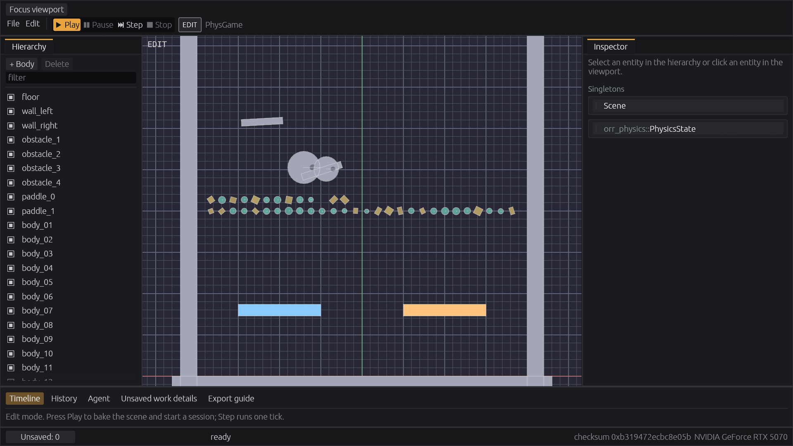
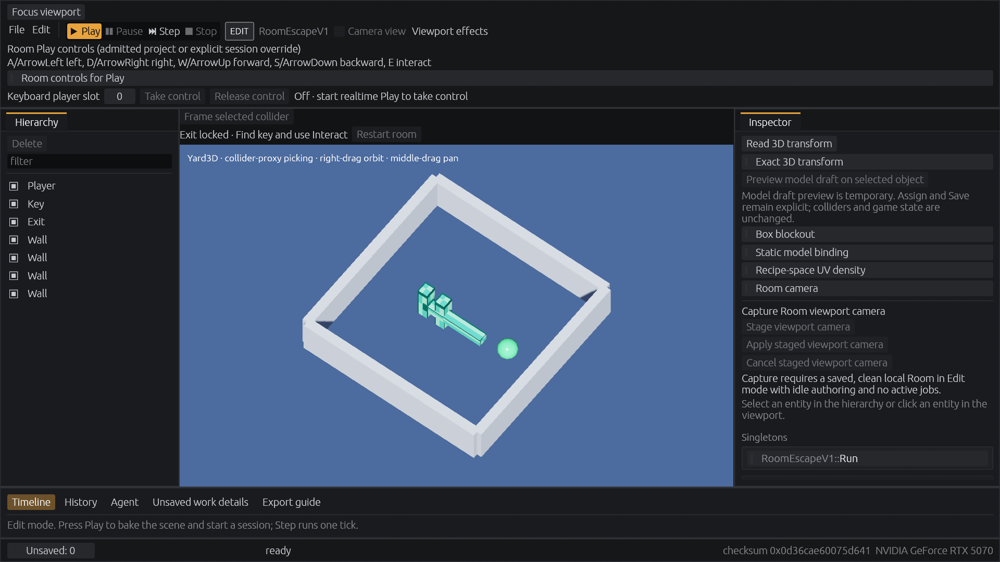

# Getting Started

Orrery를 처음 쓰는 사람을 위한 안내입니다. 순서대로 따라가면 코드로 첫 게임을 돌려 보고, 에디터로 프로젝트를 만들어 실행하고, 윈도우용 게임 폴더로 내보내기까지 합니다. 명령은 모두 저장소 최상위 폴더에서 실행합니다.

1. [준비](#1-준비)
2. [코드로 첫 게임 돌려 보기](#2-코드로-첫-게임-돌려-보기)
3. [시뮬레이션 규칙](#3-시뮬레이션-규칙)
4. [에디터 빌드와 실행](#4-에디터-빌드와-실행)
5. [내 프로젝트 만들고 실행하기](#5-내-프로젝트-만들고-실행하기)
6. [내보내기](#6-내보내기)
7. [AI 에이전트 연결](#7-ai-에이전트-연결)
8. [문제 해결](#8-문제-해결)
9. [다음에 읽을 문서](#9-다음에-읽을-문서)

## Orrery가 다른 엔진과 다른 점

- 게임 상태가 결정론적입니다. 같은 시드와 같은 입력이면 어느 컴퓨터에서 돌려도 매 틱의 체크섬이 같습니다. 그래서 롤백 넷코드, 리플레이, 되감기가 엔진 기본 기능입니다.
- 시뮬레이션 수치는 부동소수점 대신 고정소수점 `FP`(Q48.16)를 씁니다.
- 화면(뷰)은 시뮬레이션을 읽기만 합니다. 시뮬레이션을 바꾸는 길은 입력(Input)과 명령(Command)뿐입니다.
- 실행 중인 에디터에 AI 에이전트가 `orr` 명령 도구로 붙어 씬을 읽고 고칠 수 있습니다.

## 1. 준비

| 항목 | 내용 |
|---|---|
| Rust | 안정 버전 1.95 이상. [rustup](https://rustup.rs)으로 설치하고 `rustup update`로 올립니다. 시뮬레이션 코어 크레이트만 쓸 때는 1.85 이상이면 됩니다. |
| 윈도우 C++ 도구 | Rust의 기본 윈도우 대상(`x86_64-pc-windows-msvc`)은 Visual Studio Build Tools의 "C++를 사용한 데스크톱 개발" 구성이 필요합니다. rustup 설치 중에 안내가 나옵니다. |
| 그래픽 | Vulkan 또는 DirectX 12를 지원하는 그래픽 카드. 에디터와 게임 창에 필요하고, 2절의 첫 예제에는 필요 없습니다. |
| 편집기 | 아무거나 됩니다. VS Code를 쓰면 rust-analyzer 확장을 권합니다. |

확인:

```powershell
rustc --version
cargo --version
```

## 2. 코드로 첫 게임 돌려 보기

창이 없는 가장 작은 게임입니다. 공 하나가 떨어지고 튀어 오릅니다. 처음 빌드는 1분 안쪽입니다.

```powershell
cargo run -p orr_sim --example hello
```

출력:

```text
tick  30  height 5.75096  bounces 1  checksum 84634cbbdca51ae5
tick  60  height 3.61954  bounces 2  checksum 023e97e9ec7aa6be
tick  90  height 3.04701  bounces 3  checksum 1c40402c21c9176a
tick 120  height 0.72639  bounces 5  checksum 51c87dd35659c3ef
tick 150  height 0.58195  bounces 7  checksum bee66d413020d9d3
tick 180  height 0.34305  bounces 10  checksum 385a5a45d30d3a84
rolled back to tick 60 and replayed: same checksum
a fresh run with seed 7: same checksum
```

체크섬 값은 어느 컴퓨터에서 실행해도 위와 같습니다. 마지막 두 줄은 이 엔진의 핵심 성질을 보여 줍니다. 60틱의 스냅숏으로 되돌린 뒤 다시 돌려도, 처음부터 새로 돌려도 180틱의 상태가 비트 단위로 같습니다.

코드는 [crates/orr_sim/examples/hello.rs](../crates/orr_sim/examples/hello.rs) 한 파일, 100줄 남짓입니다. 구성 요소는 다섯 가지입니다.

### 컴포넌트

엔티티에 붙는 데이터입니다. `#[repr(C)]`와 `bytemuck::Pod`인 평범한 구조체여야 합니다. 힙 포인터(`Vec`, `String`, `Box`)와 패딩은 쓸 수 없습니다. 상태 전체를 바이트로 복사해 스냅숏과 체크섬을 만들기 때문입니다.

```rust
#[repr(C)]
#[derive(Clone, Copy, Pod, Zeroable)]
struct Ball {
    height: FP,
    speed: FP,
}
```

엔티티마다 하나씩이 아니라 게임 전체에 하나만 있는 값은 싱글턴으로 등록합니다. 예제의 `Bounces`가 싱글턴입니다.

### Game

게임 하나를 정의하는 트레이트입니다. 네 가지 연관 타입과 세 가지 함수로 이루어집니다.

```rust
impl Game for Hello {
    type Input = u32;    // 플레이어마다 매 틱 들어오는 입력
    type Command = ();   // 구매, 건설 같은 일회성 명령. 없으면 ()
    type Event = ();     // 시뮬레이션이 화면 쪽에 알리는 사건. 없으면 ()
    type Config = ();    // setup에 넘기는 시작 설정

    fn register(builder: &mut ComponentRegistryBuilder) { /* 컴포넌트와 싱글턴 등록 */ }
    fn setup(frame: &mut Frame, _config: &()) { /* 첫 틱 전의 상태 */ }
    fn systems() -> Vec<Box<dyn System<Self>>> { fn_systems([fall, bounce]) }
}
```

### 시스템

매 틱 정해진 순서대로 실행되는 함수입니다. `SimContext`로 프레임(게임 상태), 이번 틱의 입력, 결정론 난수(`ctx.rng()`), 생성·삭제 예약(`ctx.commands()`), 이벤트 보내기(`ctx.emit`)에 접근합니다.

```rust
fn fall(ctx: &mut SimContext<Hello>) {
    for (_, (ball,)) in ctx.frame.query::<(&mut Ball,)>() {
        ball.speed -= GRAVITY;
        ball.height += ball.speed;
    }
}
```

`fn_systems([fall, bounce])`는 평범한 함수들을 배열 순서대로 실행하는 시스템 목록으로 만듭니다. 상태를 가진 시스템이나 진단용 이름이 필요하면 구조체에 `System` 트레이트를 구현합니다.

### Simulation

`Frame` 하나를 가지고 한 틱씩 앞으로 돌립니다.

```rust
let mut sim = Simulation::<Hello>::new((), TICK_RATE, SEED);
sim.step(&TickInputs::new(sim.tick() + 1, 1)); // 플레이어 1명, 입력 없음
let snapshot = sim.frame().clone();             // 스냅숏
sim.restore(&snapshot);                         // 되돌리기
sim.checksum();                                 // 상태 전체의 체크섬
```

한 틱이 처리되는 순서는 다음과 같습니다.



실제 게임에서는 `Simulation`을 직접 돌리지 않습니다. `orr_session`이 입력 예측, 늦게 도착한 입력에 따른 롤백과 재시뮬레이션, 리플레이를 맡고, 에디터와 런타임이 그 위에서 돕니다. 엔진에 들어 있는 게임 규칙은 `crates/orr_games`에 있습니다. 예를 들어 `room_escape_game.rs`는 Room 탈출 게임 하나가 파일 하나입니다.

### 고쳐 보기

`GRAVITY`를 `fp!(0.1)`로 바꾸고 다시 실행하면 공이 더 빨리 멈춥니다. 체크섬도 바뀌지만, 롤백 후 재실행과 새 실행이 같은 값이라는 마지막 두 줄은 그대로 나옵니다.

## 3. 시뮬레이션 규칙

시뮬레이션 코드(`Game`, 컴포넌트, 시스템)는 다음 규칙을 지켜야 결정론이 유지됩니다. 뷰 코드에는 적용되지 않습니다.

| 하지 말 것 | 대신 쓸 것 | 이유 |
|---|---|---|
| `f32`, `f64` 계산 | `FP`, `FPVec2`, `FPVec3`, `fp!(1.5)` | 부동소수점 결과는 CPU와 컴파일러에 따라 달라질 수 있습니다. |
| `HashMap`, `HashSet` | `BTreeMap`, 정렬된 `Vec` | 순회 순서가 실행마다 다릅니다. |
| `Instant`, `SystemTime`, `rand` | `ctx.tick`, `ctx.rng()` | 벽시계와 외부 난수는 재실행 때 값이 다릅니다. `ctx.rng()`는 프레임 안에 저장되어 함께 롤백됩니다. |
| 상태에 `usize` | `u32`, `u64` | 32비트(wasm)와 64비트에서 크기가 다릅니다. |
| 컴포넌트에 `Vec`, `String` | 고정 크기 배열, 별도 엔티티, `FrameList` | 컴포넌트는 `Pod`여야 스냅숏을 바이트로 복사할 수 있습니다. |

엔진의 시뮬레이션 크레이트는 `clippy.toml`과 `#![deny(clippy::disallowed_types)]`, `#![deny(clippy::float_arithmetic)]`로 이 규칙을 컴파일 단계에서 막습니다. 내 게임 크레이트에도 같은 두 줄을 넣으면 실수를 `cargo clippy`가 잡아 줍니다.

## 4. 에디터 빌드와 실행

```powershell
cargo build-all
```

`build-all`은 `.cargo/config.toml`에 정의한 별칭으로, 에디터와 샘플 게임의 모든 기능을 켠 릴리스 빌드입니다. 처음에는 10분쯤 걸리고, 실행 파일이 `target\release\` 아래에 생깁니다.

```powershell
target\release\orr_editor.exe
```

기본 물리 씬이 열립니다.



| 위치 | 하는 일 |
|---|---|
| 왼쪽 Hierarchy | 개체 목록. 눌러서 고르고, `filter`로 이름을 찾습니다. |
| 가운데 뷰포트 | 개체를 눌러 고르고 끌어서 옮깁니다. |
| 오른쪽 Inspector | 고른 개체의 컴포넌트 값과 씬 전체의 싱글턴을 고칩니다. |
| 위쪽 Play · Pause · Step · Stop | `Play`는 지금 씬으로 시뮬레이션을 시작하고, `Step`은 한 틱만 진행하고, `Stop`은 편집 상태로 돌아갑니다. |
| 아래 Timeline · History | 실행한 틱을 되감아 보고, 편집 기록을 봅니다. `Ctrl+Z`로 되돌립니다. |
| 왼쪽 아래 `Unsaved: N` | 저장하지 않은 작업 수. 누르면 목록이 열립니다. |
| 오른쪽 아래 | 현재 상태의 체크섬과 그래픽 카드 이름 |

다른 샘플 게임은 `--game`으로 엽니다.

```powershell
target\release\orr_editor.exe --game arena
target\release\orr_editor.exe --game yard3d
```

## 5. 내 프로젝트 만들고 실행하기

윈도우에서 새로 만들 수 있는 프로젝트 종류는 Room(3D 방 탈출)입니다.

```powershell
target\release\orr_new_room.exe --output C:\Games\MyRoom --seed room-01
target\release\orr_editor.exe --room-project C:\Games\MyRoom
```

`--output`은 아직 없는 폴더의 절대 경로여야 하고, 상위 폴더는 있어야 합니다. 같은 시드는 같은 프로젝트를 만듭니다. 에디터 메뉴의 `File > New Room project…`와 `File > Open Room project…`로도 같은 일을 합니다.



3D 뷰포트는 오른쪽 드래그로 돌리고 가운데 드래그로 옮깁니다. 벽이나 열쇠를 골라 Inspector에서 위치를 고치고 `File > Save`로 저장합니다. `Play`를 누른 뒤 위쪽의 `Take control`을 누르면 키보드로 직접 플레이합니다. W A S D 또는 방향키로 움직이고 E로 열쇠를 줍거나 문을 엽니다. 열쇠를 들고 출구에서 E를 누르면 이깁니다.

게임 실행 파일로 직접 실행할 수도 있습니다.

```powershell
target\release\room_escape.exe --project C:\Games\MyRoom
target\release\room_escape.exe --project C:\Games\MyRoom --headless --ticks 120 --capture out.png
```

두 번째 줄은 창 없이 120틱을 돌리고 마지막 화면을 PNG로 저장합니다.

## 6. 내보내기

에디터에서 `File > Export Windows game…`을 쓰거나 명령으로 내보냅니다.

```powershell
$rt = "target\release\room_escape.exe"
$hash = (Get-FileHash $rt -Algorithm SHA256).Hash.ToLower()
target\release\orr_export_windows.exe --project C:\Games\MyRoom --runtime (Resolve-Path $rt) --runtime-sha256 $hash --output C:\Games\MyRoomExport --trusted-runtime
C:\Games\MyRoomExport\run-room-escape.cmd
```

`--runtime-sha256`은 내보낼 실행 파일이 의도한 빌드인지 확인하는 값입니다. 내보낸 폴더는 엔진 소스 없이 단독으로 실행됩니다. 자세한 내용은 [windows-game-export.md](windows-game-export.md)에 있습니다.

## 7. AI 에이전트 연결

```powershell
target\release\orr_editor.exe --erp 127.0.0.1:7777 --erp-dev
target\release\orr.exe status
```

`orr`는 실행 중인 에디터에 붙어 씬을 읽고, 개체를 고치고, Play를 제어하는 명령 도구입니다. 명령 목록은 `orr help`로 봅니다. MCP를 쓰는 에이전트는 `orr_mcp`를 씁니다. 사용법은 [AGENTS.md](AGENTS.md)에 있습니다.

## 8. 문제 해결

| 증상 | 원인과 해결 |
|---|---|
| `link.exe not found` | Visual Studio Build Tools의 C++ 구성이 없습니다. 1절을 보세요. |
| `orr_new_room requires Windows and --features ...` | `cargo build` 같은 최소 기능 빌드의 실행 파일입니다. `cargo build-all`을 다시 실행합니다. 바뀐 부분만 빌드합니다. |
| 테스트를 돌린 뒤 에디터 메뉴가 줄었다 | `cargo test --release`가 `target\release\`의 실행 파일을 최소 기능 빌드로 바꿉니다. 위와 같이 `cargo build-all`을 다시 실행합니다. |
| `orr_new_arena`, `orr_export_arena`가 지원하지 않는다고 나온다 | Arena·Collect 프로젝트 만들기와 내보내기는 아직 리눅스 전용입니다. [progress.md](progress.md)의 알려진 문제를 보세요. |
| 첫 빌드가 오래 걸린다 | 의존성이 600개 넘게 있어서 처음에는 10분쯤 걸립니다. 그 뒤로는 바뀐 크레이트만 빌드합니다. 한 부분만 고쳤을 때는 `cargo test --release -p <크레이트>`로 좁혀서 확인합니다. |
| 에디터 창이 뜨지 않거나 그래픽 오류 | `$env:WGPU_BACKEND = "vulkan"` 또는 `"dx12"`로 백엔드를 정해 다시 실행합니다. 에디터의 그래픽 초기화가 이 변수를 읽습니다. |

## 9. 다음에 읽을 문서

- [design-v1.md](design-v1.md): 결정론, 롤백, ECS의 설계와 확정 결정
- [rendering-architecture.md](rendering-architecture.md): 조명, 재질, 표면 셰이더, 후처리 효과(SSAO, SSR, 피사계 심도, 모션 블러, 툰, 외곽선, FXAA, TAA, 업스케일 포함), 노멀 맵
- [animation.md](animation.md): 스켈레탈 애니메이션, 상태 머신, 블렌드 스페이스, 레이어, IK
- [examples/static-game-starter](../examples/static-game-starter/README.md): 내 Rust 게임을 에디터와 런타임에 등록하는 예제
- [progress.md](progress.md): 지금 되는 것과 알려진 문제
