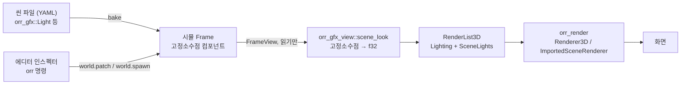

# 렌더링 구조: 씬 컴포넌트에서 화면까지

갱신: 2026-11-13. 관련 이슈: [#101](https://github.com/BeautyfullCastle/rust-ai-native-game-engine/issues/101) (HDR·조명·프로브), [#102](https://github.com/BeautyfullCastle/rust-ai-native-game-engine/issues/102) (지형).

이 문서는 렌더링 기능을 엔진 사용자가 어떻게 켜고 끄고 설정하는지 정한다. 원칙은 하나다. **씬에 보이는 것과 보이는 방식은 모두 씬 데이터다.** 조명, 렌더 레이어, 환경광, 후처리는 엔티티의 컴포넌트나 씬 싱글턴으로 존재한다. 그래서 씬 파일에 저장되고, 에디터 인스펙터와 `orr` 명령으로 같은 방식으로 고치며, 실행 취소된다.

## 1. 지금 되는 것 (1단계)

### 1.1 데이터 흐름



- 시뮬레이션 크레이트는 그리지 않는다. 뷰는 시뮬을 읽기만 한다. 설계 v1 §1.3의 경계를 그대로 지킨다.
- 컴포넌트 값은 고정소수점이다. 시뮬 시스템이 값을 바꿀 수 있다(깜빡이는 등, 낮밤 주기). 그래서 롤백·리플레이·체크섬에 들어간다.
- f32 변환은 `orr_gfx_view` 한 곳에서만 일어난다.

### 1.2 컴포넌트와 싱글턴 (`crates/orr_gfx`)

| 이름 | 종류 | 필드 | 의미 |
|---|---|---|---|
| `orr_gfx::Transform3` | 컴포넌트 | `position`, `rotation`(도, pitch·yaw·roll), `scale` | 물리 바디가 없는 엔티티(조명, 표지)의 위치. 바디가 있으면 바디가 위치를 정한다. |
| `orr_gfx::Light` | 컴포넌트 | `kind`(directional·point·spot), `color`, `intensity`, `range`, `inner_angle`, `outer_angle`, `enabled`, `cast_shadows`, `shadow_strength`, `layers` | 엔티티에 붙는 조명. 위치와 방향은 엔티티의 바디나 `Transform3`에서 온다. |
| `orr_gfx::RenderLayers` | 컴포넌트 | `layers`(8비트 마스크) | 엔티티가 그려지는 레이어. 없으면 기본 레이어(1번)다. |
| `orr_gfx::Environment` | 싱글턴 | `sky_color`, `ground_color`, `ambient` | 하늘·지면 반구 환경광. 기본값 그대로면 게임의 기본 환경광을 쓴다. |
| `orr_gfx::PostProcess` | 싱글턴 | `exposure`, `tone_mapping`(clamp·aces), `bloom`, `bloom_threshold`, `bloom_strength`, `bloom_radius`, `bloom_iterations` | 최종 화면 처리. |

규칙:

- 씬에 `Light`가 하나라도 있으면 그 조명들만 씬을 비춘다. 게임의 기본 태양은 꺼진다.
- 켜진 첫 번째 directional 조명이 씬의 태양이다. 그림자는 태양만 만든다. `cast_shadows`가 꺼져 있으면 태양도 그림자를 만들지 않는다.
- 태양 외의 조명은 한 프레임에 최대 8개다(`orr_render::MAX_SCENE_LIGHTS`). 넘친 조명은 그리지 않고 개수를 센다(`SceneLook::dropped_lights`).
- 조명은 자기 `layers`와 겹치는 레이어의 엔티티만 비춘다. 태양도 마찬가지다.
- 레이어가 하나도 없는 조명은 아무것도 비추지 않는다. 레이어가 하나도 없는 엔티티는 기본 레이어에 그려진다.
- 꺼진 조명과 세기 0인 조명은 빛을 주지 않는다. 에디터에는 회색 표지로 남는다.
- 시뮬 시스템은 범위 밖 값을 쓸 수 있다. 뷰는 렌더러에 넘기기 전에 모든 값을 인스펙터 범위 안으로 맞춘다.
- point·spot 조명은 `range`에서 0이 된다. spot은 `inner_angle`에서 `outer_angle`까지 부드럽게 줄어든다. 확산광만 계산하는 단순화 모델이며 물리 단위가 아니다.

### 1.3 게임에 붙이는 방법

Yard3D가 첫 적용 게임이다(`crates/orr_games/src/yard3d_game.rs`). 다른 게임도 세 줄이면 된다.

```rust
fn register(builder: &mut ComponentRegistryBuilder) {
    // 게임 자신의 타입 등록 뒤에
    orr_gfx::register(builder);
}
fn setup(frame: &mut Frame, config: &Config) {
    // 게임 자신의 초기화 뒤에
    orr_gfx::init(frame);
}
pub fn register_reflect(types: &mut TypeRegistry) {
    orr_gfx::register_reflect(types);
}
```

뷰 쪽은 `orr_gfx_view::scene_look(frame, &게임_기본_조명)`을 부르고 결과를 렌더 목록에 넣는다. 게임이 `orr_gfx` 타입을 등록하지 않았으면 기본 조명을 그대로 돌려주므로, 여러 게임을 그리는 뷰 코드에서도 그대로 부를 수 있다.

타입을 등록하면 등록 목록이 체크섬에 들어가므로 그 게임의 골든 체크섬이 바뀐다. 골든 값을 갱신하고 커밋 메시지에 이유를 쓴다.

### 1.4 에디터와 명령

- 계층 창의 `+ Light` 버튼이 `Transform3`와 point `Light`를 가진 엔티티를 만든다. 이 버튼은 게임이 `orr_gfx::Light`를 등록했을 때만 보인다.
- 인스펙터는 리플렉션으로 모든 필드를 그린다. `kind`와 `tone_mapping`은 선택 상자, `layers`는 레이어별 체크박스, `enabled`와 `cast_shadows`는 체크박스다. 어느 엔티티에나 `+ Add component`로 `Light`나 `RenderLayers`를 붙일 수 있다.
- 뷰포트는 조명마다 표지를 그린다. point는 작은 십자, spot은 십자와 방향선, directional은 방향선이다. 태양은 노란색, 꺼진 조명은 회색이고, 선택한 조명의 표지는 굵다.
- 한 프레임 한도를 넘은 조명이 있으면 뷰포트 왼쪽 위에 몇 개가 빛을 주지 않는지 표시한다.
- 씬 싱글턴 `PostProcess`에서 bloom을 켜면 씬에 저장되고, `Edit > Viewport effects` 메뉴의 보기 전용 설정보다 우선한다.
- 에이전트 명령 예:

```powershell
orr spawn --name lamp 'orr_gfx::Transform3={"position":[0,3,0]}' 'orr_gfx::Light={"kind":"spot","range":12}'
orr set lamp orr_gfx::Light.layers='["default","layer3"]' orr_gfx::Light.cast_shadows=true
orr sset orr_gfx::PostProcess.bloom=true orr_gfx::PostProcess.exposure=1.3
```

### 1.5 렌더러 쪽 (`crates/orr_render`)

- `SceneLights`: 태양 외 조명 8개, 태양의 레이어 마스크, 태양 그림자 세기. `RenderList3D::scene_lights`와 `ImportedSceneRenderer::scene_lights`로 전달한다.
- `Material::layers`: 절차적 도형의 렌더 레이어. 가져온 모델(glTF)은 아직 기본 레이어로 고정이다.
- 셰이더 조각 `scene_lights.wgsl`이 절차 도형, 정적 모델, 스키닝 모델 셰이더 셋에 모두 붙는다. 함수는 `scene_lights_diffuse`, `scene_sun_reaches`, `scene_sun_shadow`다.
- 검증: `crates/orr_render/tests/gpu3d.rs`의 조명 테스트 4개가 실제 GPU 픽셀로 범위·원뿔·레이어·합산을 확인한다.

### 1.6 1단계의 한계

- Yard3D만 `orr_gfx`를 등록했다. Room, 지형, 내비게이션, 메시 게임은 아직 각자의 조명 별도 파일을 쓴다.
- 조명 프로브 굽기(`Bake`)는 씬 조명을 읽지 않고 게임 기본 조명으로 굽는다.
- 웹, 안드로이드, FFI 클라이언트는 씬 조명을 그리지 않는다. 데스크톱 실행 파일과 에디터만 그린다.
- 에디터 뷰포트에서 조명 표지를 클릭해 선택할 수는 없다. 계층 창에서 선택한다.

## 2. 아직 안 되는 것과 설계

아래는 결정한 방향이다. 구현 순서는 4절에 있다.

### 2.1 터레인 컴포넌트

지금은 지형이 두 갈래다. 충돌용 높이 데이터는 `TerrainScenePin` 싱글턴이 `.orrt` 파일을 가리킨다. 외형은 `<지형>.surface.json` 별도 파일의 PNG 한 장이다. 씬에서 지형을 고르거나 외형을 바꿀 수 없다.

설계:

- `orr_gfx::Terrain` 컴포넌트를 엔티티에 붙인다. 필드는 지형 에셋 참조, 레이어 최대 4개(각 레이어의 색 또는 텍스처 참조, 타일 크기, 높이·경사 범위), `RenderLayers`, 그림자 받기와 드리우기다.
- 높이 데이터는 지금처럼 에셋으로 남는다. 시뮬에는 복사하지 않는다(설계 v1 §3.3).
- 선행 과제: 리플렉션에 `AssetRef` 형식이 없다. 지금은 `[u8; 256]` 바이트 배열로 경로를 넣는다. `orr_reflect`에 에셋 참조 종류와 인스펙터의 에셋 선택 위젯을 먼저 추가한다(`docs/asset-pipeline-v1.md`의 후속 설계 항목).
- 지형 전용 셰이더(레이어 혼합, 경사 기반 바위)를 만든다. `orr_scenery`의 `terrain.wgsl`이 출발점이다.

### 2.2 머티리얼과 셰이더 규약

지금은 셰이더가 엔진 안에 고정되어 있다. 게임은 자기 셰이더를 넣을 수 없다. 기존 셰이더 조합은 주석 표지를 문자열로 바꾸는 방식이다.

설계:

- 셰이더 언어는 WGSL로 유지한다(설계 v1 §0 2번).
- 엔진이 **표면 함수 규약**을 정한다. 사용자 셰이더는 다음 함수 하나만 쓴다.

```wgsl
// 엔진이 준비하는 입력
struct SurfaceInput { world: vec3<f32>, normal: vec3<f32>, uv: vec2<f32>, color: vec4<f32>, time: f32 };
// 사용자가 돌려주는 값
struct Surface { albedo: vec3<f32>, normal: vec3<f32>, roughness: f32, metallic: f32, emissive: vec3<f32>, alpha: f32 };
fn surface(in: SurfaceInput) -> Surface;
```

- 조명, 그림자, 안개, 레이어, 출력 인코딩은 엔진 셰이더가 맡는다. 사용자는 표면만 정하므로 렌더 경로가 바뀌어도 사용자 셰이더는 그대로 동작한다.
- `orr_gfx::Material` 컴포넌트가 셰이더 에셋과 매개변수(숫자·색 최대 16개, 텍스처 최대 4개)를 가진다. 인스펙터는 셰이더가 선언한 매개변수 목록으로 위젯을 그린다.
- 조합 방식은 문자열 치환을 그만두고 모듈 단위 결합으로 바꾼다. 후보는 설계 v1이 지목한 naga_oil이다. 도입 전에 wgpu 30과의 호환을 확인한다.
- 셰이더 컴파일 오류는 에디터 콘솔과 `orr` 응답에 파일·줄 번호로 보고한다. 오류가 난 머티리얼은 분홍색 대체 머티리얼로 그린다.

### 2.3 렌더 파이프라인 확장

지금 `ImportedSceneRenderer`는 그림자 → 배치별 색 패스 → 입자 → 후처리 순서가 고정이다. 배치 종류도 닫힌 열거형이다.

설계:

- 한 프레임을 **이름 있는 단계** 목록으로 정의한다: `shadow`, `opaque`, `sky`, `transparent`, `post`, `overlay`.
- 게임과 플러그인은 `RenderPass` 트레이트를 구현해 단계에 등록한다. 엔진은 각 패스에 카메라·조명 유니폼, 깊이 버퍼, HDR 대상, 그림자 맵을 정해진 바인드 그룹으로 넘긴다.
- 등록은 실행 시점이 아니라 게임 초기화 때 한 번 한다. 프레임마다 패스 목록이 바뀌지 않으므로 검증과 예산 계산을 미리 할 수 있다.
- 기존 `ImportedBatch`의 네 종류는 기본 패스로 옮긴다. 외부 동작은 바꾸지 않는다.

### 2.4 후처리 스택

지금 후처리는 bloom 하나와 노출·톤 매핑이다. `orr_scenery`에는 자동 노출, 빛줄기, 색 보정, 비네트, 입자 노이즈가 있지만 엔진 경로에 연결되지 않았다.

설계:

- `orr_gfx::PostProcess`를 **효과 목록**으로 넓힌다. 각 항목은 효과 종류, 켜기, 매개변수다. 순서는 목록 순서다.
- 기본 효과: 자동 노출, bloom, 빛줄기, 색 보정(채도·대비·색온도), 비네트, 필름 입자. `orr_scenery/src/shaders/post.wgsl`의 구현을 옮긴다.
- 사용자 효과는 2.3의 `post` 단계 패스로 등록한다. 입력은 HDR 장면 텍스처와 깊이, 출력은 같은 형식의 텍스처다.
- 노출과 톤 매핑은 항상 마지막 한 번만 한다. 이중 감마와 이중 톤 매핑을 구조로 막는다.

### 2.5 렌더 레이어의 다음 단계

- 카메라 컴포넌트(`orr_gfx::Camera`)에 보이는 레이어 마스크를 둔다. 미니맵이나 UI 전용 카메라를 만들 수 있다.
- 그림자 맵에 그릴 레이어 마스크를 조명에 추가한다.
- 가져온 모델(glTF)에도 레이어를 적용한다. 지금은 기본 레이어로 고정이다.

## 3. `orr_scenery`의 위치

`orr_scenery`(Forest Valley)는 하나의 장면을 위한 독립 렌더러다. 엔진의 씬 컴포넌트와 연결되어 있지 않다. 그 안의 하늘, 안개, 물, 식생, 지형 혼합, 후처리 셰이더는 2.1~2.4를 구현할 때 옮겨 쓸 재료다. 옮기고 나면 Forest Valley를 엔진 컴포넌트만으로 만든 씬으로 다시 만든다. 그것이 렌더링 기능이 엔진에 제대로 들어왔는지 확인하는 기준이다.

## 4. 구현 순서

1. 조명·렌더 레이어·환경광·후처리 기본값 컴포넌트, 에디터 `+ Light`, 조명 표지 (완료)
2. 리플렉션의 에셋 참조 종류와 인스펙터 에셋 선택 위젯
3. 터레인 컴포넌트와 레이어 혼합 지형 셰이더
4. 머티리얼 컴포넌트와 표면 함수 셰이더 규약, 셰이더 오류 보고
5. 렌더 단계와 `RenderPass` 등록
6. 후처리 효과 목록과 `orr_scenery` 효과 이전
7. 카메라 컴포넌트와 레이어 마스크
8. Forest Valley를 엔진 컴포넌트만으로 다시 만들기
