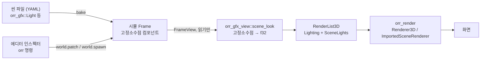
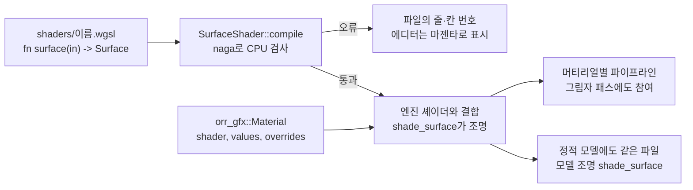
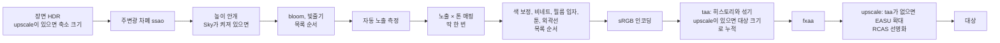

# 렌더링 구조: 씬 컴포넌트에서 화면까지

갱신: 2026-11-14. 관련 이슈: [#101](https://github.com/BeautyfullCastle/rust-ai-native-game-engine/issues/101) (HDR·조명·프로브), [#102](https://github.com/BeautyfullCastle/rust-ai-native-game-engine/issues/102) (지형).

이 문서는 렌더링 기능을 엔진 사용자가 어떻게 켜고 끄고 설정하는지 정한다. 원칙은 하나다. **씬에 보이는 것과 보이는 방식은 모두 씬 데이터다.** 조명, 렌더 레이어, 환경광, 후처리는 엔티티의 컴포넌트나 씬 싱글턴으로 존재한다. 그래서 씬 파일에 저장되고, 에디터 인스펙터와 `orr` 명령으로 같은 방식으로 고치며, 실행 취소된다.

## 1. 지금 되는 것 (1단계)

### 1.1 데이터 흐름



- 시뮬레이션 크레이트는 그리지 않는다. 뷰는 시뮬을 읽기만 한다. 설계 v1 §1.3의 경계를 그대로 지킨다.
- 컴포넌트 값은 고정소수점이다. 시뮬 시스템이 값을 바꿀 수 있다(깜빡이는 등, 낮밤 주기). 그래서 롤백·리플레이·체크섬에 들어간다.
- f32 변환은 `orr_gfx_view` 한 곳에서만 일어난다.

### 1.2 컴포넌트와 싱글턴 (`crates/orr_gfx`)

| 이름 | 종류 | 필드 | 의미 |
|---|---|---|---|
| `orr_gfx::Transform3` | 컴포넌트 | `position`, `rotation`(도, pitch·yaw·roll), `scale` | 물리 바디가 없는 엔티티(조명, 표지)의 위치. 바디가 있으면 바디가 위치를 정한다. |
| `orr_gfx::Light` | 컴포넌트 | `kind`(directional·point·spot), `color`, `intensity`, `range`, `inner_angle`, `outer_angle`, `enabled`, `cast_shadows`, `shadow_strength`, `shadow_range`, `layers` | 엔티티에 붙는 조명. 위치와 방향은 엔티티의 바디나 `Transform3`에서 온다. |
| `orr_gfx::RenderLayers` | 컴포넌트 | `layers`(8비트 마스크) | 엔티티가 그려지는 레이어. 없으면 기본 레이어(1번)다. |
| `orr_gfx::Environment` | 싱글턴 | `sky_color`, `ground_color`, `ambient` | 하늘·지면 반구 환경광. 기본값 그대로면 게임의 기본 환경광을 쓴다. |
| `orr_gfx::PostProcess` | 싱글턴 | `exposure`, `tone_mapping`(clamp·aces), `effects`(효과 8칸, 1.9절) | 최종 화면 처리. |
| `orr_gfx::Camera`, `Terrain`, `Water`, `Scatter` | 컴포넌트 | 1.8, 1.10, 1.12절 | 카메라, 지형, 수면, 식생 배치. |
| `orr_gfx::Sky` | 싱글턴 | 1.12절 | 하늘, 안개, 바람. |

규칙:

- 씬에 `Light`가 하나라도 있으면 그 조명들만 씬을 비춘다. 게임의 기본 태양은 꺼진다.
- 켜진 첫 번째 directional 조명이 씬의 태양이다. 그림자는 태양만 만든다. `cast_shadows`가 꺼져 있으면 태양도 그림자를 만들지 않는다.
- 태양 외의 조명은 한 프레임에 최대 8개다(`orr_render::MAX_SCENE_LIGHTS`). 넘친 조명은 그리지 않고 개수를 센다(`SceneLook::dropped_lights`).
- 조명은 자기 `layers`와 겹치는 레이어의 엔티티만 비춘다. 태양도 마찬가지다.
- 레이어가 하나도 없는 조명은 아무것도 비추지 않는다. 레이어가 하나도 없는 엔티티는 기본 레이어에 그려진다.
- 꺼진 조명과 세기 0인 조명은 빛을 주지 않는다. 에디터에는 회색 표지로 남는다.
- 시뮬 시스템은 범위 밖 값을 쓸 수 있다. 뷰는 렌더러에 넘기기 전에 모든 값을 인스펙터 범위 안으로 맞춘다.
- point·spot 조명은 `range`에서 0이 된다. spot은 `inner_angle`에서 `outer_angle`까지 부드럽게 줄어든다. 확산광만 계산하는 단순화 모델이며 물리 단위가 아니다.

### 1.3 게임에 붙이는 방법

Yard3D가 첫 적용 게임이다(`crates/orr_games/src/yard3d_game.rs`). 다른 게임도 세 줄이면 된다.

```rust
fn register(builder: &mut ComponentRegistryBuilder) {
    // 게임 자신의 타입 등록 뒤에
    orr_gfx::register(builder);
}
fn setup(frame: &mut Frame, config: &Config) {
    // 게임 자신의 초기화 뒤에
    orr_gfx::init(frame);
}
pub fn register_reflect(types: &mut TypeRegistry) {
    orr_gfx::register_reflect(types);
}
```

뷰 쪽은 `orr_gfx_view::scene_look(frame, &게임_기본_조명)`을 부르고 결과를 렌더 목록에 넣는다. 게임이 `orr_gfx` 타입을 등록하지 않았으면 기본 조명을 그대로 돌려주므로, 여러 게임을 그리는 뷰 코드에서도 그대로 부를 수 있다.

타입을 등록하면 등록 목록이 체크섬에 들어가므로 그 게임의 골든 체크섬이 바뀐다. 골든 값을 갱신하고 커밋 메시지에 이유를 쓴다.

### 1.4 에디터와 명령

- 계층 창의 `+ Light` 버튼이 `Transform3`와 point `Light`를 가진 엔티티를 만든다. 이 버튼은 게임이 `orr_gfx::Light`를 등록했을 때만 보인다.
- 인스펙터는 리플렉션으로 모든 필드를 그린다. `kind`와 `tone_mapping`은 선택 상자, `layers`는 레이어별 체크박스, `enabled`와 `cast_shadows`는 체크박스다. 어느 엔티티에나 `+ Add component`로 `Light`나 `RenderLayers`를 붙일 수 있다.
- 뷰포트는 조명마다 표지를 그린다. point는 작은 십자, spot은 십자와 방향선, directional은 방향선이다. 태양은 노란색, 꺼진 조명은 회색이고, 선택한 조명의 표지는 굵다.
- 한 프레임 한도를 넘은 조명이 있으면 뷰포트 왼쪽 위에 몇 개가 빛을 주지 않는지 표시한다.
- 씬 싱글턴 `PostProcess`에서 bloom을 켜면 씬에 저장되고, `Edit > Viewport effects` 메뉴의 보기 전용 설정보다 우선한다.
- 에이전트 명령 예:

```powershell
orr spawn --name lamp 'orr_gfx::Transform3={"position":[0,3,0]}' 'orr_gfx::Light={"kind":"spot","range":12}'
orr set lamp orr_gfx::Light.layers='["default","layer3"]' orr_gfx::Light.cast_shadows=true
orr sset orr_gfx::PostProcess.bloom=true orr_gfx::PostProcess.exposure=1.3
```

### 1.5 렌더러 쪽 (`crates/orr_render`)

- `SceneLights`: 태양 외 조명 8개, 태양의 레이어 마스크, 태양 그림자 세기. `RenderList3D::scene_lights`와 `ImportedSceneRenderer::scene_lights`로 전달한다.
- `Material::layers`: 절차적 도형의 렌더 레이어. 가져온 모델(glTF)은 아직 기본 레이어로 고정이다.
- 셰이더 조각 `scene_lights.wgsl`이 절차 도형, 정적 모델, 스키닝 모델 셰이더 셋에 모두 붙는다. 함수는 `scene_lights_diffuse`, `scene_sun_reaches`, `scene_sun_shadow`다.
- 검증: `crates/orr_render/tests/gpu3d.rs`의 조명 테스트 4개가 실제 GPU 픽셀로 범위·원뿔·레이어·합산을 확인한다.

### 1.6 표면 셰이더 (2단계)

게임 개발자가 엔진 코드를 고치지 않고 물체의 표면 모양을 WGSL로 바꾼다.



**규약.** 사용자 파일은 함수 하나를 정의한다.

```wgsl
// @param tint color = 0.9, 0.3, 0.1
// @param stripes float 0.5..20 = 3
fn surface(in: SurfaceInput) -> Surface {
    var s = default_surface(in);
    let band = step(0.5, fract(in.world.y * params.stripes));
    s.albedo = mix(in.color, params.tint, band);
    return s;
}
```

| 이름 | 내용 |
|---|---|
| `SurfaceInput` | `world`(월드 위치), `local`(물체 자체 좌표: 도형은 크기를 곱한 단위 도형, 모델은 메시 정점 위치), `normal`, `uv`(모델 메시의 텍스처 좌표, 도형은 0), `color`(도형은 바닥 체커 포함, 모델은 텍스처 × 재질 색), `roughness`, `metallic`, `emissive`, `time`(호스트 시계의 초. 에디터는 실행 후 경과 시간) |
| `Surface` | `albedo`, `normal`, `roughness`, `metallic`, `emissive` |
| `default_surface(in)` | 셰이더가 없을 때의 모양. 여기서 출발해 바꾼다 |
| `params` | `// @param`으로 선언한 값. 종류는 `float`, `vec2`, `vec3`, `vec4`, `color`. 범위 `최소..최대`와 기본값은 선택. 모두 합쳐 숫자 16개까지 |

- 조명, 태양 그림자, 환경광, 씬 조명과 레이어, 톤 매핑, 출력 인코딩은 엔진(`shade_surface`)이 한다. 기본 머티리얼도 같은 함수를 지난다. 그래서 렌더 경로가 바뀌어도 사용자 셰이더는 그대로 동작한다.
- 셰이더를 쓴 물체도 그림자를 드리운다. 에디터 전체 기능 경로(합성 렌더러)에서도 그려진다.
- **정적 모델(glTF)에도 같은 파일이 적용된다.** 모델이 붙은 엔티티에 `orr_gfx::Material`을 붙이면 된다. 모델은 모델 자신의 조명(`shader_model.wgsl`의 `shade_surface`)으로 밝혀진다. `default_surface(in)`를 그대로 돌려주면 셰이더가 없을 때와 같은 모습이다. 모델의 재질 칸이 금속·거칠기 방식이면 `roughness`와 `metallic`이 반영되고, 기존 확산광 방식이면 반영되지 않는다. 그림자는 메시 자체로 드리우고, 셰이더를 쓴 모델도 공유 태양 그림자를 받는다.
- 한 파일이 도형과 모델 양쪽 엔진 셰이더에 모두 맞아야 한다. 그래서 검사도 두 번 한다. 한쪽에만 있는 엔진 함수를 부르면 오류다.
- 언어는 WGSL이다. 파일은 64 KiB까지다.
- 검사는 렌더러가 쓰는 것과 같은 엔진 셰이더(조명 프로브 기능 포함)를 대상으로 한다.
- 검사로 찾을 수 없는 문제가 있다. 끝나지 않는 반복문(`loop {}`)은 GPU를 멈추게 하므로 반복은 횟수를 정해서 쓴다.
- 매개변수 이름은 WGSL 예약어(`type`, `target` 등)를 쓸 수 없다.

**오류.** `SurfaceShader::compile`이 GPU에 넘기기 전에 naga로 해석과 검증을 한다. 오류는 사용자 파일 기준 줄과 칸으로 보고한다. 예: `shaders/stripes.wgsl line 7, column 14: no definition in scope for identifier: 'band2'`. 함수 모양이 규약과 다르면 규약을 함께 알려 준다. naga가 위치를 주지 않는 오류는 줄 번호 없이 보고한다.

**씬 데이터.** `orr_gfx::Material` 컴포넌트:

| 필드 | 의미 |
|---|---|
| `shader` | 셰이더 이름(텍스트, 48바이트까지). 에디터는 씬 파일 옆 `shaders/<이름>.wgsl`을 읽는다 |
| `values` | 매개변수 숫자 16개, 셰이더가 선언한 순서 |
| `overrides` | 비트 i가 켜져 있으면 `values[i]`를 쓰고, 꺼져 있으면 셰이더의 기본값을 쓴다. 그래서 새 머티리얼과 셰이더를 바꾼 머티리얼은 셰이더의 기본 모양으로 시작한다 |

이 컴포넌트를 위해 리플렉션에 텍스트 필드 종류(`#[reflect(text)]`, `Kind::Text`)를 추가했다. 씬 파일에는 문자열로, 인스펙터에는 입력란으로, `orr` 명령에는 JSON 문자열로 나온다.

**에디터.**

1. 씬 파일 옆 `shaders` 폴더에 `.wgsl` 파일을 둔다. 예제 3개가 `scenes/shaders/`에 있다(`stripes`, `glow_pulse`, `rock`).
2. 엔티티를 선택하고 `+ Add component`에서 `orr_gfx::Material`을 고른다.
3. 머티리얼 칸의 `Shader` 목록에서 셰이더를 고른다. 매개변수가 선언한 이름으로 나온다. 색은 색상 버튼, 범위가 있는 숫자는 슬라이더다.
4. 셰이더 파일을 다른 편집기에서 고쳐 저장하면 0.5초 안에 다시 읽는다. 같은 이름의 셰이더는 GPU 파이프라인 하나를 바꿔 쓴다. 오류가 있으면 인스펙터에 줄 번호와 함께 빨간 글씨로 나오고 물체는 마젠타로 그려진다.
5. `Use the shader's defaults`는 `overrides`를 0으로 되돌린다. 모든 변경은 실행 취소된다.

에이전트 명령 예:

```powershell
orr add box_left orr_gfx::Material '{"shader":"stripes"}'
orr set box_left orr_gfx::Material.values[3]=6 orr_gfx::Material.overrides=8
```

### 1.7 에셋 참조

컴포넌트 필드가 씬 파일 옆의 파일을 가리킬 수 있다. 리플렉션의 텍스트 필드에 에셋 종류를 붙인다.

- 선언: `#[reflect(asset = "heightmap")] pub heightmap: [u8; 128]`. 리플렉션 종류는 `Kind::Text { len, asset: Some("heightmap") }`이다.
- 종류와 확장자는 `orr_reflect::ASSET_KINDS`에 있다: `terrain`(.orrt), `heightmap`(.png), `texture`(.png), `model`(.glb, .gltf), `shader`(.wgsl).
- 값은 씬 폴더 기준의 상대 경로다. 폴더 구분은 `/`이고 `..`과 절대 경로는 거부된다. 확장자도 검사한다. 빈 값은 "없음"이다.
- 인스펙터는 입력란 옆에 `Pick` 목록을 그린다. 목록에는 씬 폴더 아래의 맞는 파일이 4단계 깊이까지 나온다.
- 씬 파일, JSON 스키마, `orr` 명령에서는 문자열이다.

### 1.8 카메라 (`orr_gfx::Camera`)

엔티티의 `Transform3`가 카메라의 위치와 방향을 정한다. 필드는 다음과 같다.
- `fov_y`, `half_height`, `near`, `far`, `projection`(perspective, orthographic)
- `layers`: 카메라가 그리는 렌더 레이어
- `priority`, `active`

활성 카메라 가운데 우선순위가 가장 높은 것이 씬의 주 카메라다(`orr_gfx_view::main_camera`). 에디터 툴바의 `Camera view`를 켜면 주 카메라로 본다. 이때 카메라의 레이어에 없는 도형, 모델, 지형은 그려지지 않는다. 하늘, 수면, 식생 배치는 아직 레이어를 보지 않는다.

### 1.9 포스트 효과 목록 (`orr_gfx::PostProcess`)

`PostProcess`는 노출, 톤 매핑, 효과 8칸으로 이루어진다. 각 칸에는 종류, 켜기 여부, 숫자 4개가 있다. 실행 순서는 다음과 같다.



| 종류 | 숫자 |
|---|---|
| `bloom` | threshold, strength, radius, passes |
| `light_shafts` | strength, length (원근 카메라에서만) |
| `auto_exposure` | darkest, brightest, speed, target |
| `color_grade` | saturation, contrast, warmth, tint |
| `vignette` | strength, radius, softness |
| `film_grain` | strength |
| `ssao` | strength (0~2), radius (미터) |
| `toon` | bands (2~8), softness |
| `outline` | thickness (픽셀), sensitivity, darkness |
| `fxaa` | strength |
| `upscale` | scale (0.5~1), sharpness |
| `taa` | blend (0.05~0.5, 새 프레임의 비율) |

- `ssao`: 깊이에서 위치와 노멀을 복원해 반경 안에서 표면보다 솟은 점을 12개 샘플로 센다. 절반 해상도로 계산하고 최종 패스에서 네 번 샘플해 부드럽게 한다. 장면 색 전체에 곱해지므로 직사광이 비치는 면도 어두워진다(주변광만 분리된 G-buffer가 없음).
- `toon`: 톤 매핑 뒤 밝기를 단계로 나눈다. 색조는 유지한다. 재질별 셰이딩이 아니라 화면 전체에 적용된다.
- `outline`: 눈에서의 거리가 이웃 픽셀과 `sensitivity` 비율 이상 다르면 선을 그린다. 노멀이 꺾이는 면 경계는 잡지 않는다.
- `fxaa`: 톤 매핑과 효과가 끝난 그림에 적용한다.
- `upscale`: 장면, 깊이, 등록된 렌더 패스, 입자를 `scale` 크기로 그리고 마지막에 대상 크기로 키운다. 확대는 AMD FSR 1의 EASU 방식(엣지 방향으로 늘인 Lanczos 근사 12탭, 가까운 4텍셀로 링잉 제한), 선명화는 RCAS 방식이다. AMD 원본 코드를 그대로 옮긴 것이 아니라 같은 수식을 WGSL로 다시 쓴 것이다. 후처리가 꺼져 있으면 축소하지 않는다.
- `taa`: 켜져 있으면 매 프레임 투영 행렬을 Halton(2, 3) 16개 순서로 서브픽셀만큼 옮긴다(지터). 장면 배치, 등록된 패스가 모두 같은 행렬로 그린다. 표시 단계에서 현재 그림을 지터만큼 되돌려 읽고, 깊이와 이전 프레임의 카메라 행렬로 각 픽셀의 이전 위치를 찾아 히스토리를 읽는다. 히스토리는 현재 3×3 이웃의 최소·최대 범위로 제한해서 가려졌다 드러난 곳에 잔상이 남지 않게 한다. 히스토리 크기가 바뀌거나 첫 프레임이면 현재 그림만 쓴다.
- `taa`와 `upscale`을 함께 켜면 히스토리를 대상 크기로 둔다. 축소된 장면이 프레임마다 다른 서브픽셀을 채우므로 여러 프레임에 걸쳐 대상 해상도의 그림이 모인다(FSR 2 계열의 시간 누적 업스케일). 이때 EASU는 쓰지 않고 RCAS로 선명하게 한다.

- 범위는 `orr_gfx::effect_params`에 있다. 인스펙터는 이 범위로 이름 붙은 슬라이더를 그린다. 효과 추가, 켜기와 끄기, 위아래 이동, 제거도 인스펙터에서 한다.
- 렌더러 쪽 형식은 `orr_render::ScreenEffect`이고, `PostProcessSettings::effects`에 들어간다. 효과 칸이 모두 비어 있으면 예전 bloom 체인이 그대로 돈다.
- 노출과 톤 매핑은 구조상 한 번만 일어난다. 그래서 감마나 톤 매핑이 두 번 적용될 수 없다.

### 1.10 터레인 (`orr_gfx::Terrain`)

- 필드: `heightmap`(PNG 에셋, 8 또는 16비트 회색조), `size`(x, z 미터), `height`(흰색의 높이), `resolution`(한 변의 격자 점, 최대 352), `cast_shadows`.
- `Transform3`의 위치가 지형의 중심이다.
- 뷰 쪽(`orr_gfx_view::terrain_mesh`)이 높이맵을 부드러운 법선의 격자 메시로 만든다. 이 메시는 일반 정적 모델로 그려진다. 그래서 그림자를 드리우고 받으며, 씬 조명과 레이어가 적용된다. 같은 엔티티의 `Material`(표면 셰이더)이 지형의 모습을 정한다.
- 경사와 노이즈로 풀, 숲 바닥, 바위를 섞는 셰이더 예제가 `scenes/forest_valley/shaders/terrain.wgsl`에 있다.
- 에디터는 높이맵 파일이 바뀌면 메시를 다시 만든다. 문제가 있으면 뷰포트 아래에 빨간 글씨로 보인다.
- 충돌은 지금처럼 게임의 지형 데이터(`.orrt`)가 맡는다. 이 컴포넌트는 그리기만 한다.

### 1.11 렌더 패스 등록 (`orr_render::RenderPass`)

게임이나 도구가 `ImportedSceneRenderer::add_pass`로 자기 패스를 넣는다. 프레임은 고정된 단계로 돈다.

| 단계 | 그리는 곳 |
|---|---|
| `Shadow` | 공유 태양 그림자 맵. 엔진 캐스터 다음에 그린다 |
| `Opaque` | 장면 색과 깊이. 엔진 배치 다음에 그린다 |
| `Sky` | 불투명한 것을 모두 그린 다음. 먼 평면의 하늘은 빈 곳만 채운다 |
| `Transparent` | 입자와 후처리 앞. 깊이는 유지된다 |

- 패스는 매 프레임 `PassFrame`을 받는다. 여기에는 카메라와 조명, 크기와 형식, 그리고 그림자 맵(뷰, 비교 샘플러, 빛 행렬, 매개변수)이 들어 있다. 패스는 `prepare`에서 버퍼를 쓰고, 단계마다 `encode`로 그린다.
- 주인은 `pass_mut::<T>()`로 패스에 다시 접근해 그릴 내용을 바꾼다. 렌더러 하나에 패스는 16개까지 들어간다.

### 1.12 야외 장면: 하늘, 물, 식생

- `orr_gfx::Sky`(싱글턴): 하늘 밝기, 해 주변 빛, 구름 양과 속도, 높이 안개(밀도, 높이에 따른 감소, 기준 높이, 옅은 안개), 바람. `enabled`가 켜져 있으면 다음이 그려진다.
  - 하늘: 해와 구름 포함.
  - 높이 안개: 후처리에서 깊이로 모든 물체에 똑같이 적용된다.
  - 바람: 나무와 풀이 흔들린다.
- `orr_gfx::Water`(컴포넌트): 엔티티 위치를 중심으로 한 수평 수면이다. 크기, 깊은 물의 색, 맑기, 물결, 흐름, 반짝임을 정한다. `terrain`에 지형 엔티티를 지정하면 그 지형의 높이로 깊이를 계산한다. 그러면 얕은 곳은 맑고 깊은 곳은 물의 색이 된다. 수면은 지형보다 낮은 곳에만 보인다.
- `orr_gfx::Scatter`(컴포넌트): 지형 위 영역에 침엽수, 활엽수, 바위, 풀을 퍼뜨린다. 영역, 높이 범위, 최대 경사, 크기 범위, 개수, 시드, 그림자 여부를 정한다. 같은 시드는 항상 같은 배치를 준다. 물 아래에는 아무것도 놓이지 않는다.
- `orr_gfx::Light::shadow_range`: 태양 그림자 영역의 반경이다. 0이 아니면 그림자 영역이 매 프레임 시점 앞으로 따라간다.
- 그리는 쪽은 `orr_scenery::passes::OutdoorPass`다. Forest Valley의 하늘, 물, 식생 셰이더를 쓰는 렌더 패스이고, 네 단계에 모두 등록된다. 나무는 공유 그림자 맵에 그림자를 드리우고 그 맵으로 그림자를 받는다. 그래서 지형과 나무가 서로 그림자를 주고받는다. 거리에 따라 세부 단계를 고르고, 시야 밖의 것은 그리지 않는다. 에디터는 `outdoor` 기능에서 이 패스를 뷰포트에 붙인다.

### 1.13 Forest Valley 씬

`scenes/forest_valley/forest_valley.scene.yaml`은 엔진 컴포넌트만으로 된 씬이다. 다음 명령이 생성기로 높이맵과 씬 파일을 만든다.

```powershell
cargo run -p orr_scenery --example forest_valley_scene -- scenes/forest_valley
```

구성은 다음과 같다.
- 계곡 지형 1024 m와 먼 능선 지형 6144 m. 둘 다 `terrain` 표면 셰이더를 쓴다.
- 태양 `Light`(그림자 140 m), `Sky`, `PostProcess` 효과 6개, `Camera`.
- 계곡 웅덩이마다 `Water` 18개.
- `Scatter` 4개: 전나무 9000, 활엽수 2600, 바위 1200, 시점 근처의 풀 20000.

에디터 테스트 `crates/orr_editor/tests/forest_valley_ui.rs`가 이 씬을 열고 카메라 시점으로 그림을 확인한다. `ORR_FOREST_CAPTURE` 환경 변수를 주면 화면을 저장한다.

### 1.15 용 비행 (`orr_games::dragon`)

Forest Valley 위를 동양식 용이 난다. 비행은 시뮬에서 고정소수점으로 계산된다. 그래서 모든 피어에서 같고 리플레이도 된다.

- `orr_games::Dragon`(컴포넌트): 머리 위치, 방향(yaw), 기울기(pitch), 선회 기울기(bank), 속도, 순항·가속 속도, 선회·상승 속도, 지면 여유 높이, 최고 높이, 머무는 영역, 조종하는 플레이어, 머리가 지나간 경로 48점(3틱마다 한 점).
- `orr_games::DragonCamera`(컴포넌트): 같은 엔티티의 `Transform3`를 용의 머리 뒤 위쪽에 두고 머리를 보게 한다. 같은 엔티티의 `orr_gfx::Camera`가 따라서 용을 비춘다.
- `orr_games::DragonGround`(싱글턴): 지면 높이 32×32 격자. 시뮬은 높이맵 파일을 읽지 않으므로 씬 생성기가 이 격자를 써 둔다. 용은 지면 + 여유 높이 아래로 내려가지 않는다.
- 입력: Yard3D 입력(`YardInput::buttons`)의 `DRAGON_*` 비트. 에디터에서는 Play, `Take control`을 누른 뒤 A/D로 선회, W/S로 상승과 하강, E로 가속한다.
- 그리기: `orr_scenery::dragon::DragonPass`가 그림자와 불투명 단계에 등록된 렌더 패스다. 매 프레임 경로를 따라 34 m 몸통을 다시 만든다. 몸통에는 머리, 뿔, 수염, 눈, 갈기, 다리 넷, 꼬리 털이 있다. 비늘, 배 비늘판, 갈기는 패스의 셰이더가 그린다. 몸통은 헤엄치듯 굽이친다. 그림자는 공유 그림자 맵에 드리운다.
- 에디터 테스트 `forest_valley_ui.rs`의 `the_dragon_flies_over_the_valley_with_the_keys_and_the_camera_follows`가 키로 비행을 확인하고 화면을 저장한다.

### 1.16 재질 텍스처와 스키닝 모델

표면 셰이더는 PNG 이미지를 최대 4장 읽는다.

- 셰이더가 `// @texture <이름> <color|data> [= r, g, b, a]` 줄로 텍스처를 선언한다. 선언한 이름이 함수가 된다. `grass(uv)`는 그 이미지를 `uv`에서 읽은 색(vec4)이다.
- `color`는 sRGB 색 이미지이고 선형 색으로 읽힌다. `data`는 0~1 숫자 이미지이고 값 그대로 읽힌다. 네 숫자는 이미지를 고르지 않았을 때 읽히는 값이다. 생략하면 `color`는 흰색, `data`는 0이다.
- 이미지는 0~1 밖에서 반복되고, 화면에서 보이는 크기에 맞는 밉 단계로 걸러진다. 밉 단계는 CPU에서 만든다. 색 이미지는 선형 빛으로 평균한다.
- `orr_gfx::Material`의 `texture_0`~`texture_3`이 선언 순서대로 각 텍스처의 PNG 경로(씬 폴더 기준)를 가진다. 인스펙터의 재질 칸에서 선언 이름 옆 목록으로 고른다. 파일을 저장하면 다시 읽는다. 읽을 수 없는 이미지는 빨간 글씨로 이유를 보이고 기본값으로 그린다.
- 한 변 최대 2048 픽셀이다.
- 픽셀마다 갈리는 분기 안에서 텍스처를 읽으면 분기 경계에서 밉 단계가 틀릴 수 있다. 분기 밖에서 읽는다.
- RHI(`orr_rhi`)에 밉 단계가 있는 텍스처(`create_texture_mipmapped`, `write_texture_rgba8_mip`)와 반복·밉 샘플러(`SamplerDesc::MATERIAL`, 비등방 8배)가 추가되었다.
- 같은 표면 셰이더가 스키닝(애니메이션) 모델에도 적용된다(`SkinnedModelRenderer::add_surface`, `set_instance_surfaces`). 셰이더 검사는 도형, 정적 모델, 스키닝 모델 세 엔진 모두에 대해 한다. `local`은 바인드 포즈의 정점 위치다.
- Forest Valley 지형은 풀(`textures/grass.png`)과 바위(`textures/rock.png`) 디테일 이미지를 쓴다. 바위는 세 평면에 투영해 섞으므로 절벽에서 늘어나지 않는다. 생성기가 두 이미지를 반복되게 만든다.

### 1.17 캐스케이드 그림자

해 그림자는 공유 그림자 맵(2048²) 한 장에 최대 네 단계(캐스케이드)로 그려진다.

- `orr_gfx::Light::shadow_cascades`(1~4, 기본 4)가 단계 수다. 해의 `shadow_range`가 0보다 클 때, 즉 그림자 영역이 시점을 따라갈 때만 2 이상이 쓰인다.
- 단계가 둘 이상이면 각 단계가 시점 방향으로 점점 먼 구간을 맡는다. 전체 거리는 눈에서 `shadow_range`의 1.5배까지다. 가까운 단계일수록 구간이 짧아 그림자가 선명하다. 각 단계는 맵의 4분의 1 칸(1024²)에 그려진다. 단계 하나는 예전처럼 맵 전체를 쓴다.
- 구간 경계는 기하 분할 3, 균등 분할 1의 비율로 섞어 정한다. 다음 단계는 앞 단계의 끝 12%부터 덮는다. 각 단계는 자기 구간을 감싸는 구를 덮고, 구의 반지름을 1미터 단위로 올리고 중심을 텍셀 단위로 맞춰서 시점이 움직여도 그림자 가장자리가 떨리지 않는다. 단계 끝부분 12%에서 다음 단계로 부드럽게 넘어가고, 마지막 단계는 햇빛으로 넘어간다.
- 그림자를 받는 셰이더는 엔진의 `orr_render::SHADOW_CASCADES_WGSL`에 있는 `cascaded_visibility`를 쓴다. 정적 모델, 스키닝 모델, 도형, 표면 셰이더, 야외 패스(나무, 물), 용 패스가 모두 같은 함수를 쓴다.
- 그림자를 그리는 쪽은 단계마다 조명 행렬을 바꿔 다시 그린다. 렌더러는 단계마다 제출(submit)한 뒤 다음 단계의 행렬을 쓴다. 등록된 렌더 패스의 그림자 단계 `encode`는 단계마다 한 번 불리고, `frame.shadow`에 그 단계의 행렬(`light_vp`)과 칸(`viewport`)이 들어 있다. 패스는 `Command::SetViewport`로 칸을 정하고 그린다.
- RHI에 그림 영역을 정하는 `Command::SetViewport`가 추가되었다.
- 코드에서는 `ImportedSceneRenderer::shadow_cascades`로 정한다. 에디터는 씬의 해 조명에서 이 값을 읽는다.
- Forest Valley의 해는 4단계, `shadow_range` 260이다. 그래서 그림자가 눈에서 약 390미터까지 그려진다.

### 1.14 지금의 한계

- Yard3D만 `orr_gfx`를 등록했다. Room, 지형, 내비게이션, 메시 게임은 아직 각자의 조명 별도 파일을 쓴다.
- 조명 프로브 굽기(`Bake`)는 씬 조명을 읽지 않고 게임 기본 조명으로 굽는다.
- 웹, 안드로이드, FFI 클라이언트와 데스크톱 실행 파일은 이 컴포넌트들을 그리지 않는다. 에디터만 그린다.
- 에디터 뷰포트에서 조명 표지를 클릭해 선택할 수는 없다. 계층 창에서 선택한다.
- 표면 셰이더는 절차 도형, 정적 모델, 스키닝 모델, 지형에 적용된다. 모델은 합성 렌더러(`ImportedSceneRenderer`)로 그릴 때만 적용된다.
- 셰이더 오류는 에디터에만 보인다. `orr` 명령의 응답에는 나오지 않는다.
- 셰이더 검사기(naga)가 `orr_render`의 필수 의존성이어서 웹 빌드 크기가 늘어난다.
- 빛줄기는 원근 카메라에서만 그려진다. 높이 안개도 원근 카메라를 기준으로 계산한다. 높이 안개와 자동 노출은 HDR 후처리가 켜져 있을 때만 적용된다.
- 같은 종류의 효과를 목록에 두 번 넣으면 첫 번째만 쓴다.
- TAA의 움직임은 깊이와 카메라 행렬로 계산한다. 물체별 움직임 벡터 버퍼가 없어서 움직이는 물체(스키닝, 이동하는 바디)는 이웃 범위 제한에만 의존한다. 그래서 빠르게 움직이는 물체의 경계는 FSR 2보다 덜 선명하다. 투명한 입자도 같은 깊이 기준으로 재투영된다.
- 툰 셰이딩은 화면 후처리다. 재질마다 단계 수를 다르게 하려면 표면 셰이더에서 직접 계산한다.
- 사용자 후처리 패스(`post` 단계)는 아직 없다. 효과는 엔진의 목록에서만 고른다.
- 렌더 패스는 `ImportedSceneRenderer`에만 등록된다. 절차 도형만 그리는 `Renderer3D` 단독 경로에는 없다.
- 캐스케이드는 단계마다 그림자 그리기를 따로 제출한다. 단계 수만큼 그리는 호출이 늘어난다. `Renderer3D` 단독 경로(합성 렌더러 밖)는 캐스케이드 없이 자기 그림자 맵 하나를 쓴다.
- `Scatter`는 지형 높이와 경사, 물만 본다. 원래 Forest Valley의 숲 밀도 지도(빈터, 강가 비우기)는 아직 없다.
- 용의 지면 충돌은 32×32 격자의 근삿값이다. 나무와는 부딪히지 않는다. 용의 몸통은 표면 셰이더가 아니라 패스 자체 셰이더로 그린다.
- 씬 파일 형식은 모든 필드를 요구한다. `Light::shadow_range`, `Light::shadow_cascades`, `Material::texture_0`~`texture_3`이 추가되고 `PostProcess`가 효과 목록으로 바뀌었다. 그래서 전에 저장한 씬의 `orr_gfx::Light`, `orr_gfx::Material`, `orr_gfx::PostProcess`는 새 형식으로 고쳐야 열린다.

## 2. 아직 안 되는 것과 설계

아래는 결정한 방향이다. 구현 순서는 4절에 있다.

### 2.1 터레인 컴포넌트

지금은 지형이 두 갈래다. 충돌용 높이 데이터는 `TerrainScenePin` 싱글턴이 `.orrt` 파일을 가리킨다. 외형은 `<지형>.surface.json` 별도 파일의 PNG 한 장이다. 씬에서 지형을 고르거나 외형을 바꿀 수 없다.

설계:

- `orr_gfx::Terrain` 컴포넌트를 엔티티에 붙인다. 필드는 지형 에셋 참조, 레이어 최대 4개(각 레이어의 색 또는 텍스처 참조, 타일 크기, 높이·경사 범위), `RenderLayers`, 그림자 받기와 드리우기다.
- 높이 데이터는 지금처럼 에셋으로 남는다. 시뮬에는 복사하지 않는다(설계 v1 §3.3).
- 선행 과제: 리플렉션에 `AssetRef` 형식이 없다. 지금은 `[u8; 256]` 바이트 배열로 경로를 넣는다. `orr_reflect`에 에셋 참조 종류와 인스펙터의 에셋 선택 위젯을 먼저 추가한다(`docs/asset-pipeline-v1.md`의 후속 설계 항목).
- 지형 전용 셰이더(레이어 혼합, 경사 기반 바위)를 만든다. `orr_scenery`의 `terrain.wgsl`이 출발점이다.

### 2.2 머티리얼과 셰이더 규약 (1.6에 일부 구현)

지금은 셰이더가 엔진 안에 고정되어 있다. 게임은 자기 셰이더를 넣을 수 없다. 기존 셰이더 조합은 주석 표지를 문자열로 바꾸는 방식이다.

설계:

- 셰이더 언어는 WGSL로 유지한다(설계 v1 §0 2번).
- 엔진이 **표면 함수 규약**을 정한다. 사용자 셰이더는 다음 함수 하나만 쓴다.

```wgsl
// 엔진이 준비하는 입력
struct SurfaceInput { world: vec3<f32>, normal: vec3<f32>, uv: vec2<f32>, color: vec4<f32>, time: f32 };
// 사용자가 돌려주는 값
struct Surface { albedo: vec3<f32>, normal: vec3<f32>, roughness: f32, metallic: f32, emissive: vec3<f32>, alpha: f32 };
fn surface(in: SurfaceInput) -> Surface;
```

- 조명, 그림자, 안개, 레이어, 출력 인코딩은 엔진 셰이더가 맡는다. 사용자는 표면만 정하므로 렌더 경로가 바뀌어도 사용자 셰이더는 그대로 동작한다.
- `orr_gfx::Material` 컴포넌트가 셰이더 에셋과 매개변수(숫자·색 최대 16개, 텍스처 최대 4개)를 가진다. 인스펙터는 셰이더가 선언한 매개변수 목록으로 위젯을 그린다.
- 조합 방식은 문자열 치환을 그만두고 모듈 단위 결합으로 바꾼다. 후보는 설계 v1이 지목한 naga_oil이다. 도입 전에 wgpu 30과의 호환을 확인한다.
- 셰이더 컴파일 오류는 에디터 콘솔과 `orr` 응답에 파일·줄 번호로 보고한다. 오류가 난 머티리얼은 분홍색 대체 머티리얼로 그린다.

### 2.3 렌더 파이프라인 확장

지금 `ImportedSceneRenderer`는 그림자 → 배치별 색 패스 → 입자 → 후처리 순서가 고정이다. 배치 종류도 닫힌 열거형이다.

설계:

- 한 프레임을 **이름 있는 단계** 목록으로 정의한다: `shadow`, `opaque`, `sky`, `transparent`, `post`, `overlay`.
- 게임과 플러그인은 `RenderPass` 트레이트를 구현해 단계에 등록한다. 엔진은 각 패스에 카메라·조명 유니폼, 깊이 버퍼, HDR 대상, 그림자 맵을 정해진 바인드 그룹으로 넘긴다.
- 등록은 실행 시점이 아니라 게임 초기화 때 한 번 한다. 프레임마다 패스 목록이 바뀌지 않으므로 검증과 예산 계산을 미리 할 수 있다.
- 기존 `ImportedBatch`의 네 종류는 기본 패스로 옮긴다. 외부 동작은 바꾸지 않는다.

### 2.4 후처리 스택

지금 후처리는 bloom 하나와 노출·톤 매핑이다. `orr_scenery`에는 자동 노출, 빛줄기, 색 보정, 비네트, 입자 노이즈가 있지만 엔진 경로에 연결되지 않았다.

설계:

- `orr_gfx::PostProcess`를 **효과 목록**으로 넓힌다. 각 항목은 효과 종류, 켜기, 매개변수다. 순서는 목록 순서다.
- 기본 효과: 자동 노출, bloom, 빛줄기, 색 보정(채도·대비·색온도), 비네트, 필름 입자. `orr_scenery/src/shaders/post.wgsl`의 구현을 옮긴다.
- 사용자 효과는 2.3의 `post` 단계 패스로 등록한다. 입력은 HDR 장면 텍스처와 깊이, 출력은 같은 형식의 텍스처다.
- 노출과 톤 매핑은 항상 마지막 한 번만 한다. 이중 감마와 이중 톤 매핑을 구조로 막는다.

### 2.5 렌더 레이어의 다음 단계

- 카메라 컴포넌트(`orr_gfx::Camera`)에 보이는 레이어 마스크를 둔다. 미니맵이나 UI 전용 카메라를 만들 수 있다.
- 그림자 맵에 그릴 레이어 마스크를 조명에 추가한다.
- 가져온 모델(glTF)에도 레이어를 적용한다. 지금은 기본 레이어로 고정이다.

## 3. `orr_scenery`의 위치

`orr_scenery`(Forest Valley)는 하나의 장면을 위한 독립 렌더러다. 엔진의 씬 컴포넌트와 연결되어 있지 않다. 그 안의 하늘, 안개, 물, 식생, 지형 혼합, 후처리 셰이더는 2.1~2.4를 구현할 때 옮겨 쓸 재료다. 옮기고 나면 Forest Valley를 엔진 컴포넌트만으로 만든 씬으로 다시 만든다. 그것이 렌더링 기능이 엔진에 제대로 들어왔는지 확인하는 기준이다.

## 4. 구현 순서

1. 조명·렌더 레이어·환경광·후처리 기본값 컴포넌트, 에디터 `+ Light`, 조명 표지 (완료)
2. 리플렉션의 에셋 참조 종류와 인스펙터 에셋 선택 위젯 (완료, 1.7)
3. 터레인 컴포넌트와 레이어 혼합 지형 셰이더 (완료, 1.10. 레이어는 표면 셰이더가 맡는다)
4. 머티리얼 컴포넌트와 표면 함수 셰이더 규약, 셰이더 오류 보고, 텍스처, 스키닝 모델 (완료, 1.6과 1.16)
5. 렌더 단계와 `RenderPass` 등록 (완료, 1.11. `post` 단계는 남음)
6. 후처리 효과 목록과 `orr_scenery` 효과 이전 (완료, 1.9)
7. 카메라 컴포넌트와 레이어 마스크 (완료, 1.8)
8. Forest Valley를 엔진 컴포넌트만으로 다시 만들기 (완료, 1.13)
