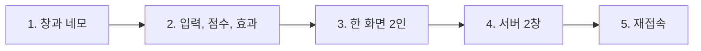

# 튜토리얼: 별 줍기 (Star Pick)

빈 프로젝트에서 시작해 작은 게임 하나를 만듭니다. 마지막에는 창 두 개가 서버로 연결되고, 한 창을 닫았다가 같은 자리로 다시 들어옵니다.

게임은 단순합니다. 각 플레이어는 네모를 움직입니다. 판 위에 별이 생기고, 네모가 별에 닿으면 점수를 얻습니다.

## 이 튜토리얼이 가르치는 것

| 단계 | 하는 일 | 새로 배우는 것 |
|---|---|---|
| [1. 빈 프로젝트](step1-empty-project.md) | 창에 네모 하나를 띄웁니다 | `Game`, 컴포넌트, 시스템, `Frame`, `FP`, `App` |
| [2. 혼자 하기](step2-solo.md) | 키로 움직이고 별을 주워 점수를 얻습니다 | 입력, 이벤트, 예측과 확정, `EntityView`, `SceneView` |
| [3. 한 화면 2인](step3-two-players.md) | 키보드 하나로 두 명이 놉니다 | `.local_players`, `PlayerLink`, `ctx.is_local` |
| [4. 로컬 서버 2창](step4-local-server.md) | 창 하나가 플레이어 한 명입니다 | `Players`, `player_signals`, 프리팹, `--host`, `--connect` |
| [5. 재접속](step5-reconnect.md) | 창을 닫았다가 같은 자리로 돌아옵니다 | `Disconnected`, `Reconnected`, `Removed`, `--slot`, `--token`, 스냅숏 |

각 단계는 **혼자 빌드되고 실행되는 완전한 프로그램**입니다. 다음 단계는 앞 단계 코드에 몇 가지를 더합니다. 문서에는 달라지는 부분과 그 이유를 보여 줍니다.



## 준비

[Getting Started](../getting-started.md)의 1절(Rust와 윈도우 C++ 도구)을 먼저 끝냅니다. 그래픽 카드는 Vulkan 또는 DirectX 12를 지원해야 합니다. 명령은 모두 저장소 최상위 폴더에서 실행합니다.

```powershell
cargo run -p star_pick --release --bin step1
```

첫 빌드는 몇 분 걸립니다. 그 뒤에는 바뀐 부분만 빌드합니다.

## 두 가지 방법으로 따라 합니다

**방법 A. 완성된 코드를 읽고 실행합니다.** 코드는 `tutorial/star_pick/src/step1.rs`부터 `step5.rs`까지 있습니다. 각 단계의 실행 명령은 그 단계 문서에 있습니다.

**방법 B. 빈 프로젝트에서 직접 칩니다.** 이 방법을 권합니다. 1단계 문서가 새 크레이트 만드는 법을 설명합니다. 이후 단계는 앞 단계 `main.rs`를 고쳐 갑니다. 막히면 `tutorial/star_pick/src/stepN.rs`와 비교합니다.

## 화면 그림 만들기

모든 게임 창은 같은 명령줄 옵션을 이해합니다. 그림 한 장을 저장하려면 이렇게 합니다.

```powershell
cargo run -p star_pick --release --bin step1 -- --screenshot out.png --ticks 60 --size 640x360
```

`--ticks 60`은 시뮬레이션을 60틱까지 돌리고 멈춥니다. 같은 틱의 그림은 어느 컴퓨터에서나 같습니다. 문서의 그림도 이 옵션으로 만들었습니다. 2단계와 3단계 그림은 사람이 조종한 모습이 아니라, 별을 향해 가는 자동 조종으로 찍은 것입니다.

## 테스트

모든 단계는 창 없이 테스트합니다. 창이 없어도 게임 규칙, 예측과 확정, 서버와 클라이언트가 모두 돕니다.

```powershell
cargo test --release -p star_pick
```

| 테스트 | 확인하는 것 |
|---|---|
| `tests/step2.rs` | 같은 입력이면 점수와 체크섬이 같다. 리플레이가 같은 결과를 낸다. 뷰가 게임을 따라간다 |
| `tests/step3.rs` | 두 슬롯이 따로 움직이고 따로 점수를 얻는다 |
| `tests/step4.rs` | 서버와 클라이언트 둘로 `Added`가 두 쪽 게임에 닿는다. 체크섬이 같다 |
| `tests/step5.rs` | `Disconnected`, `Reconnected`, `Removed`가 게임에 닿는다. 스냅숏으로 들어온 클라이언트의 체크섬도 같다 |

## 규칙 하나

시뮬레이션 코드(`Game`, 컴포넌트, 시스템)는 `f32`와 `f64`를 쓰지 않습니다. `HashMap`, 시계, `usize` 상태도 쓰지 않습니다. 이유는 [Getting Started 3절](../getting-started.md#3-시뮬레이션-규칙)에 있습니다. 화면을 그리는 코드(뷰)는 `f32`를 써도 됩니다. 뷰는 시뮬레이션을 읽기만 합니다.

`tutorial/star_pick/src/lib.rs`의 `#![deny(clippy::float_arithmetic)]`가 이 규칙을 컴파일 단계에서 지킵니다. 뷰 함수만 `#[allow(clippy::float_arithmetic)]`로 예외를 둡니다.
