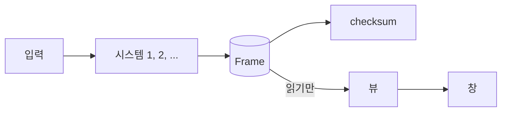
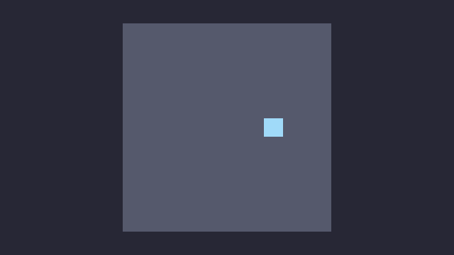

# 1단계. 빈 프로젝트

[튜토리얼 목차](README.md) · 다음: [2단계. 혼자 하기](step2-solo.md)

## 목표

빈 프로젝트에서 시작해 창을 열고, 네모 하나가 좌우로 오가게 합니다. 코드는 80줄입니다.

이 단계에서 만드는 것은 게임이 아닙니다. 엔진의 기본 구조를 한 번 훑어 보는 것이 목적입니다.

## 새로 배우는 것

| 이름 | 뜻 |
|---|---|
| `FP` | 고정소수점 수(Q48.16). 시뮬레이션은 `f32` 대신 이것만 씁니다. |
| 컴포넌트 | 엔티티에 붙는 데이터. `Pod`인 평범한 구조체입니다. |
| `Frame` | 게임 상태 전체. 엔티티와 컴포넌트가 들어 있습니다. |
| `Game` | 게임 하나를 정의하는 트레이트. 컴포넌트 등록, 첫 상태, 시스템 목록을 줍니다. |
| 시스템 | 매 틱 순서대로 실행되는 함수입니다. |
| `App` | `Game`을 창에 띄우는 실행 함수입니다. |
| 뷰 | `Frame`을 읽어서 무엇을 어떻게 그릴지 정하는 코드입니다. |

## 크레이트 만들기

엔진 저장소 옆에 새 폴더를 만듭니다. 폴더 이름은 `my_star_pick`입니다.

```powershell
cargo new my_star_pick
```

`my_star_pick\Cargo.toml`의 `[dependencies]`를 이렇게 바꿉니다. 경로는 엔진 저장소의 위치에 맞춥니다.

```toml
[dependencies]
bytemuck = { version = "1", features = ["derive"] }
orr_sim = { path = "../rust-ai-native-game-engine/crates/orr_sim" }
orr_app = { path = "../rust-ai-native-game-engine/crates/orr_app" }
```

세 크레이트의 역할은 다음과 같습니다.

- `orr_sim`: 게임 규칙을 쓰는 곳입니다. 결정론 시뮬레이션입니다.
- `orr_app`: 창, 키 입력, 그리기, 서버 연결입니다.
- `bytemuck`: 컴포넌트를 바이트로 복사할 수 있게 합니다 (`Pod`).

엔진 저장소 안에서 바로 따라 해도 됩니다. 완성 코드는 `tutorial/star_pick/src/step1.rs`입니다.

## 코드

`src/main.rs` 전체는 다섯 조각입니다. 순서대로 봅니다.

### 1. 컴포넌트

```rust
use bytemuck::{Pod, Zeroable};
use orr_sim::{fn_systems, ComponentRegistryBuilder, Frame, Game, SimContext, System, FP};

#[repr(C)]
#[derive(Clone, Copy, Pod, Zeroable)]
pub struct Pos {
    pub x: FP,
    pub y: FP,
}
```

`Pos`는 "어디에 있는가"입니다. `#[repr(C)]`와 `Pod`는 필수입니다. 엔진이 상태 전체를 바이트로 복사해서 스냅숏과 체크섬을 만들기 때문입니다. 그래서 `Vec`, `String`, `Box` 같은 힙 값은 컴포넌트에 넣을 수 없습니다.

`FP`는 `f32` 대신 쓰는 수입니다. `FP::ZERO`, `FP::from_int(3)`, `fp!(0.5)`로 만듭니다. 더하고 빼고 곱하는 연산은 `f32`와 같게 씁니다. 결과는 어느 컴퓨터에서나 비트까지 같습니다.

### 2. 게임

```rust
pub struct StarPick;

impl Game for StarPick {
    type Input = ();   // 플레이어마다 매 틱 들어오는 입력. 아직 없습니다.
    type Command = (); // 구매, 건설 같은 일회성 명령. 없습니다.
    type Event = ();   // 시뮬레이션이 화면에 알리는 사건. 아직 없습니다.
    type Config = ();  // setup에 넘기는 시작 설정. 없습니다.

    fn register(builder: &mut ComponentRegistryBuilder) {
        builder.register_component::<Pos>("Pos");
    }

    fn setup(frame: &mut Frame, _config: &()) {
        let square = frame.spawn();
        frame.add(square, Pos { x: FP::ZERO, y: FP::ZERO });
    }

    fn systems() -> Vec<Box<dyn System<Self>>> {
        fn_systems([sweep])
    }
}
```

`Game`은 네 가지 타입과 세 가지 함수로 이루어집니다.

- `register`: 게임이 쓰는 컴포넌트를 이름과 함께 등록합니다. 등록하지 않은 컴포넌트는 쓸 수 없습니다.
- `setup`: 첫 틱 전의 상태를 만듭니다. 여기서는 엔티티 하나에 `Pos`를 붙입니다. 엔티티는 컴포넌트를 붙이는 번호표입니다.
- `systems`: 매 틱 실행할 시스템 목록입니다. 순서가 곧 실행 순서입니다.

### 3. 시스템

```rust
/// 매 틱: 네모를 왔다 갔다 하는 자리에 놓습니다. 한 번 오가는 데 160틱이 걸립니다.
fn sweep(ctx: &mut SimContext<StarPick>) {
    let phase = (ctx.tick % 160) as i32; // 0..159
    let along = if phase < 80 { phase - 40 } else { 120 - phase }; // -40..40, 그리고 되돌아옴
    for (_, (pos,)) in ctx.frame.query::<(&mut Pos,)>() {
        pos.x = FP::from_int(along).div_int(10); // -4.0 .. 4.0
    }
}
```

시스템은 `SimContext`를 받는 평범한 함수입니다. `ctx.frame`은 게임 상태이고, `ctx.tick`은 지금 틱 번호입니다. `query::<(&mut Pos,)>()`는 `Pos`가 있는 엔티티를 모두 돌려줍니다.

시스템은 시계를 읽지 않고 틱 번호만 읽습니다. 그래서 같은 틱이면 어디서 돌려도 같은 자리가 나옵니다.

한 틱은 이렇게 처리됩니다.



시뮬레이션은 `Frame`을 바꿉니다. 뷰는 `Frame`을 읽기만 합니다. 뷰에서 시뮬레이션으로 가는 길은 입력과 명령뿐입니다.

### 4. 뷰

```rust
use orr_app::{
    fp_to_f32, solid_quad, App, Camera, Extracted, Extractor, FrameView, InterpMode, RenderItem, Shape, Style, Transform2, Vec2, View2D,
};

struct Look;

impl Extractor for Look {
    fn extract(&self, frame: FrameView<'_>, out: &mut Vec<Extracted>) {
        for (entity, pos) in frame.iter::<Pos>() {
            out.push(Extracted {
                entity,
                transform: Transform2::new(Vec2::new(fp_to_f32(pos.x), fp_to_f32(pos.y)), 0.0),
                mode: InterpMode::Prediction, // 두 틱 사이를 부드럽게 이어 줍니다
                style: Style { shape: Shape::Quad, size: 0.4, half_y: 0.0, color: [0.35, 0.7, 0.95, 1.0] },
            });
        }
    }
}

impl View2D for Look {
    fn camera(&self, _frame: FrameView<'_>) -> Camera {
        Camera::new([0.0, 0.0], 5.5) // 그림의 위아래가 11 단위입니다
    }

    fn backdrop(&self, _frame: FrameView<'_>, out: &mut Vec<RenderItem>) {
        out.push(solid_quad([0.0, 0.0], [4.5, 4.5], [0.09, 0.10, 0.15, 1.0])); // 판
    }
}
```

뷰는 두 부분입니다.

- `Extractor`: `Frame`에서 그릴 것을 뽑습니다. 엔티티마다 위치(`Transform2`), 모양(`Style`), 틱 사이를 이어 주는 방법(`InterpMode`)을 줍니다.
- `View2D`: 카메라와 배경을 정합니다.

여기서 `FP`가 `f32`로 바뀝니다. `fp_to_f32`가 그 한 곳입니다. 화면은 틱 사이를 보간해야 하므로 `f32`를 씁니다. 뷰는 시뮬레이션이 아니어서 괜찮습니다.

### 5. 실행

```rust
fn main() -> Result<(), orr_app::Error> {
    App::<StarPick>::new()
        .input(|_keys, _slot| ()) // 입력을 읽는 함수. 지금은 쓸 입력이 없습니다.
        .view(Look)
        .title("Star Pick 1")
        .run()
}
```

`App::new()`는 `Game::Config`가 `Default`일 때 씁니다. `.input(..)`과 `.view(..)`는 반드시 필요합니다. 하나라도 빠지면 `run()`이 창을 열기 전에 오류를 냅니다.

`.run()`은 명령줄을 읽고 창을 열어서, 닫을 때까지 돕니다. 시뮬레이션은 초당 60틱입니다. 바꾸려면 `.tick_rate(n)`을 씁니다.

## 실행

```powershell
cargo run -p star_pick --release --bin step1
```

`my_star_pick`에서는 `cargo run --release`입니다. Esc나 창 닫기로 끝냅니다.

## 보이는 것



어두운 판 위에서 파란 네모가 왼쪽 끝에서 오른쪽 끝으로, 다시 왼쪽으로 오갑니다. 위 그림은 60틱째입니다. 네모가 오른쪽으로 2.0만큼 간 자리입니다.

```powershell
cargo run -p star_pick --release --bin step1 -- --screenshot out.png --ticks 60 --size 640x360
```

## 더 해보기

1. `sweep`의 `160`을 `80`으로 바꿔 보세요. 네모가 두 배 빨라집니다.
2. 네모를 하나 더 만드세요. `setup`에서 `frame.spawn()`을 한 번 더 부릅니다. 같은 위치에 겹쳐 보입니다. `sweep`에서 `pos.y`도 정해서 위아래로 나눠 보세요.
3. `pos.x`에 `1.5` 같은 `f32` 값을 넣어 보세요. 컴파일이 안 됩니다. 이 오류가 어떤 규칙을 지키게 하는지 [Getting Started 3절](../getting-started.md#3-시뮬레이션-규칙)에서 찾아 보세요.
4. `--ticks 60` 그림을 두 번 만들어서 파일이 같은지 비교하세요.

완성 코드: [tutorial/star_pick/src/step1.rs](../../tutorial/star_pick/src/step1.rs)

다음: [2단계. 혼자 하기](step2-solo.md)
