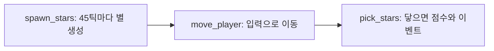
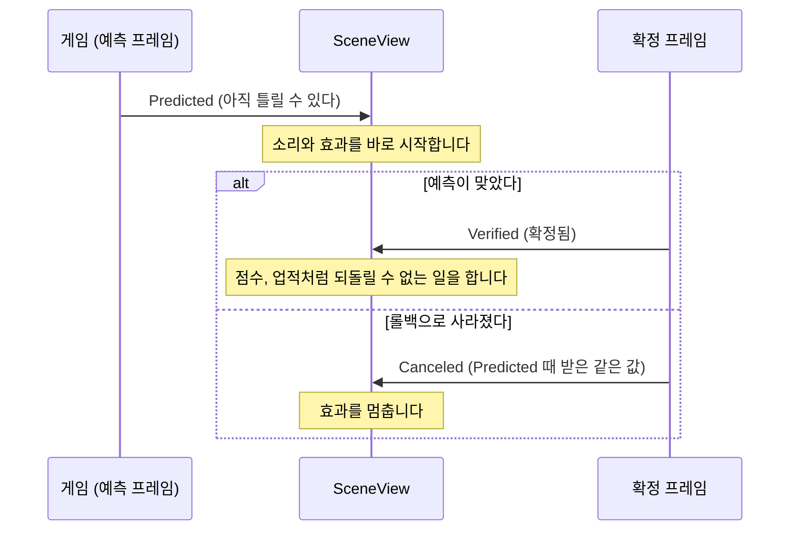
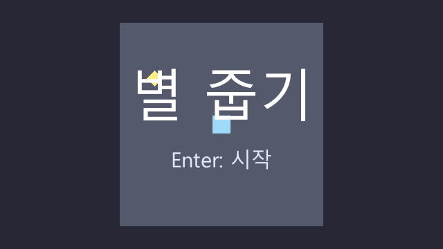
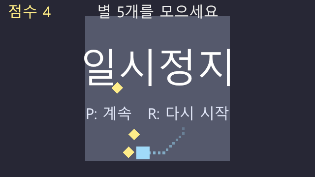
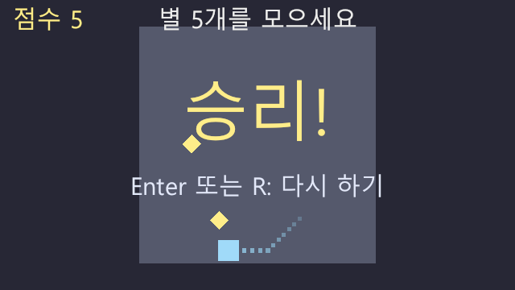
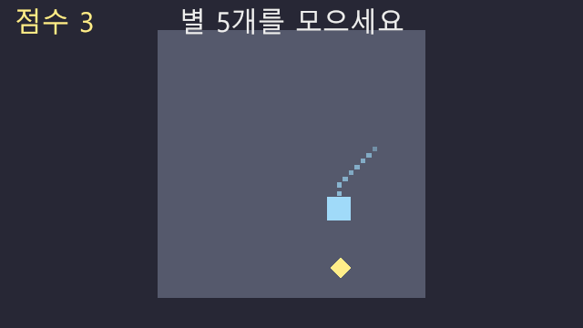

# 2단계. 혼자 하기

[튜토리얼 목차](README.md) · 이전: [1단계](step1-empty-project.md) · 다음: [3단계. 한 화면 2인](step3-two-players.md)

## 목표

키로 네모를 움직이고, 판 위에 생기는 별을 주워 점수를 얻습니다. 별을 주우면 효과와 짧은 소리가 나옵니다. 왼쪽 위에는 점수 글자가 있고, 네모 뒤에는 꼬리가 남습니다. 게임은 제목 화면에서 시작하고, `P`로 일시정지하며, 별 5개를 모으면 승리 화면이 나옵니다. 승리 화면이나 일시정지 화면에서 다시 시작할 수 있습니다.

완성 코드는 `tutorial/star_pick/src/step2.rs`(391줄)와 소리를 만드는 `sound.rs`(54줄)입니다. 1단계 파일에서 달라진 부분만 설명합니다.

## 새로 배우는 것

| 이름 | 뜻 |
|---|---|
| `Input` | 플레이어마다 매 틱 시뮬레이션에 들어가는 입력입니다. |
| `.input(f)` | 눌린 키를 `Input`으로 바꾸는 함수입니다. |
| `ctx.rng()` | 결정론 난수입니다. `Frame` 안에 저장됩니다. |
| 이벤트 | 시뮬레이션이 화면에 알리는 사건입니다 (`ctx.emit`). |
| 예측과 확정 | 이벤트는 `Predicted`, `Verified`, `Canceled` 세 상태로 옵니다. |
| `SceneView` | 화면 전체에 하나 있는 뷰. 이벤트와 점수를 다룹니다. |
| `EntityView` | 엔티티마다 하나 있는 뷰. 생기고, 움직이고, 사라질 때 불립니다. |
| `ctx.draw()` | 뷰가 화면에 글자와 선을 그리는 목록입니다. 매 프레임 비워집니다. |
| `ctx.audio()`, `App::sound` | 뷰가 소리를 켜고 끕니다. 소리는 앱을 만들 때 한 번 등록합니다. |
| `Screens` | 제목, 일시정지, 승리, 패배, 다시 시작 화면과 그 상태 전환입니다. 화면이 떠 있는 동안 게임은 중립 입력만 받습니다. |
| `Command` | 시뮬레이션에 한 번 보내는 명령입니다. 여기서는 새 판을 시작하는 `Restart`입니다. |

## 시뮬레이션: 입력, 컴포넌트, 이벤트

```rust
/// 한 플레이어의 한 틱 입력: 축마다 -1, 0, 1
#[repr(C)]
#[derive(Clone, Copy, PartialEq, Eq, Default, Debug, Pod, Zeroable)]
pub struct Move { pub dx: i32, pub dy: i32 }

#[repr(C)]
#[derive(Clone, Copy, Pod, Zeroable)]
pub struct Score { pub points: u32, pub _pad: u32 }   // 플레이어 엔티티에

#[repr(C)]
#[derive(Clone, Copy, Pod, Zeroable)]
pub struct Star { pub born: u64 }                     // 별마다. 생긴 틱

/// 이벤트: 별을 주웠다.
#[repr(C)]
#[derive(Clone, Copy, PartialEq, Debug, Pod, Zeroable)]
pub struct Picked { pub x: FP, pub y: FP, pub slot: u32, pub points: u32 }
```

`Input`과 `Event`도 `Pod`입니다. `Input`은 `Default`와 `Eq`도 필요합니다. 입력 예측이 틀렸는지 비교하기 때문입니다. `_pad`는 패딩 없이 크기를 맞추려는 자리입니다. `Pod`는 패딩 바이트를 허용하지 않습니다.

`Game`의 타입 두 줄이 달라집니다.

```rust
type Input = Move;
type Command = Restart;   // 새 판을 시작하는 명령 (아래 "게임 화면")
type Event = Picked;
```

`setup`은 플레이어 엔티티에 `Pos`와 `Score`를 붙입니다. `register`는 세 컴포넌트를 모두 등록합니다.

## 시스템 세 개

```rust
fn systems() -> Vec<Box<dyn System<Self>>> {
    // 순서가 중요합니다. 새로 생긴 별은 같은 틱에 주워지지 않습니다.
    fn_systems([spawn_stars, move_player, pick_stars])
}
```



### 별 만들기: 결정론 난수

```rust
fn spawn_stars(ctx: &mut SimContext<StarPick>) {
    if ctx.tick % SPAWN_EVERY != 0 || ctx.frame.count::<Star>() >= MAX_STARS {
        return;
    }
    let edge = HALF - fp!(0.5);
    let x = ctx.rng().range_fp(-edge, edge);
    let y = ctx.rng().range_fp(-edge, edge);
    let star = ctx.frame.spawn();
    ctx.frame.add(star, Pos { x, y });
    ctx.frame.add(star, Star { born: ctx.tick });
}
```

`ctx.rng()`는 `rand`가 아닙니다. 난수 상태가 `Frame` 안에 있습니다. 그래서 같은 시드로 시작하면 어느 컴퓨터에서나 같은 별이 같은 자리에 생깁니다. 롤백으로 되돌아가면 난수 상태도 같이 되돌아갑니다.

### 움직이기

```rust
fn move_player(ctx: &mut SimContext<StarPick>) {
    let input = *ctx.inputs.input(PlayerSlot(0));
    let (dx, dy) = (input.dx.clamp(-1, 1), input.dy.clamp(-1, 1)); // 입력 값을 믿지 않습니다
    for (_, (pos, _)) in ctx.frame.query::<(&mut Pos, &Score)>() {
        pos.x = (pos.x + STEP.mul_int(dx)).clamp(-HALF, HALF);
        pos.y = (pos.y + STEP.mul_int(dy)).clamp(-HALF, HALF);
    }
}
```

`ctx.inputs.input(PlayerSlot(0))`은 0번 플레이어의 이번 틱 입력입니다. 입력은 네트워크를 타고 올 수 있으므로 범위를 `clamp`로 다시 확인합니다. `STEP`은 `fp!(0.1)`입니다.

### 줍기와 이벤트

```rust
fn pick_stars(ctx: &mut SimContext<StarPick>) {
    let stars: Vec<(Entity, Pos)> = ctx.frame.query::<(&Pos, &Star)>().map(|(star, (pos, _))| (star, *pos)).collect();
    let mut picked: Vec<Entity> = Vec::new();
    let mut events: Vec<Picked> = Vec::new();
    for (_, (pos, score)) in ctx.frame.query::<(&Pos, &mut Score)>() {
        for (star, at) in &stars {
            let near = (pos.x - at.x).abs() < REACH && (pos.y - at.y).abs() < REACH;
            if near && !picked.contains(star) {
                picked.push(*star);
                score.points += 1;
                events.push(Picked { x: at.x, y: at.y, slot: 0, points: score.points });
            }
        }
    }
    for star in picked { ctx.frame.despawn(star); }
    for event in events { ctx.emit(event); }
}
```

질의(`query`)가 `Frame`을 빌려 쓰는 동안에는 엔티티를 지우거나 `ctx.emit`을 부를 수 없습니다. 그래서 먼저 모아 두고, 질의가 끝난 뒤에 지우고 알립니다. 지역 `Vec`은 상태가 아니라서 써도 됩니다.

## 입력 함수

```rust
App::<StarPick>::new()
    .input(|keys, _slot| Move {
        dx: keys.axis(&[KeyCode::KeyA, KeyCode::ArrowLeft], &[KeyCode::KeyD, KeyCode::ArrowRight]),
        dy: keys.axis(&[KeyCode::KeyS, KeyCode::ArrowDown], &[KeyCode::KeyW, KeyCode::ArrowUp]),
    })
```

`keys.axis(음수 키들, 양수 키들)`은 -1, 0, 1을 줍니다. 양쪽 키를 같이 누르면 0입니다. 이 함수는 매 프레임 불리고, 그 값이 다음 틱의 입력이 됩니다.

## 뷰 3개가 하는 일

뷰 코드는 `Fx` 상태 하나를 나눠 씁니다. `SceneView`와 `EntityView`가 쓰고, `Look`이 그립니다.

```rust
#[derive(Default)]
pub struct Fx {
    pub now: u64,          // 마지막으로 본 틱
    pub score: u32,        // 확정 프레임의 점수
    pub rings: Vec<Ring>,  // 별을 주운 자리에서 커지는 고리
    pub trails: Vec<Trail>,// 네모 뒤의 점들
}
pub type Shared = Rc<RefCell<Fx>>;
```

### 예측과 확정

온라인에서 창은 서버의 확정을 기다리지 않고 먼저 계산합니다. 이것이 예측입니다. 나중에 다른 플레이어의 입력이 도착해서 예측이 틀렸다면, 엔진이 그 틱으로 되돌아가 다시 계산합니다. 이것이 롤백입니다.

그래서 같은 이벤트가 세 번에 걸쳐 올 수 있습니다.



| 상태 | 뜻 | 이 튜토리얼에서 하는 일 |
|---|---|---|
| `Predicted` | 확정되지 않은 틱에서 났습니다. 롤백으로 사라질 수 있습니다. | 고리 효과와 "딩" 소리를 바로 시작합니다. |
| `Verified` | 그 틱이 확정되었습니다. 한 이벤트에 한 번 옵니다. | 이미 시작하지 않았다면 효과를 시작합니다. |
| `Canceled` | 롤백이 `Predicted` 이벤트를 없앴습니다. | 그 고리를 지우고 그 소리를 멈춥니다. |

점수는 `Verified` 프레임에서 읽습니다. 롤백이 나도 점수가 줄었다 늘지 않습니다. `ctx.predicted()`는 가장 앞선 프레임이고, `ctx.verified()`는 확정된 프레임입니다.

**서버 없이 실행하면 예측이 없습니다.** 이 단계의 게임은 서버가 없어서 이벤트가 곧바로 `Verified`로 옵니다. 그래도 `Predicted`와 `Canceled`를 처리하는 코드를 지금 씁니다. 4단계부터는 이 코드가 서버에서도 그대로 돕니다.

### SceneView: 효과와 점수

```rust
impl SceneView<StarPick> for Juice {
    fn on_event(&mut self, ctx: &mut ViewContext<'_, StarPick>, event: &Picked, state: EventState) {
        let mut fx = self.fx.borrow_mut();
        match state {
            EventState::Predicted | EventState::Verified => {
                if !fx.rings.iter().any(|ring| ring.picked == *event) {
                    let sound = ctx.audio().play_named(sound::PICKUP); // 짧은 "딩"을 바로 냅니다
                    fx.rings.push(Ring { picked: *event, start: ctx.tick(), sound });
                }
            }
            EventState::Canceled => {
                // 롤백이 줍기를 되돌렸습니다. 고리를 지우고, 시작한 소리도 멈춥니다.
                for sound in fx.rings.iter().filter(|ring| ring.picked == *event).filter_map(|ring| ring.sound) {
                    ctx.audio().stop(sound);
                }
                fx.rings.retain(|ring| ring.picked != *event);
            }
        }
    }

    fn on_resync(&mut self, ctx: &mut ViewContext<'_, StarPick>) {
        // 예측이 통째로 버려졌습니다. 그 `Canceled`는 오지 않으므로 소리와 고리를 여기서 치웁니다.
        let mut fx = self.fx.borrow_mut();
        for sound in fx.rings.drain(..).filter_map(|ring| ring.sound) {
            ctx.audio().stop(sound);
        }
    }

    fn on_update(&mut self, ctx: &mut ViewContext<'_, StarPick>) {
        let mut fx = self.fx.borrow_mut();
        fx.now = ctx.tick();
        if let Some(verified) = ctx.verified() {
            fx.score = verified.iter::<Score>().map(|(_, score)| score.points).sum();
        }
        // 점수를 왼쪽 위에, 목표를 위쪽 가운데에 글자로 그립니다 (화면 좌표: 픽셀, 왼쪽 위가 원점).
        // 제목 화면 뒤에는 그리지 않습니다.
        if fx.screens.as_ref().is_none_or(|screens| screens.screen() != Screen::Title) {
            ctx.draw().text([16.0, 14.0], 21.0, STAR, &format!("점수 {}", fx.score));
            ctx.draw().text_anchored(Anchor::Top, [0.0, 14.0], 21.0, [1.0, 1.0, 1.0, 0.85], &format!("별 {WIN_STARS}개를 모으세요"));
        }
        // ... 오래된 고리를 지웁니다
    }
}
```

`on_event`는 이벤트마다, `on_update`는 프레임마다 불립니다. `Predicted`에서 고리를 만들었다면 같은 이벤트가 `Verified`로 다시 올 때 새 고리를 만들지 않습니다. 이벤트 값 자체(`Picked`)로 같은지 비교합니다.

`play_named`가 돌려주는 `SoundHandle`은 `Ring`에 담아 둡니다. `Canceled`가 오면 그 손잡이로 `stop`을 불러 소리를 줄이며 끕니다. 소리는 짧아서 대개 이미 끝났지만, 길게 이어지는 소리라면 이 한 줄이 중요합니다. 끝난 소리에 `stop`을 불러도 아무 일도 없습니다.

`Canceled`가 오지 않는 경우가 하나 더 있습니다. 창이 서버와 어긋나서 예측을 통째로 버리고 다시 맞추면(`ViewResync`), 엔진은 `Predicted`로 받은 이벤트의 기억을 비웁니다. 그 이벤트들의 `Canceled`는 끝내 오지 않습니다. 그래서 `on_resync`에서 `Ring`에 담아 둔 손잡이로 소리를 모두 멈추고 고리도 비웁니다. 다시 맞춘 프레임의 이벤트가 오면 `on_event`가 필요한 효과를 새로 만듭니다. 이 경로는 `tutorial/star_pick/tests/resync_sound.rs`가 2~5단계에서 확인합니다.

### 글자와 소리

`ctx.draw()`는 한 프레임 동안만 쓰는 그리기 목록입니다. 기본 렌더러가 그린 뒤에, 그림 맨 위에 그려집니다. 매 프레임 비워지므로 보이게 하고 싶은 동안은 매 프레임 부릅니다(여기서는 `on_update`).

| 호출 | 뜻 |
|---|---|
| `text([x, y], 크기, 색, "글")` | 화면 좌표(픽셀, 왼쪽 위가 원점, y는 아래로)의 한 줄 글자입니다. `크기`는 대문자 높이(픽셀)입니다. |
| `text_anchored(앵커, 이동, 크기, 색, "글")` | 창의 위, 가운데, 모서리 같은 자리(`Anchor`)에 한 줄을 놓습니다. `이동`은 그 자리에서 밀 픽셀입니다(오른쪽 아래가 양수). |
| `text_box(ScreenRect, 크기, 색, "글", Align)` | 상자 너비에 맞춰 줄바꿈하고 왼쪽, 가운데, 오른쪽으로 맞춥니다. 한글은 띄어쓰기에서 나누고, 띄어쓰기 없이 긴 글은 글자 사이에서 나눕니다. 폭과 높이를 돌려줍니다. |
| `line(a, b, 색)`, `rect(min, max, 색)` | 세계 좌표의 선과 채운 사각형입니다. 카메라를 따라 움직입니다. |
| `line3(a, b, 색)`, `aabb3(min, max, 색)` | 3D 실행용 선과 상자 모서리입니다. 2D에서는 `x`와 `y`만 씁니다. |

**글자는 진짜 글꼴로 그립니다.** 앱은 시스템의 한글 글꼴(Windows는 `malgun.ttf`)을 찾아 쓰고, `App::font_file(경로)`나 `App::font(이름, 바이트)`로 다른 글꼴을 줄 수 있습니다. 글꼴 파일은 저장소에 없습니다. 시스템에 글꼴이 없으면 5 x 7 점 글꼴(ASCII만)로 돌아가고, 이때 한글은 속이 빈 네모 상자로 그려집니다. 글꼴에 없는 글자는 언제나 네모 상자로 그려지고, 그 글자가 처음 나올 때 터미널에 한 번 알립니다(`Overlay::missing_glyphs()`로도 읽습니다). 창 크기는 `ctx.screen_size()`로 읽습니다. 자세한 내용은 [orr_app README](../../crates/orr_app/README.md)의 "글꼴과 글자 상자"입니다.

`ctx.audio()`는 소리를 켜고 끕니다.

| 호출 | 뜻 |
|---|---|
| `play(&clip)` | 소리 하나를 켜고 `Option<SoundHandle>`을 줍니다. 장치가 없거나 소리가 너무 많으면 `None`입니다. |
| `play_named("pickup")` | `App::sound`로 등록한 소리를 켭니다. |
| `play_at(&clip, 위치, near, far)` | 세계의 한 점에서 나는 소리입니다. `near` 안에서는 크고 `far`부터는 들리지 않으며, 그쪽 스피커로 치우칩니다. |
| `stop(손잡이)` | 소리를 줄이며 끕니다. 이미 끝난 소리면 아무 일도 없습니다. |

소리 데이터는 `Clip`입니다. 이 튜토리얼은 소리 파일을 쓰지 않고, `tutorial/star_pick/src/sound.rs`가 프로그램이 시작할 때 사인파 두 개(라, 미)를 숫자로 만들어 `Clip::from_stereo`에 줍니다. 그래서 저장소에 소리 파일도 저작권 걱정도 없습니다. 앱을 만들 때 한 번 등록합니다.

```rust
App::<StarPick>::new()
    // ...
    .sound(sound::PICKUP, sound::pickup())
```

오디오 장치는 첫 소리를 켤 때 앱이 엽니다. 장치가 없는 컴퓨터에서는 터미널에 한 번 알리고 소리 없이 계속 돕니다. `--screenshot`으로 실행하면 장치를 열지 않습니다. 소리는 화면 쪽 일이라서 게임 규칙이나 체크섬에는 닿지 않습니다.

### EntityView: 꼬리

```rust
impl EntityView<StarPick> for TrailView {
    fn on_create(&mut self, _ctx: &mut ViewContext<'_, StarPick>, entity: Entity) {
        self.fx.borrow_mut().trails.push(Trail { entity, dots: Vec::new() });
    }
    fn on_update(&mut self, _ctx: &mut ViewContext<'_, StarPick>, entity: Entity, pose: Option<Transform2>) { /* 움직였으면 점 하나 */ }
    fn on_destroy(&mut self, _ctx: &mut ViewContext<'_, StarPick>, entity: Entity) {
        self.fx.borrow_mut().trails.retain(|trail| trail.entity != entity);
    }
}
```

`.entity_view::<Score>(factory)`는 "`Score`가 있는 엔티티마다 뷰 하나"라는 뜻입니다. `factory`는 새 엔티티마다 뷰를 만드는 함수입니다. `on_update`가 받는 `pose`는 두 틱 사이를 보간한 위치입니다.

### 게임 화면: 제목, 일시정지, 승리, 다시 시작

`orr_app::Screens`는 화면 상태와 화면마다의 글자를 가진 작은 도우미입니다. `ctx.draw()` 위에 글자를 그리고, 키와 패드 버튼을 읽어 상태를 바꿉니다.

```text
제목 --Enter--> 플레이 <--P--> 일시정지 --R--> 새 판
                  |
                  +-- 별 5개 --> 승리 --Enter/R--> 새 판
```

| 동작 | 키 | 패드 |
|---|---|---|
| 확인 (시작, 이어하기, 다시 하기) | Enter, Space | 남쪽 버튼(A) |
| 일시정지 | P | Start |
| 다시 시작 | R | Select |

게임이 연결할 곳은 세 군데입니다.

1. **입력.** `.input(..)` 함수가 `screens.input(keys, read_keys)`를 부릅니다. 플레이 화면이 아니면 `Move::default()`(중립 입력)를 돌려주고 `read_keys`는 부르지 않습니다. 화면을 닫은 키는 뗄 때까지 게임에 보이지 않습니다. 그래서 Space가 "시작"이면서 게임의 동작 키여도 시작 키가 게임에 새지 않습니다. 시뮬레이션은 `Input` 값만 보므로 화면이 어떻게 떠 있었는지와 상관없이 같은 입력은 같은 체크섬을 만듭니다. 일시정지 중에도 시뮬레이션 시계는 멈추지 않습니다. 멈추는 것은 이 창의 조작입니다.
2. **결과.** `Juice::on_event`가 확정(`Verified`)된 `Picked`의 `points`가 `WIN_STARS`(5) 이상이면 `screens.win()`을 부릅니다. 예측(`Predicted`) 이벤트로는 승리를 정하지 않습니다. 롤백이 되돌릴 수 있기 때문입니다.
3. **다시 시작.** 다시 시작은 새 세션이 아니라 **리셋 명령**입니다. `Juice::on_update`가 `screens.take_restart()`가 `true`일 때 `ctx.send_command(Restart::default())`를 보내고, 시뮬레이션의 `restart` 시스템이 별을 모두 지우고 플레이어를 가운데로, 점수를 0으로 되돌립니다. 명령은 기록되는 게임의 일부라서 리플레이와 서버 대전에서도 같은 판이 같게 다시 시작합니다. 프레임의 난수는 이어서 쓰므로 같은 시드에서도 새 판은 새 별 자리를 받습니다. 같은 시드의 새 `PlaySession`이 필요하면 앱 밖에서 만들어야 합니다. 앱은 실행 중에 세션을 새로 만들지 않습니다. 제목에서 시작할 때도 같은 명령을 보내서 첫 판이 0점에서 시작하게 합니다.

화면 글자는 창 가운데에 놓이고 창 너비에 맞춰 줄바꿈합니다. 제목, 안내, 승리 같은 말은 `Labels`로 정하고, 이 게임은 한글로 줍니다(`screens()`는 "별 줍기", "일시정지", "승리!").





패드는 `gilrs`(MIT 또는 Apache-2.0)로 읽습니다. `InputContext`는 `pad_stick(번호)`, `pad_axis`, `pad_button`을 주고, `stick_of(슬롯)`은 슬롯 0에 키보드(W A S D), 슬롯 1에 첫 번째 패드, 슬롯 2에 두 번째 패드를 줍니다. 패드가 없으면 슬롯 1은 방향키를 씁니다. 이 단계는 한 명이 하므로 `read_keys`는 키보드만 읽습니다.

### 조립

```rust
pub fn app() -> App<StarPick> {
    let screens = screens();            // 제목 "별 줍기"
    let fx = Shared::default();
    fx.borrow_mut().screens = Some(screens.clone());
    let for_trails = fx.clone();
    App::<StarPick>::new()
        .input(move |keys, _slot| screens.input(keys, read_keys))
        .view(Look { fx: fx.clone() })
        .entity_view::<Score>(move || TrailView { fx: for_trails.clone() })
        .scene_view(Juice { fx })
        .sound(sound::PICKUP, sound::pickup()) // 소리를 한 번 등록합니다
        .title("Star Pick 2")
}
```

## 실행

```powershell
cargo run -p star_pick --release --bin step2
```

Enter로 시작하고, W A S D 또는 방향키로 움직입니다. 별에 닿으면 짧은 "딩" 소리가 납니다. P는 일시정지, R은 일시정지 화면에서 다시 시작, 별 5개를 모으면 승리 화면이 나옵니다. Esc로 끝냅니다.

## 보이는 것



왼쪽 위에는 점수 글자(`점수 3`)가, 위쪽 가운데에는 목표(`별 5개를 모으세요`)가 있고, 판에는 별이 있습니다. 별은 마름모입니다. 새 별은 작게 시작해 10틱 동안 커집니다. 방금 주운 자리에는 노란 고리가 커지며 사라집니다. 네모를 움직이면 뒤에 점이 남습니다.

그림은 시스템 한글 글꼴(`malgun.ttf`)로 그린 것이고, 별을 향해 가는 자동 조종으로 200틱을 찍은 것입니다. 점수는 3점입니다. 제목, 일시정지, 승리 그림은 같은 자동 조종에 시작 키와 `P`를 눌러 준 것으로, 각각 60틱(제목), 330틱(일시정지, 250틱에서 `P`), 330틱(승리)에서 찍었습니다. 자동 조종은 그림을 찍을 때만 임시로 붙였고 저장소 코드에는 없습니다.

## 창 없이 확인하기

`tests/step2.rs`가 창 없이 다음을 확인하고, `sound.rs`의 테스트가 소리를 확인합니다.

| 테스트 | 확인하는 것 |
|---|---|
| `scoring_is_deterministic` | 가장 가까운 별로 가는 플레이어로 900틱을 두 번 돌려 같은 점수와 같은 체크섬을 얻는다. 이벤트 수가 점수와 같다 |
| `a_replay_reproduces_the_run` | `save_replay`로 기록해 `open_replay`로 열고 `seek`로 끝 틱에 가면 같은 체크섬이 나온다 |
| `the_views_follow_the_game` | 창 없는 브리지 위에서 뷰를 돌린다. 점수 글자는 확정 프레임의 점수와 같고, 고리가 시작되며, 엔티티 뷰가 만들어진다. 별마다 소리가 한 번 켜진다(소리 장치 대신 창도 장치도 없는 오프라인 출력으로 센다) |
| `a_restart_command_empties_the_round_and_a_replay_reproduces_it` | 한참 뒤에 `Restart` 명령을 넣으면 점수가 0이 되고 별이 사라지며, 리플레이가 같은 체크섬을 만든다 |
| `the_screens_start_pause_win_and_restart_a_game_that_only_sees_neutral_input` | 제목에서는 네모가 가운데에 서 있고, 시작하면 화면 글자가 사라지며, 일시정지 중에는 시계가 가지만 네모가 서 있다. 확정된 5번째 별에서 승리 화면이 뜨고, 다시 시작하면 점수가 0이 된다 |

```powershell
cargo test --release -p star_pick --test step2
```

## 더 해보기

1. `STEP`을 `fp!(0.2)`로 바꾸면 네모가 두 배 빨라집니다. 한 틱에 0.2칸입니다. 판 끝까지 몇 틱 걸리는지 세어 보세요.
2. `MAX_STARS`를 10으로 바꾸고 `--screenshot out.png --ticks 600`으로 그림을 찍어 보세요. 별이 더 많이 쌓입니다. 이제 `--screenshot`은 제목 화면을 찍습니다. 게임 화면은 시작 키를 눌러야 나오므로, 그림에는 임시 자동 조종이 필요합니다.
3. 별마다 점수가 다르게 해 보세요. `Star { born: u64, worth: u64 }`로 바꾸고 `pick_stars`가 `worth`만큼 더하게 합니다. `worth: u32`를 쓰면 구조체에 패딩이 생겨 `Pod`를 쓸 수 없다는 컴파일 오류가 납니다. 이유를 생각해 보세요.
4. `Juice::on_event`에서 `EventState::Predicted | EventState::Verified =>`를 `EventState::Predicted =>`로 바꾸고 `EventState::Verified => {}`를 더하세요. 서버 없이 실행하면 고리가 나오지 않습니다. 위 표에서 이유를 찾으세요.
5. 꼬리 점 수 `TRAIL_DOTS`를 30으로 늘려 보세요. 뷰 코드만 바뀌므로 게임 규칙과 체크섬은 그대로입니다.

완성 코드: [tutorial/star_pick/src/step2.rs](../../tutorial/star_pick/src/step2.rs)

다음: [3단계. 한 화면 2인](step3-two-players.md)
