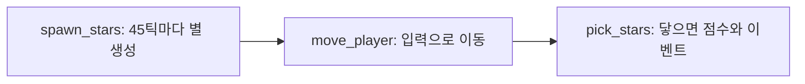
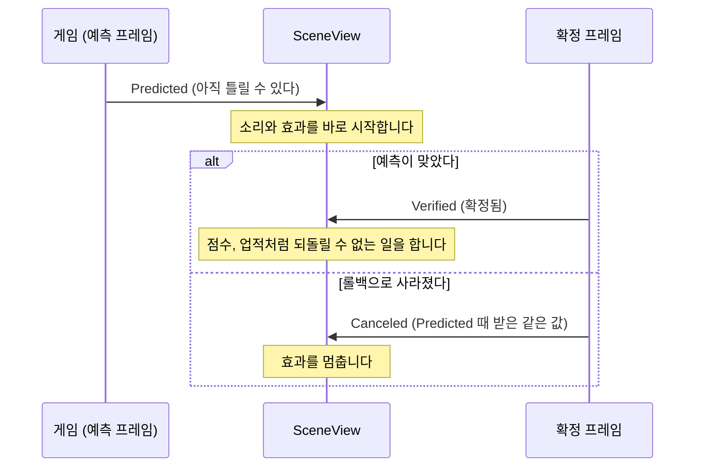

# 2단계. 혼자 하기

[튜토리얼 목차](README.md) · 이전: [1단계](step1-empty-project.md) · 다음: [3단계. 한 화면 2인](step3-two-players.md)

## 목표

키로 네모를 움직이고, 판 위에 생기는 별을 주워 점수를 얻습니다. 별을 주우면 효과가 나옵니다. 위쪽에는 점수 막대가 있고, 네모 뒤에는 꼬리가 남습니다.

완성 코드는 `tutorial/star_pick/src/step2.rs`(315줄)입니다. 1단계 파일에서 달라진 부분만 설명합니다.

## 새로 배우는 것

| 이름 | 뜻 |
|---|---|
| `Input` | 플레이어마다 매 틱 시뮬레이션에 들어가는 입력입니다. |
| `.input(f)` | 눌린 키를 `Input`으로 바꾸는 함수입니다. |
| `ctx.rng()` | 결정론 난수입니다. `Frame` 안에 저장됩니다. |
| 이벤트 | 시뮬레이션이 화면에 알리는 사건입니다 (`ctx.emit`). |
| 예측과 확정 | 이벤트는 `Predicted`, `Verified`, `Canceled` 세 상태로 옵니다. |
| `SceneView` | 화면 전체에 하나 있는 뷰. 이벤트와 점수를 다룹니다. |
| `EntityView` | 엔티티마다 하나 있는 뷰. 생기고, 움직이고, 사라질 때 불립니다. |

## 시뮬레이션: 입력, 컴포넌트, 이벤트

```rust
/// 한 플레이어의 한 틱 입력: 축마다 -1, 0, 1
#[repr(C)]
#[derive(Clone, Copy, PartialEq, Eq, Default, Debug, Pod, Zeroable)]
pub struct Move { pub dx: i32, pub dy: i32 }

#[repr(C)]
#[derive(Clone, Copy, Pod, Zeroable)]
pub struct Score { pub points: u32, pub _pad: u32 }   // 플레이어 엔티티에

#[repr(C)]
#[derive(Clone, Copy, Pod, Zeroable)]
pub struct Star { pub born: u64 }                     // 별마다. 생긴 틱

/// 이벤트: 별을 주웠다.
#[repr(C)]
#[derive(Clone, Copy, PartialEq, Debug, Pod, Zeroable)]
pub struct Picked { pub x: FP, pub y: FP, pub slot: u32, pub points: u32 }
```

`Input`과 `Event`도 `Pod`입니다. `Input`은 `Default`와 `Eq`도 필요합니다. 입력 예측이 틀렸는지 비교하기 때문입니다. `_pad`는 패딩 없이 크기를 맞추려는 자리입니다. `Pod`는 패딩 바이트를 허용하지 않습니다.

`Game`의 타입 두 줄이 달라집니다.

```rust
type Input = Move;
type Event = Picked;
```

`setup`은 플레이어 엔티티에 `Pos`와 `Score`를 붙입니다. `register`는 세 컴포넌트를 모두 등록합니다.

## 시스템 세 개

```rust
fn systems() -> Vec<Box<dyn System<Self>>> {
    // 순서가 중요합니다. 새로 생긴 별은 같은 틱에 주워지지 않습니다.
    fn_systems([spawn_stars, move_player, pick_stars])
}
```



### 별 만들기: 결정론 난수

```rust
fn spawn_stars(ctx: &mut SimContext<StarPick>) {
    if ctx.tick % SPAWN_EVERY != 0 || ctx.frame.count::<Star>() >= MAX_STARS {
        return;
    }
    let edge = HALF - fp!(0.5);
    let x = ctx.rng().range_fp(-edge, edge);
    let y = ctx.rng().range_fp(-edge, edge);
    let star = ctx.frame.spawn();
    ctx.frame.add(star, Pos { x, y });
    ctx.frame.add(star, Star { born: ctx.tick });
}
```

`ctx.rng()`는 `rand`가 아닙니다. 난수 상태가 `Frame` 안에 있습니다. 그래서 같은 시드로 시작하면 어느 컴퓨터에서나 같은 별이 같은 자리에 생깁니다. 롤백으로 되돌아가면 난수 상태도 같이 되돌아갑니다.

### 움직이기

```rust
fn move_player(ctx: &mut SimContext<StarPick>) {
    let input = *ctx.inputs.input(PlayerSlot(0));
    let (dx, dy) = (input.dx.clamp(-1, 1), input.dy.clamp(-1, 1)); // 입력 값을 믿지 않습니다
    for (_, (pos, _)) in ctx.frame.query::<(&mut Pos, &Score)>() {
        pos.x = (pos.x + STEP.mul_int(dx)).clamp(-HALF, HALF);
        pos.y = (pos.y + STEP.mul_int(dy)).clamp(-HALF, HALF);
    }
}
```

`ctx.inputs.input(PlayerSlot(0))`은 0번 플레이어의 이번 틱 입력입니다. 입력은 네트워크를 타고 올 수 있으므로 범위를 `clamp`로 다시 확인합니다. `STEP`은 `fp!(0.1)`입니다.

### 줍기와 이벤트

```rust
fn pick_stars(ctx: &mut SimContext<StarPick>) {
    let stars: Vec<(Entity, Pos)> = ctx.frame.query::<(&Pos, &Star)>().map(|(star, (pos, _))| (star, *pos)).collect();
    let mut picked: Vec<Entity> = Vec::new();
    let mut events: Vec<Picked> = Vec::new();
    for (_, (pos, score)) in ctx.frame.query::<(&Pos, &mut Score)>() {
        for (star, at) in &stars {
            let near = (pos.x - at.x).abs() < REACH && (pos.y - at.y).abs() < REACH;
            if near && !picked.contains(star) {
                picked.push(*star);
                score.points += 1;
                events.push(Picked { x: at.x, y: at.y, slot: 0, points: score.points });
            }
        }
    }
    for star in picked { ctx.frame.despawn(star); }
    for event in events { ctx.emit(event); }
}
```

질의(`query`)가 `Frame`을 빌려 쓰는 동안에는 엔티티를 지우거나 `ctx.emit`을 부를 수 없습니다. 그래서 먼저 모아 두고, 질의가 끝난 뒤에 지우고 알립니다. 지역 `Vec`은 상태가 아니라서 써도 됩니다.

## 입력 함수

```rust
App::<StarPick>::new()
    .input(|keys, _slot| Move {
        dx: keys.axis(&[KeyCode::KeyA, KeyCode::ArrowLeft], &[KeyCode::KeyD, KeyCode::ArrowRight]),
        dy: keys.axis(&[KeyCode::KeyS, KeyCode::ArrowDown], &[KeyCode::KeyW, KeyCode::ArrowUp]),
    })
```

`keys.axis(음수 키들, 양수 키들)`은 -1, 0, 1을 줍니다. 양쪽 키를 같이 누르면 0입니다. 이 함수는 매 프레임 불리고, 그 값이 다음 틱의 입력이 됩니다.

## 뷰 3개가 하는 일

뷰 코드는 `Fx` 상태 하나를 나눠 씁니다. `SceneView`와 `EntityView`가 쓰고, `Look`이 그립니다.

```rust
#[derive(Default)]
pub struct Fx {
    pub now: u64,          // 마지막으로 본 틱
    pub score: u32,        // 확정 프레임의 점수
    pub rings: Vec<Ring>,  // 별을 주운 자리에서 커지는 고리
    pub trails: Vec<Trail>,// 네모 뒤의 점들
}
pub type Shared = Rc<RefCell<Fx>>;
```

### 예측과 확정

온라인에서 창은 서버의 확정을 기다리지 않고 먼저 계산합니다. 이것이 예측입니다. 나중에 다른 플레이어의 입력이 도착해서 예측이 틀렸다면, 엔진이 그 틱으로 되돌아가 다시 계산합니다. 이것이 롤백입니다.

그래서 같은 이벤트가 세 번에 걸쳐 올 수 있습니다.



| 상태 | 뜻 | 이 튜토리얼에서 하는 일 |
|---|---|---|
| `Predicted` | 확정되지 않은 틱에서 났습니다. 롤백으로 사라질 수 있습니다. | 고리 효과와 "딩" 소리(글자)를 바로 시작합니다. |
| `Verified` | 그 틱이 확정되었습니다. 한 이벤트에 한 번 옵니다. | 이미 시작하지 않았다면 효과를 시작합니다. |
| `Canceled` | 롤백이 `Predicted` 이벤트를 없앴습니다. | 그 고리를 지웁니다. |

점수는 `Verified` 프레임에서 읽습니다. 롤백이 나도 점수가 줄었다 늘지 않습니다. `ctx.predicted()`는 가장 앞선 프레임이고, `ctx.verified()`는 확정된 프레임입니다.

**서버 없이 실행하면 예측이 없습니다.** 이 단계의 게임은 서버가 없어서 이벤트가 곧바로 `Verified`로 옵니다. 그래도 `Predicted`와 `Canceled`를 처리하는 코드를 지금 씁니다. 4단계부터는 이 코드가 서버에서도 그대로 돕니다.

### SceneView: 효과와 점수

```rust
impl SceneView<StarPick> for Juice {
    fn on_event(&mut self, ctx: &mut ViewContext<'_, StarPick>, event: &Picked, state: EventState) {
        let mut fx = self.fx.borrow_mut();
        match state {
            EventState::Predicted | EventState::Verified => {
                if !fx.rings.iter().any(|ring| ring.picked == *event) {
                    fx.rings.push(Ring { picked: *event, start: ctx.tick() });
                    println!("Ding! Star picked, {} points", event.points);
                }
            }
            EventState::Canceled => fx.rings.retain(|ring| ring.picked != *event),
        }
    }

    fn on_update(&mut self, ctx: &mut ViewContext<'_, StarPick>) {
        let mut fx = self.fx.borrow_mut();
        fx.now = ctx.tick();
        if let Some(verified) = ctx.verified() {
            fx.score = verified.iter::<Score>().map(|(_, score)| score.points).sum();
        }
        // ... 오래된 고리를 지웁니다
    }
}
```

`on_event`는 이벤트마다, `on_update`는 프레임마다 불립니다. `Predicted`에서 고리를 만들었다면 같은 이벤트가 `Verified`로 다시 올 때 새 고리를 만들지 않습니다. 이벤트 값 자체(`Picked`)로 같은지 비교합니다.

소리는 아직 없어서 "딩"은 글자로 찍습니다. 소리를 붙인다면 같은 자리에 넣습니다. 이 엔진의 뷰는 아직 글자를 그리지 못해서 점수는 작은 네모 막대로 보여 줍니다.

### EntityView: 꼬리

```rust
impl EntityView<StarPick> for TrailView {
    fn on_create(&mut self, _ctx: &mut ViewContext<'_, StarPick>, entity: Entity) {
        self.fx.borrow_mut().trails.push(Trail { entity, dots: Vec::new() });
    }
    fn on_update(&mut self, _ctx: &mut ViewContext<'_, StarPick>, entity: Entity, pose: Option<Transform2>) { /* 움직였으면 점 하나 */ }
    fn on_destroy(&mut self, _ctx: &mut ViewContext<'_, StarPick>, entity: Entity) {
        self.fx.borrow_mut().trails.retain(|trail| trail.entity != entity);
    }
}
```

`.entity_view::<Score>(factory)`는 "`Score`가 있는 엔티티마다 뷰 하나"라는 뜻입니다. `factory`는 새 엔티티마다 뷰를 만드는 함수입니다. `on_update`가 받는 `pose`는 두 틱 사이를 보간한 위치입니다.

### 조립

```rust
pub fn app() -> App<StarPick> {
    let fx = Shared::default();
    let for_trails = fx.clone();
    App::<StarPick>::new()
        .input(|keys, _slot| read_keys(keys))
        .view(Look { fx: fx.clone() })
        .entity_view::<Score>(move || TrailView { fx: for_trails.clone() })
        .scene_view(Juice { fx })
        .title("Star Pick 2")
}
```

## 실행

```powershell
cargo run -p star_pick --release --bin step2
```

W A S D 또는 방향키로 움직입니다. 별에 닿으면 터미널에 `Ding!`이 찍힙니다. Esc로 끝냅니다.

## 보이는 것


위에는 점수 막대가 있고, 판에는 별이 있습니다. 별은 마름모입니다. 새 별은 작게 시작해 10틱 동안 커집니다. 방금 주운 자리에는 노란 고리가 커지며 사라집니다. 네모를 움직이면 뒤에 점이 남습니다.

그림은 별을 향해 가는 자동 조종으로 590틱을 찍은 것입니다. 점수는 12점입니다.

## 창 없이 확인하기

`tests/step2.rs`가 창 없이 세 가지를 확인합니다.

| 테스트 | 확인하는 것 |
|---|---|
| `scoring_is_deterministic` | 가장 가까운 별로 가는 플레이어로 900틱을 두 번 돌려 같은 점수와 같은 체크섬을 얻는다. 이벤트 수가 점수와 같다 |
| `a_replay_reproduces_the_run` | `save_replay`로 기록해 `open_replay`로 열고 `seek`로 끝 틱에 가면 같은 체크섬이 나온다 |
| `the_views_follow_the_game` | 창 없는 브리지 위에서 뷰를 돌린다. 점수 막대는 확정 프레임의 점수와 같고, 고리가 시작되며, 엔티티 뷰가 만들어진다 |

```powershell
cargo test --release -p star_pick --test step2
```

## 더 해보기

1. `STEP`을 `fp!(0.2)`로 바꾸면 네모가 두 배 빨라집니다. 한 틱에 0.2칸입니다. 판 끝까지 몇 틱 걸리는지 세어 보세요.
2. `MAX_STARS`를 10으로 바꾸고 `--screenshot out.png --ticks 600`으로 그림을 찍어 보세요. 별이 더 많이 쌓입니다.
3. 별마다 점수가 다르게 해 보세요. `Star { born: u64, worth: u64 }`로 바꾸고 `pick_stars`가 `worth`만큼 더하게 합니다. `worth: u32`를 쓰면 구조체에 패딩이 생겨 `Pod`를 쓸 수 없다는 컴파일 오류가 납니다. 이유를 생각해 보세요.
4. `Juice::on_event`에서 `EventState::Predicted | EventState::Verified =>`를 `EventState::Predicted =>`로 바꾸고 `EventState::Verified => {}`를 더하세요. 서버 없이 실행하면 고리가 나오지 않습니다. 위 표에서 이유를 찾으세요.
5. 꼬리 점 수 `TRAIL_DOTS`를 30으로 늘려 보세요. 뷰 코드만 바뀌므로 게임 규칙과 체크섬은 그대로입니다.

완성 코드: [tutorial/star_pick/src/step2.rs](../../tutorial/star_pick/src/step2.rs)

다음: [3단계. 한 화면 2인](step3-two-players.md)
