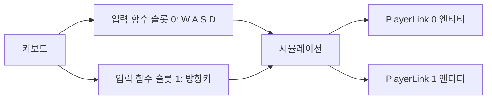
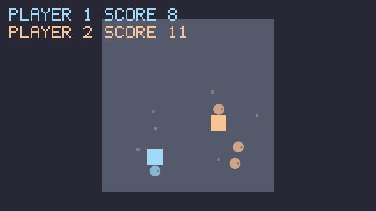

# 3단계. 한 화면 2인

[튜토리얼 목차](README.md) · 이전: [2단계](step2-solo.md) · 다음: [4단계. 로컬 서버 2창](step4-local-server.md)

## 목표

키보드 하나로 두 명이 놉니다. 1번 플레이어는 W A S D, 2번 플레이어는 방향키입니다. 점수 글자는 1번이 첫 줄에, 2번이 둘째 줄에 각자의 색으로 나옵니다.

완성 코드는 `tutorial/star_pick/src/step3.rs`(338줄)입니다. 2단계에서 달라진 부분만 설명합니다.

## 새로 배우는 것

| 이름 | 뜻 |
|---|---|
| 슬롯 | 플레이어 번호입니다 (`PlayerSlot(0)`, `PlayerSlot(1)`). |
| `.local_players(n)` | 이 화면을 같이 쓰는 플레이어 수입니다. 슬롯 `0..n`이 이 화면의 플레이어입니다. |
| `stick_for_slot(slot)` | 슬롯의 기본 키를 방향 `(x, y)`와 버튼으로 읽습니다. |
| `PlayerLink` | "이 엔티티는 플레이어 N의 것"이라는 표준 컴포넌트입니다. |
| `ctx.is_local(slot)` | 뷰에서 "이 슬롯은 이 화면의 플레이어인가"를 묻습니다. |

## 무엇이 달라지는가



2단계에서 시스템은 "0번 플레이어의 입력"을 읽었습니다. 이제 플레이어가 둘이므로 **엔티티가 어느 플레이어의 것인지** 알아야 합니다. 그 표시가 `PlayerLink`입니다.

## 시뮬레이션: PlayerLink

```rust
use orr_sim::{register_player_link, PlayerLink, PlayerSlot /* ... */};

pub const PLAYERS: u8 = 2;

fn register(builder: &mut ComponentRegistryBuilder) {
    builder.register_component::<Pos>("Pos");
    builder.register_component::<Score>("Score");
    builder.register_component::<Star>("Star");
    register_player_link(builder); // 표준 컴포넌트를 등록합니다
}

fn setup(frame: &mut Frame, _config: &()) {
    for slot in 0..PLAYERS {
        let player = frame.spawn();
        let x = FP::from_int(4 * i32::from(slot) - 2); // -2와 2
        frame.add(player, Pos { x, y: FP::ZERO });
        frame.add(player, Score { points: 0, _pad: 0 });
        frame.add(player, PlayerLink { player: PlayerSlot(slot) });
    }
}
```

지금은 플레이어 둘을 `setup`에서 바로 만듭니다. 4단계에서 이 부분을 바꿉니다. 플레이어가 서버에 들어오고 나가는 순간에 만들고 지우게 됩니다.

### 움직이기: 엔티티가 자기 슬롯의 입력을 읽는다

```rust
fn move_players(ctx: &mut SimContext<StarPick>) {
    let inputs = ctx.inputs;
    for (_, (pos, link)) in ctx.frame.query::<(&mut Pos, &PlayerLink)>() {
        if link.player.0 >= inputs.player_count() {
            continue;
        }
        let input = inputs.input(link.player);
        pos.x = (pos.x + STEP.mul_int(input.dx.clamp(-1, 1))).clamp(-HALF, HALF);
        pos.y = (pos.y + STEP.mul_int(input.dy.clamp(-1, 1))).clamp(-HALF, HALF);
    }
}
```

`let inputs = ctx.inputs;`는 입력 참조를 따로 꺼내 둡니다. 그러면 `ctx.frame`을 가변으로 빌려 쓰는 동안에도 입력을 읽을 수 있습니다.

점수를 올리는 `pick_stars`도 같게 바뀝니다. 질의에 `&PlayerLink`를 더하고, 이벤트의 `slot`을 `link.player.0`으로 채웁니다.

```rust
for (_, (pos, score, link)) in ctx.frame.query::<(&Pos, &mut Score, &PlayerLink)>() { /* ... */ }
```

플레이어는 프레임의 순서대로 방문합니다. 이 순서는 모든 컴퓨터에서 같습니다. 그래서 두 플레이어가 같은 틱에 같은 별에 닿아도, 먼저 방문한 쪽이 점수를 얻는 결과가 항상 같습니다.

## 입력: 키 배치

```rust
App::<StarPick>::new()
    .local_players(2) // 슬롯 0과 1이 이 화면에 있습니다
    .input(|keys, slot| {
        let stick = keys.stick_for_slot(slot); // 슬롯 0: W A S D, 슬롯 1: 방향키
        Move { dx: stick.x, dy: stick.y }
    })
```

입력 함수는 매 프레임 **로컬 슬롯마다 한 번씩** 불립니다. `slot`이 그 슬롯 번호입니다. `stick_for_slot`이 슬롯 0에 W A S D, 슬롯 1에 방향키를 줍니다. 세 번째 슬롯부터는 기본 키가 없어서 가만히 있는 입력입니다.

키를 직접 정하려면 `KeyLayout { up, down, left, right, action }`을 만들어 `keys.stick(&layout)`에 줍니다. 패드 입력은 아직 없습니다.

`.local_players(2)`는 시뮬레이션의 플레이어 수도 2로 만듭니다. `.players(2)`를 따로 부를 필요가 없습니다.

## 뷰: is_local

```rust
impl EntityView<StarPick> for TrailView {
    fn on_create(&mut self, ctx: &mut ViewContext<'_, StarPick>, entity: Entity) {
        let Some(link) = ctx.predicted().get::<PlayerLink>(entity) else { return };
        if ctx.is_local(link.player) {
            let color = color_of(u32::from(link.player.0));
            self.fx.borrow_mut().trails.push(Trail { entity, color, dots: Vec::new() });
        }
    }
    // ...
}
```

이 화면에서는 두 슬롯이 모두 로컬이므로 `is_local`이 둘 다 참입니다. 꼬리가 두 개 생깁니다. 4단계에서 창이 둘로 나뉘면 각 창은 자기 플레이어 꼬리만 그립니다. **같은 뷰 코드가 그대로 돕니다.**

그 밖의 뷰 변화는 모두 "슬롯별 색"입니다. 색은 `color_of(slot)`이 고르고(파랑, 주황), 점수는 슬롯마다 따로 `Fx.scores`에 담습니다.

```rust
pub scores: [u32; 2], // 확정 프레임에서 읽은 슬롯별 점수
```

## 실행

```powershell
cargo run -p star_pick --release --bin step3
```

| 플레이어 | 이동 |
|---|---|
| 1번 (파랑) | W A S D |
| 2번 (주황) | 방향키 |

두 사람이 한 키보드를 같이 씁니다. 키보드가 동시에 누를 수 있는 키 수에 한계가 있어서, 어떤 키 조합은 같이 눌리지 않을 수 있습니다.

## 보이는 것



파란 네모와 주황 네모가 각자 움직입니다. 점수 글자는 파랑이 첫 줄에, 주황이 둘째 줄에 있습니다. 고리와 꼬리는 주운 사람의 색입니다.

그림은 두 플레이어가 자기 쪽 절반의 별만 줍는 자동 조종으로 872틱을 찍은 것입니다.

## 창 없이 확인하기

`tests/step3.rs`:

| 테스트 | 확인하는 것 |
|---|---|
| `the_two_slots_move_independently` | 슬롯 0은 오른쪽으로, 슬롯 1은 위로 10틱 가면 각자 그만큼만 움직인다. 슬롯 0의 입력만 끄면 슬롯 0만 멈춘다 |
| `each_slot_scores_for_its_own_player` | 슬롯 0만 별을 쫓아도 이벤트의 `slot`과 각 플레이어의 점수가 맞다 |
| `two_runs_end_the_same` | 같은 입력이면 체크섬이 같다 |

```powershell
cargo test --release -p star_pick --test step3
```

## 더 해보기

1. 슬롯 1의 시작 위치를 `y = 2`로 바꾸세요. `setup`에서 `Pos`를 만드는 한 줄만 바꾸면 됩니다.
2. 점수가 5점이 되면 이기는 규칙을 더해 보세요. 시스템 하나를 더하고, `Won { slot }` 이벤트를 `ctx.emit`합니다. 뷰가 이벤트를 받아 터미널에 승자를 찍게 하세요.
3. 2번 플레이어에게 `KeyLayout`을 직접 줘 보세요. `KeyLayout { up: KeyCode::KeyI, down: KeyCode::KeyK, left: KeyCode::KeyJ, right: KeyCode::KeyL, action: KeyCode::Space }`를 `keys.stick(&layout)`에 줍니다.
4. `ctx.is_local`을 쓰지 않도록 `TrailView`를 바꿔 보세요. 이 화면에서는 아무것도 달라 보이지 않습니다. 4단계의 창 두 개에서는 어떻게 달라질까요?

완성 코드: [tutorial/star_pick/src/step3.rs](../../tutorial/star_pick/src/step3.rs)

다음: [4단계. 로컬 서버 2창](step4-local-server.md)
