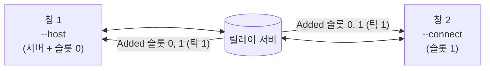
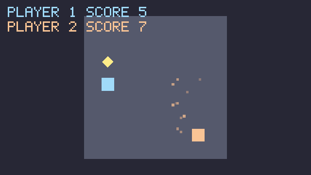

# 4단계. 로컬 서버 2창

[튜토리얼 목차](README.md) · 이전: [3단계](step3-two-players.md) · 다음: [5단계. 재접속](step5-reconnect.md)

## 목표

창 두 개를 띄웁니다. 한 창은 서버를 겸하고(`--host`), 다른 창은 거기에 접속합니다(`--connect`). 창 하나가 플레이어 한 명입니다. 같은 컴퓨터에서 돌지만 네트워크를 타는 진짜 서버 경로입니다.

완성 코드는 `tutorial/star_pick/src/step4.rs`(392줄)입니다. 3단계에서 달라진 부분만 설명합니다. 뷰 코드는 거의 같습니다.

## 새로 배우는 것

| 이름 | 뜻 |
|---|---|
| 플레이어 신호 | 플레이어가 들어오고, 끊기고, 돌아오고, 나갔다는 알림입니다. 입력의 일부라서 모든 창이 같은 틱에 받습니다. |
| `Players` | 신호를 받는 트레이트입니다. `on_player` 하나를 구현합니다. |
| `player_signals` | 신호를 `on_player`로 넘기는 시스템입니다. 시스템 목록의 맨 앞에 둡니다. |
| 프리팹 | 엔티티를 만드는 "레시피"입니다. 컴포넌트와 첫 값의 목록입니다. |
| `Config` | `setup`에 넘기는 시작 설정입니다. 여기서는 프리팹을 담습니다. |
| `--host`, `--connect` | 같은 `App` 코드를 서버로 돌립니다. |

## 왜 신호가 필요한가

3단계는 `setup`에서 플레이어 둘을 만들었습니다. 서버에서는 이것이 맞지 않습니다. 플레이어가 언제 들어올지, 들어왔다가 나갈지 `setup` 때는 모릅니다. 게임은 **누가 게임에 있는지** 알아야 합니다.

서버는 자리가 바뀔 때마다 모든 창에 알립니다. 이 알림은 입력과 같은 길을 타고 같은 틱에 모든 창에 도착합니다. 그래서 게임이 "2번 플레이어가 들어왔다"를 모든 컴퓨터에서 같은 틱에 처리합니다.



서버는 게임 규칙을 돌리지 않습니다. 입력을 모아서 전달할 뿐입니다. 규칙은 두 창이 각자 돌립니다. 이 방식을 릴레이라고 합니다. 두 창의 결과가 같다는 것은 체크섬으로 확인합니다.

## 시뮬레이션: Players

### 1. 플레이어가 없는 시작

```rust
fn setup(frame: &mut Frame, config: &Setup) {
    // 플레이어는 아직 없습니다. `Added`가 만듭니다.
    prefab::install(frame, &config.avatars).expect("StarPick registers prefabs");
}
```

`setup`은 이제 플레이어를 만들지 않습니다. 프리팹만 프레임에 넣어 둡니다.

### 2. 프리팹

```rust
/// `setup`에 필요한 것. 프리팹은 플레이어 엔티티의 레시피입니다. 실행 전에 구워 둡니다.
pub struct Setup { pub avatars: Vec<Prefab> }

impl Default for Setup {
    fn default() -> Self {
        let registry = Simulation::<StarPick>::build_registry();
        let avatar = Prefab::new()
            .with(&registry, Pos { x: FP::ZERO, y: FP::ZERO })
            .and_then(|prefab| prefab.with(&registry, Score { points: 0, _pad: 0 }))
            .and_then(|prefab| prefab.with(&registry, PlayerLink { player: PlayerSlot::NONE })) // `Added`가 채웁니다
            .expect("StarPick registers these components");
        Self { avatars: vec![avatar] }
    }
}
```

`Game::Config`를 `Setup`으로 바꿉니다(`type Config = Setup;`). `register`에는 `prefab::register(builder);`를 더합니다.

프리팹을 `Config`에서 구워서 `setup`이 프레임에 복사하는 이유가 있습니다. 시스템과 `on_player`는 `Config`를 볼 수 없습니다. 프리팹이 프레임 안에 있으면 스냅숏, 체크섬, 중간에 들어온 창, 롤백과 리플레이가 모두 같은 엔티티를 만듭니다.

### 3. on_player

```rust
impl Players for StarPick {
    /// 플레이어의 시작 데이터(이름, 색). StarPick에는 없습니다.
    type Player = ();

    fn on_player(frame: &mut Frame, signal: PlayerSignal<()>) {
        match signal {
            PlayerSignal::Added { slot, .. } => {
                if avatar_of(frame, slot).is_some() {
                    return; // 같은 플레이어에게 아바타가 둘 생기지 않게 합니다
                }
                let Some(avatar) = spawn_prefab(frame, PrefabId(0)) else { return };
                if let Some(link) = frame.get_mut::<PlayerLink>(avatar) {
                    link.player = slot;
                }
                if let Some(pos) = frame.get_mut::<Pos>(avatar) {
                    pos.x = FP::from_int(4 * i32::from(slot.0) - 2); // 슬롯 0은 -2, 슬롯 1은 2
                }
            }
            PlayerSignal::Disconnected { .. } | PlayerSignal::Reconnected { .. } => {} // 5단계
            PlayerSignal::Removed { slot } => {
                if let Some(avatar) = avatar_of(frame, slot) {
                    frame.despawn(avatar);
                }
            }
        }
    }
}

/// 플레이어의 아바타: `PlayerLink`가 그 슬롯을 가리키는 엔티티
pub fn avatar_of(frame: &mut Frame, slot: PlayerSlot) -> Option<Entity> {
    frame.query::<(&PlayerLink,)>().find(|(_, (link,))| link.player == slot).map(|(entity, _)| entity)
}
```

`on_player`는 시스템처럼 프레임을 바꿉니다. 단, **프레임과 신호만** 보고 정해야 합니다. 파일, 시계, 난수를 쓰지 않습니다. 모든 창이 같은 결과를 내야 하기 때문입니다.

`Player` 타입은 신호에 실려 오는 플레이어별 시작 데이터입니다. 이름이나 고른 캐릭터를 넣을 수 있습니다. 이 게임에는 없어서 `()`입니다. 지금은 서버로 돌릴 때 이 데이터가 비어 있습니다. 서버 없이 돌릴 때는 기본값입니다.

### 4. 시스템 목록

```rust
fn systems() -> Vec<Box<dyn System<Self>>> {
    // `player_signals`를 맨 앞에 둡니다: 이번 틱의 플레이어가 다른 시스템보다 먼저 생깁니다.
    let mut systems = vec![player_signals::<Self>()];
    systems.extend(fn_systems([spawn_stars, move_players, pick_stars]));
    systems
}
```

`Players`는 선택입니다. `player_signals`를 넣지 않은 게임은 신호를 무시합니다.

## 실행 함수

```rust
pub fn app() -> App<StarPick> {
    // ...
    App::<StarPick>::new() // `Setup::default()`가 프리팹을 굽습니다
        .players(PLAYERS)  // 자리 두 개. 둘이 다 차야 서버가 게임을 시작합니다
        .input(|keys, _slot| read_keys(keys))
        // 뷰는 3단계와 같습니다
}
```

3단계의 `.local_players(2)`가 `.players(2)`로 바뀌었습니다. 이 창에서 조종하는 플레이어는 하나입니다. 시뮬레이션의 플레이어는 둘입니다.

입력 함수의 `slot`은 이 창 안의 번호라서 항상 0입니다. 서버가 어느 슬롯을 주든, 각 창에서 W A S D(또는 방향키)가 먹습니다. `read_keys`는 두 키 배치를 모두 읽습니다.

뷰의 `ctx.is_local(slot)`은 서버가 준 **실제** 슬롯을 씁니다. 3단계 뷰 코드가 그대로 돌고, 각 창이 자기 플레이어의 꼬리만 그립니다.

## 실행

터미널 두 개를 엽니다.

```powershell
cargo run -p star_pick --release --bin step4 -- --host
```

```powershell
cargo run -p star_pick --release --bin step4 -- --connect 127.0.0.1:7777
```

`--host`가 서버를 이 프로세스에서 띄우고, 이 창도 서버에 접속합니다. 이 창이 0번 슬롯입니다. 기본 주소는 `127.0.0.1:7777`입니다. `--connect` 창은 빈 슬롯을 받습니다. 두 창이 모두 들어오면 게임이 시작합니다. 그 전에는 창이 열리지 않습니다.

`--connect` 창은 이런 줄을 찍습니다. 5단계에서 이 값을 씁니다.

```text
playing as slot 1 of 2. To take the seat again after closing this window: --connect 127.0.0.1:7777 --slot 1 --token 8042519091568454697
```

**서버 없이** 실행하면 어떻게 됩니까? `cargo run -p star_pick --release --bin step4`는 0번 플레이어만 조종할 수 있습니다. 앱이 틱 1에 두 슬롯 모두에 `Added`를 넣어서, 2번 플레이어의 아바타는 생기지만 가만히 서 있습니다. 둘이 같이 놀려면 서버로 실행합니다.

## 보이는 것



두 창 모두 파란 네모(슬롯 0)와 주황 네모(슬롯 1), 그리고 별을 보여 줍니다. 한쪽 창에서 네모를 움직이면 다른 창에서도 같은 네모가 움직입니다. 점수도 같습니다.

그림은 별을 향해 가는 임시 자동 조종으로, `--connect` 창에서 `--screenshot out.png --ticks 150 --size 640x360`로 찍었습니다. 서버로 돌릴 때 `--ticks`는 서버 시계를 따라가서, 그 틱에 닿을 때까지 기다린 뒤 프레임을 셉니다. 두 창의 그림이 같은 틱이 아닐 수도 있습니다.

## 창 없이 확인하기

`tests/step4.rs`는 `orr_server::harness`를 씁니다. 서버 하나와 클라이언트 둘이 가짜 네트워크(지연, 손실, 순서 뒤바뀜이 있음) 위에서 도는 시험 장치입니다. 소켓도 시계도 쓰지 않아서 매번 같은 결과가 나옵니다.

| 테스트 | 확인하는 것 |
|---|---|
| `added_gives_every_player_an_avatar_on_every_client` | 두 클라이언트 모두 확정 프레임에 아바타가 둘 있다. 각 클라이언트의 입력은 자기 아바타만 움직인다. 두 클라이언트의 체크섬이 같은 틱마다 같다 |
| `without_a_server_the_app_announces_every_player_in_tick_one` | 서버 없이 실행할 때처럼 `announce_players`를 하면 틱 1에 아바타가 둘 생긴다 |

```powershell
cargo test --release -p star_pick --test step4
```

## 더 해보기

1. `--host 0.0.0.0:7777`로 띄우고 같은 네트워크의 다른 컴퓨터에서 `--connect <주소>:7777`로 접속해 보세요. 두 컴퓨터는 같은 빌드여야 합니다.
2. `PLAYERS`를 3으로 올려 보세요. 창을 세 개 띄워야 게임이 시작합니다. 세 번째 아바타가 판 밖에 생깁니다. 시작 위치 공식(`4 * 슬롯 - 2`)을 고치세요. 세 번째 플레이어의 색은 `color_of`가 정합니다.
3. 아바타의 시작 위치를 난수로 정해 보세요. `on_player`는 `ctx`가 없어서 `ctx.rng()`를 부를 수 없습니다. 난수 상태는 프레임 안의 싱글턴 `FrameRng`입니다. `frame.singleton_mut::<FrameRng>()`로 꺼내 쓸 수 있습니다. 모든 창이 같은 값을 얻는 이유를 설명해 보세요.
4. `on_player`에서 `Disconnected`를 받으면 `println!`을 하게 해 보세요. 시뮬레이션 코드는 롤백 때문에 같은 틱을 여러 번 계산할 수 있어서, 같은 줄이 여러 번 찍힐 수 있습니다. 찍는 일은 뷰의 `SceneView::on_player`에서 합니다. 5단계가 이 길을 갑니다.

완성 코드: [tutorial/star_pick/src/step4.rs](../../tutorial/star_pick/src/step4.rs)

다음: [5단계. 재접속](step5-reconnect.md)
