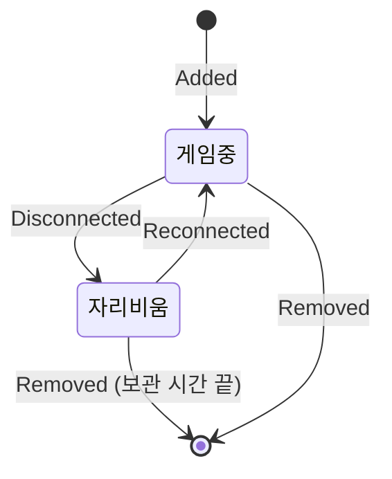
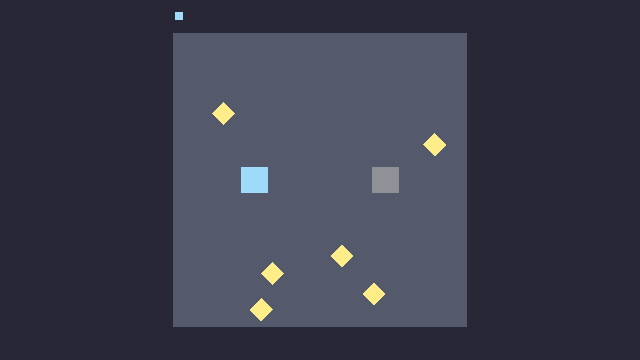
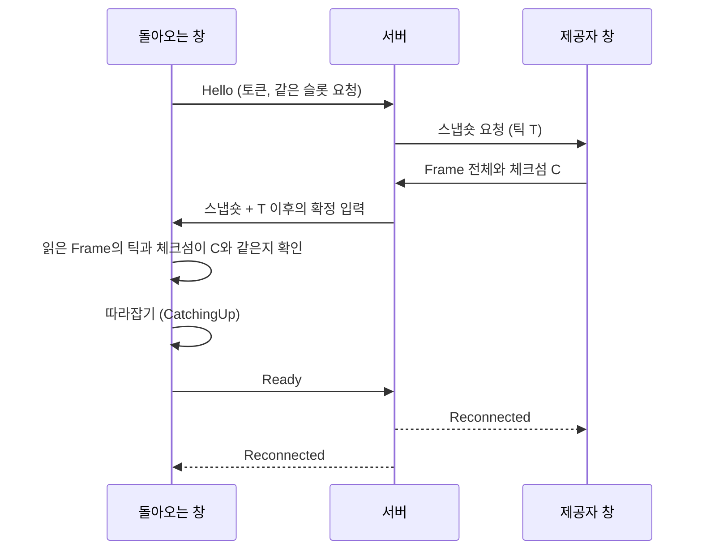

# 5단계. 재접속

[튜토리얼 목차](README.md) · 이전: [4단계](step4-local-server.md)

## 목표

한 플레이어가 창을 닫거나 연결이 끊기면 그 아바타는 멈추고 회색이 됩니다. 정해진 시간 안에 같은 자리로 돌아오면 아바타를 되찾습니다. 시간이 지나면 아바타는 사라지고 자리가 비어, 새 플레이어가 들어올 수 있습니다.

완성 코드는 `tutorial/star_pick/src/step5.rs`(423줄)입니다. 4단계에 다음을 더합니다.

- `Away` 컴포넌트와 세 신호(`Disconnected`, `Reconnected`, `Removed`)의 처리
- 멈춘 아바타를 시스템에서 빼는 `without::<Away>()`
- 회색으로 그리기
- 뷰의 `SceneView::on_player`

## 새로 배우는 것

| 이름 | 뜻 |
|---|---|
| `Disconnected` | 연결이 끊겼습니다. 서버는 자리를 한동안 보관합니다. |
| `Reconnected` | 같은 토큰으로 돌아왔습니다. |
| `Removed` | 보관 시간이 끝났거나 쫓겨났습니다. 자리가 비었습니다. |
| `--slot`, `--token` | 닫은 창이 자리를 되찾는 명령줄 옵션입니다. |
| 스냅숏 합류 | 돌아온 창은 진행 중인 게임의 `Frame`을 통째로 받습니다. |
| `SceneView::on_player` | 뷰에서 신호를 받는 함수입니다. |

## 아바타의 일생



| 신호 | 서버가 알리는 때 | 이 튜토리얼에서 게임이 하는 일 |
|---|---|---|
| `Added` | 게임 시작, 또는 새 플레이어가 들어올 때 | 프리팹으로 아바타를 만듭니다 (4단계) |
| `Disconnected` | 연결이 끊겼습니다. 자리는 보관 중입니다. | 아바타에 `Away`를 붙여 멈춥니다 |
| `Reconnected` | 같은 토큰으로 돌아왔습니다. | `Away`를 뗍니다 |
| `Removed` | 보관 시간(`reserve_ticks`)이 끝났거나 쫓겨났습니다. | 아바타를 지웁니다 (4단계) |

서버가 자리를 보관하는 시간은 기본 600틱(10초)입니다. 이 신호들은 모두 `from_tick`이 붙어서 두 창이 같은 틱에 같은 일을 합니다.

## 시뮬레이션

### Away 컴포넌트

```rust
/// 자리를 비운 플레이어의 아바타에 붙습니다. `since`는 `Disconnected`를 처리할 때의 `frame.tick()`입니다.
#[repr(C)]
#[derive(Clone, Copy, Pod, Zeroable)]
pub struct Away { pub since: u64 }
```

`register`에 `builder.register_component::<Away>("Away");`를 더합니다. 자리를 비웠다는 사실은 게임 상태입니다. 그래서 컴포넌트로 `Frame` 안에 둡니다. 뷰가 따로 기억하는 값이 아닙니다. 그래야 스냅숏과 체크섬에 들어가고, 돌아오는 창도 같은 상태를 받습니다.

### on_player

```rust
// 연결이 끊겼습니다. 자리는 한동안 보관됩니다: 아바타를 멈춥니다.
PlayerSignal::Disconnected { slot } => {
    if let Some(avatar) = avatar_of(frame, slot) {
        let since = frame.tick();
        frame.add(avatar, Away { since });
    }
}
// 같은 토큰으로 돌아왔습니다: 아바타를 돌려줍니다.
PlayerSignal::Reconnected { slot } => {
    if let Some(avatar) = avatar_of(frame, slot) {
        frame.remove::<Away>(avatar);
    }
}
// 보관 시간이 끝났거나 쫓겨났습니다: 아바타가 사라집니다.
PlayerSignal::Removed { slot } => { /* 4단계와 같습니다: frame.despawn(avatar) */ }
```

### 멈추기

```rust
// `without::<Away>()`: 자리를 비운 아바타는 입력이 무엇이든 움직이지 않습니다.
for (_, (pos, link)) in ctx.frame.query::<(&mut Pos, &PlayerLink)>().without::<Away>() {
    // ...
}
```

`pick_stars`의 질의에도 `.without::<Away>()`를 붙입니다. 자리를 비운 아바타는 별도 줍지 않습니다.

끊긴 플레이어의 입력은 서버가 채웁니다. 게임은 그 값에 기대지 않고, `Away`로 직접 멈춥니다.

## 뷰

### 회색으로 그리기

```rust
let mut color = color_of(link.map_or(0, |link| u32::from(link.player.0)));
if frame.has::<Away>(entity) {
    color = AWAY; // 회색, 반투명
}
```

`Extractor`가 `frame.has::<Away>(entity)`로 읽습니다. 게임 규칙과 뷰가 같은 `Away`를 봅니다.

### SceneView::on_player

```rust
fn on_player(&mut self, _ctx: &mut ViewContext<'_, StarPick>, signal: &RawPlayerSignal, state: EventState) {
    if state != EventState::Verified {
        return;
    }
    let who = u32::from(signal.slot.0) + 1;
    match signal.kind {
        SignalKind::Added => println!("Player {who} joined"),
        SignalKind::Disconnected => println!("Player {who} lost the connection and is away"),
        SignalKind::Reconnected => println!("Player {who} is back"),
        SignalKind::Removed => println!("Player {who} was removed"),
    }
}
```

신호도 이벤트처럼 `Predicted`, `Verified`, `Canceled`로 옵니다. 되돌릴 수 없는 안내는 `Verified`에서 합니다. 게임 규칙은 이미 `on_player`에서 `Frame`에 적용되어 있습니다. 뷰의 `on_player`는 화면 쪽 반응(안내 글자, 소리)을 위한 것입니다.

## 실행

터미널 세 개를 씁니다.

```powershell
cargo run -p star_pick --release --bin step5 -- --host
```

```powershell
cargo run -p star_pick --release --bin step5 -- --connect 127.0.0.1:7777
```

`--connect` 창이 이 줄을 찍습니다. 토큰은 창마다 다릅니다.

```text
playing as slot 1 of 2. To take the seat again after closing this window: --connect 127.0.0.1:7777 --slot 1 --token 8042519091568454697
```

1. `--connect` 창을 닫습니다. `--host` 창에서 네모가 회색이 되고 멈춥니다. 터미널에 `Player 2 lost the connection and is away`가 찍힙니다.
2. **10초 안에** 그 줄의 인자로 다시 접속합니다.

```powershell
cargo run -p star_pick --release --bin step5 -- --connect 127.0.0.1:7777 --slot 1 --token 8042519091568454697
```

3. 회색이 풀리고 네모가 다시 움직입니다. `--host` 창에 `Player 2 is back`이 찍힙니다.
4. 이번에는 접속하지 않고 10초를 넘깁니다. `Player 2 was removed`가 찍히고 네모가 사라집니다. 그 뒤에 `--slot`과 `--token` 없이 `--connect`로 접속하면 빈 자리를 새로 받고, 새 아바타가 생깁니다(`Player 2 joined`).

`--host` 창을 닫으면 서버도 끝납니다. 재접속 연습은 `--connect` 창으로 합니다.

돌아온 창의 터미널은 이런 상태를 거칩니다.

```text
[net] Connecting
[net] Handshake
[net] AwaitSnapshot
[net] CatchingUp
[net] Playing
Player 2 is back
```

`AwaitSnapshot`과 `CatchingUp`이 아래 설명하는 스냅숏 합류입니다.

## 보이는 것



`--host` 창의 모습입니다. 2번 플레이어가 나간 뒤입니다. 주황 네모가 회색이 되어 그 자리에 서 있습니다. 점수 막대는 1번 것만 남았습니다.

이 그림은 `--host` 창에 `--screenshot out.png --ticks 420 --size 640x360`을 주고, 접속한 창을 3초 뒤에 강제로 끝내서 찍었습니다.

## 돌아올 때 무슨 일이 일어나는가

돌아온 창은 게임을 처음부터 다시 계산하지 않습니다. 진행 중인 창 하나가 확정된 `Frame` 전체를 보내 주고, 돌아온 창은 그 틱부터 따라잡습니다. 이것이 스냅숏 합류입니다.



두 가지를 확인합니다.

- 서버는 제공자가 올린 체크섬을 다른 창들이 같은 틱에 보고한 체크섬과 비교합니다. 다르면 다른 제공자에게 다시 요청합니다. 2인 게임에서는 비교할 다른 창이 없어서 이 단계를 건너뜁니다.
- 돌아온 창은 받은 `Frame`을 읽고, 틱과 체크섬이 서버가 말한 값과 같은지 직접 확인합니다. 다르면 입장이 실패합니다.

**게임 코드가 한 일은 없습니다.** 스냅숏이 통째로 복사될 수 있는 것은 모든 상태가 `Pod`인 컴포넌트로 `Frame`에 있기 때문입니다. `Away` 표시, 별, 점수, 난수 상태, 프리팹이 모두 그 안에 있습니다. 뷰에만 있던 값(꼬리, 고리)은 스냅숏에 들어가지 않아서 돌아온 창에서 새로 시작합니다. 그래도 게임은 달라지지 않습니다.

스냅숏 이후의 `Reconnected` 같은 신호는 스냅숏에 이미 반영된 것은 다시 오지 않고, 그 뒤의 것만 옵니다.

## 창 없이 확인하기

`tests/step5.rs`도 `orr_server::harness`를 씁니다.

| 테스트 | 확인하는 것 |
|---|---|
| `a_returning_player_is_frozen_while_away_and_moves_again_after_reconnecting` | 한 클라이언트의 연결을 끊으면 다른 클라이언트의 게임에서 `Away`가 붙고 아바타가 움직이지 않는다. 다른 아바타는 계속 걷는다. 토큰으로 돌아오면 두 쪽(남아 있던 클라이언트와 스냅숏으로 들어온 클라이언트)에서 `Away`가 사라지고 아바타가 다시 움직인다. 모든 클라이언트의 체크섬이 같다 |
| `a_seat_that_runs_out_removes_the_avatar_and_a_new_player_gets_one` | 보관 시간(120틱)이 끝나면 아바타가 지워진다. 새 클라이언트가 같은 슬롯을 받아 `Added`로 아바타를 얻는다. 체크섬이 같다 |

테스트는 손실 2%, 지연 30ms, 순서 뒤바뀜이 있는 가짜 네트워크에서 돕니다.

```powershell
cargo test --release -p star_pick --test step5
```

## 더 해보기

1. `Away { since }`의 `since`로 5초(300틱)가 지나면 아바타를 지우는 시스템을 만들어 보세요. 서버의 보관 시간과는 별개의 게임 규칙입니다.
2. 자리를 비운 아바타를 회색 대신 깜빡이게 해 보세요. `Extracted`의 색을 `frame.tick()`으로 바꿉니다. 이것은 뷰 코드입니다.
3. `Reconnected`가 오면 점수를 1점 깎아 보세요. 게임 규칙이므로 `on_player`에서 `Score`를 바꿉니다. 두 창의 체크섬이 계속 같은지 `tests/step5.rs`의 `assert_clients_agree`로 확인하세요.
4. 자리가 다 찬 서버에 `--connect`를 하나 더 띄워 보세요. 접속이 거절됩니다(`Rejected(RoomFull)`). `PLAYERS`를 3으로 올리면 어떻게 됩니까?
5. 4단계의 `Setup`에 프리팹을 하나 더 만들어 슬롯마다 다른 모양의 아바타를 쓰게 해 보세요. `PrefabId(slot % 프리팹 수)`로 고릅니다.

완성 코드: [tutorial/star_pick/src/step5.rs](../../tutorial/star_pick/src/step5.rs)

여기까지 따라왔다면 이 엔진으로 플레이어가 드나드는 게임의 기본 구조를 모두 만든 것입니다. 더 읽을 문서는 [Getting Started 9절](../getting-started.md#9-다음에-읽을-문서), [crates/orr_app/README.md](../../crates/orr_app/README.md), [view-framework.md](../view-framework.md)입니다.
