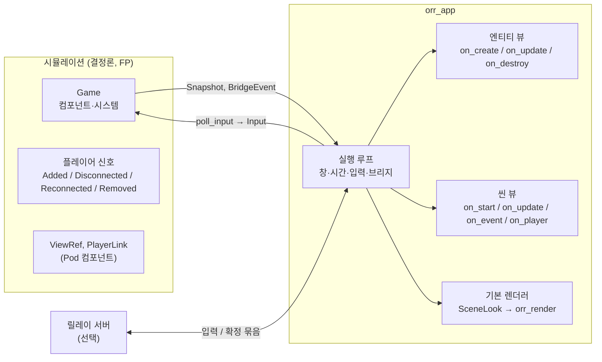
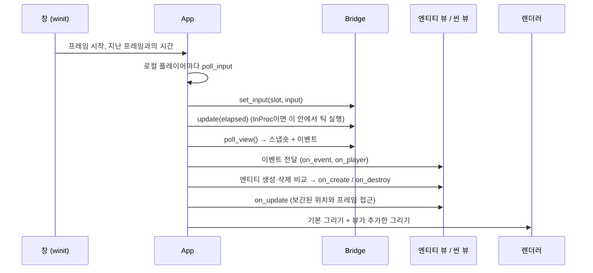
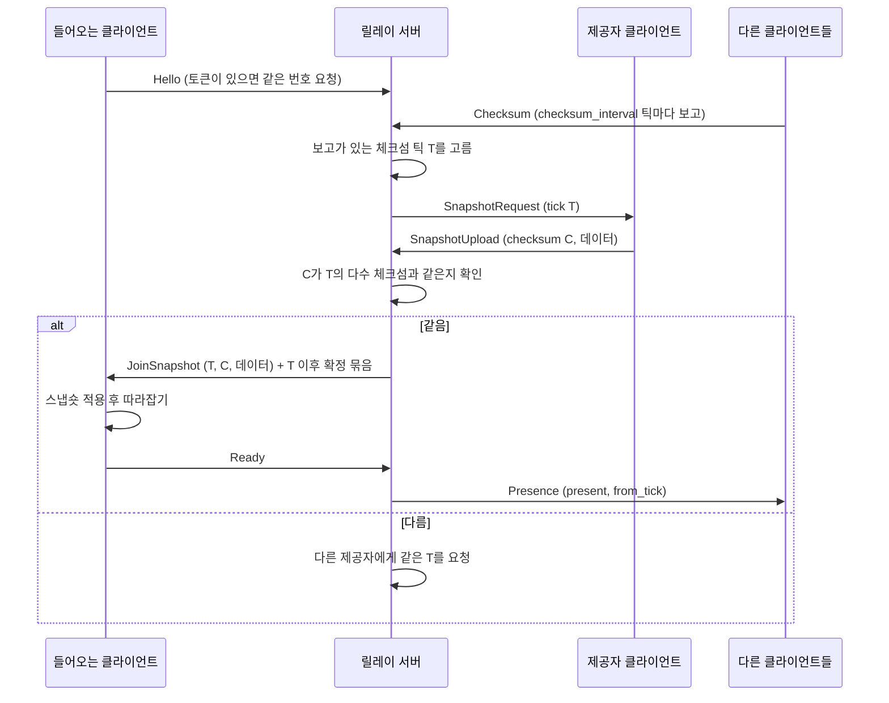

# 뷰 프레임워크 설계 (`orr_app`)

갱신: 2026-11-17 · 상태: 제안 (아직 구현 전) · 관련: [설계 v1](design-v1.md) 4~6장, [getting-started.md](getting-started.md)

## 1. 목표

사용자가 게임 규칙(시뮬레이션)과 화면 코드만 쓰면 창이 뜨고, 입력이 들어가고, 그림이 그려지게 한다. 유니티처럼 엔진이 실행 루프를 맡고, 퀀텀 3처럼 시뮬레이션과 화면을 나눠서 짠다.

지금은 이 층이 없다. 게임마다 창 생성, 입력 처리, 그리기 루프를 직접 짠다(`orr_sample`의 `physics_app.rs`, `defense_app.rs`, `collect_app.rs` 등, 각각 수백 줄). 그래서 처음 배우는 사람이 빈 프로젝트에서 시작해 창에 무언가를 띄우기까지가 길다.

이 문서가 정하는 것:

- 실행 함수와 실행 방식(서버 없이, 로컬 서버, 원격 서버)
- 화면 쪽 구성 단위: 엔티티 뷰, 씬 뷰
- 플레이어 번호, 플레이어 신호, 플레이어별 시작 데이터
- 재접속과 중간 입장, 스냅숏 검증
- 입력 전송 규칙과 비용
- 에디터에서 정하는 값(Authoring)과 프리팹

이 프레임워크가 생기면 [getting-started.md](getting-started.md)에 빈 프로젝트부터 따라 하는 튜토리얼을 더한다(10장).

## 2. 지금 있는 것

새 층은 아래 부품을 묶는다. 부품 자체는 바꾸지 않는 것이 원칙이고, 바꿔야 하는 곳은 각 장에 적는다.

| 부품 | 하는 일 | 위치 |
|---|---|---|
| `Game`, `Simulation` | 결정론 시뮬레이션. 입력은 `TickInputs`로만 들어간다 | `orr_sim` |
| `PlayerSlot(u8)` | 플레이어 번호. 세션 동안 바뀌지 않는다. 입력과 명령이 이 번호에 붙는다 | `orr_sim/src/input.rs` |
| `PlayerFlags` | 이번 틱 입력이 예측값인지(`predicted`), 연결이 끊겼는지(`disconnected`) | `orr_sim/src/input.rs` |
| 세션 | 입력 예측, 롤백, 리플레이, 중간 입장, 퇴장 처리 | `orr_session` |
| `Bridge` | 화면과 시뮬레이션 사이의 유일한 통로. 쓰기는 `set_input`, `send_command`뿐이다 | `orr_bridge` |
| `Snapshot` | `predicted`, `predicted_prev`, `verified` 프레임과 `verified_tick` | `orr_bridge/src/snapshot.rs` |
| `BridgeEvent` | 게임 이벤트(예측·확정·취소)와 세션 알림(`Rollback`, `Stalled`, `Desync`, `Disconnected` 등) | `orr_bridge/src/event.rs` |
| `ViewWorld` | 틱 사이 보간, 롤백으로 생긴 위치 튐 보정. 3가지 보간 방식(`Prediction`, `Snapshot`, `None`) | `orr_view` |
| 그리기 컴포넌트 | `Transform3`, `Material`, `Light`, `Camera`, `Terrain` 등과 그것을 렌더 데이터로 바꾸는 `SceneLook` | `orr_gfx`, `orr_gfx_view` |
| 릴레이 서버 | 시뮬레이션하지 않고 틱마다 입력을 모아 확정 묶음을 보낸다. 중간 입장 스냅숏 중계, 체크섬 비교 | `orr_server`, `orr_proto`, `orr_relay_net` |
| 씬 파일과 리플렉션 | 씬 파일의 엔티티가 곧 시뮬레이션 엔티티다. 에디터 인스펙터가 같은 경로를 쓴다 | `orr_reflect`, `orr_edit` |

## 3. 전체 구조



규칙은 설계 v1과 같다. 화면은 시뮬레이션을 읽기만 한다. 화면에서 시뮬레이션으로 가는 길은 입력과 명령뿐이다.

## 4. 실행 함수

### 4.1 사용 모습

```rust
fn main() -> Result<(), orr_app::Error> {
    orr_app::App::<Pong>::new()
        .scene("scenes/pong.scene.yaml")   // 시작 상태 (없으면 Game::setup만)
        .input(read_keys)                   // 키보드·패드 → Pong::Input
        .entity_view::<Paddle>(PaddleView::default) // Paddle 컴포넌트가 있는 엔티티마다 하나
        .scene_view(Scoreboard::default())  // 화면 전체에 하나
        .run()                              // 실행 방식은 명령줄 인자로 고른다 (4.3)
}
```

사용자가 쓰지 않아도 되는 것: 창, 그래픽 장치, 고정 틱 시계, 브리지 선택, 보간, 기본 조명·카메라·메시·모델 그리기, 창 크기 변경, 종료 처리.

### 4.2 한 프레임의 순서



### 4.3 실행 방식

게임 코드는 세 방식에서 같다. 방식은 `App`의 설정이나 명령줄 인자로 고른다.

| 방식 | 명령 예 | 브리지 | 용도 |
|---|---|---|---|
| 서버 없이 | `my_game` | `InProc` 또는 `Threaded` | 혼자 하기, 한 화면 여러 명 |
| 로컬 서버 | `my_game --host` (서버를 같은 프로세스에서 띄우고 접속), `my_game --connect 127.0.0.1:7777` | 릴레이 클라이언트 | 같은 PC 창 두 개, LAN |
| 원격 서버 | `my_game --connect <주소>` | 릴레이 클라이언트 | 인터넷 |

"한 화면 여러 명"은 서버 없이 실행하면서 로컬 플레이어를 둘 이상 두는 것이다(5장). 로컬 서버와는 다르다.

## 5. 입력

- 게임은 `fn poll_input(ctx: &InputContext, slot: PlayerSlot) -> G::Input`을 준다. `App`이 로컬 플레이어마다 매 프레임 부른다.
- `InputContext`는 키보드, 마우스, 패드 상태와 "이 로컬 플레이어에게 배정된 장치"를 준다. 한 화면 2인이면 1번은 키보드 왼쪽, 2번은 패드처럼 배정한다.
- `Bridge::set_input`은 지금 로컬 슬롯 하나만 받는다. 로컬 플레이어가 여러 명이면 이 제한을 "이 클라이언트에 배정된 슬롯들"로 넓혀야 한다. 바꿀 곳은 `orr_bridge`와 세션의 로컬 입력 경로다.
- 일회성 명령(구매, 건설)은 `ctx.send_command(cmd)`로 보낸다. 지금의 `Bridge::send_command`와 같다.

## 6. 엔티티 뷰

시뮬레이션 엔티티 하나에 화면 객체 하나가 붙는다. 퀀텀의 `EntityView`에 해당한다.

```rust
pub trait EntityView<G: Game> {
    fn on_create(&mut self, ctx: &mut ViewContext<G>, entity: Entity) {}
    fn on_update(&mut self, ctx: &mut ViewContext<G>, entity: Entity, pose: &Pose) {}
    fn on_destroy(&mut self, ctx: &mut ViewContext<G>, entity: Entity) {}
}
```

- **붙이는 기준:** 두 가지를 지원한다.
  - 컴포넌트 필터: `entity_view::<Paddle>(...)`은 `Paddle` 컴포넌트를 가진 엔티티마다 뷰를 만든다.
  - `ViewRef` 컴포넌트: 시뮬레이션에 뷰 에셋 번호를 넣는다(11장). 같은 컴포넌트 구성이라도 엔티티마다 다른 모델·소리를 붙일 때 쓴다. 퀀텀의 `View` 컴포넌트와 같다.
- **기준 프레임:** 생성과 삭제는 예측 프레임을 기준으로 판단한다. 반응이 즉각적이기 때문이다.
- **롤백 때:** 예측으로 생겼던 엔티티가 롤백으로 사라지면 `on_destroy`가 불린다. 엔티티 키는 `(번호, 버전)`이라 같은 번호가 재사용되어도 다른 엔티티로 다룬다(`ViewWorld`와 같은 규칙).
- **위치:** `pose`는 `ViewWorld`가 보간하고 롤백 튐을 보정한 값이다. 보간 방식은 뷰마다 고른다. 기본은 `Prediction`이다.
- **기본 뷰:** `Transform3`과 `Material`(또는 모델 참조)이 있는 엔티티는 사용자가 뷰를 붙이지 않아도 기본 렌더러가 그린다. 사용자 뷰는 그 위에 효과, 소리, UI를 더한다.

## 7. 씬 뷰

화면 전체에 하나씩 있는 객체다. 퀀텀의 `SystemView`, `QuantumCallback`에 해당한다.

```rust
pub trait SceneView<G: Game> {
    fn on_start(&mut self, ctx: &mut ViewContext<G>) {}
    fn on_update(&mut self, ctx: &mut ViewContext<G>) {}
    fn on_event(&mut self, ctx: &mut ViewContext<G>, event: &G::Event, state: EventState) {}
    fn on_player(&mut self, ctx: &mut ViewContext<G>, signal: PlayerSignal) {}
    fn on_session(&mut self, ctx: &mut ViewContext<G>, note: Lifecycle) {}
    fn on_resync(&mut self, ctx: &mut ViewContext<G>) {}
}
```

`ViewContext`가 주는 것:

| 메서드 | 내용 |
|---|---|
| `predicted()` | 예측 프레임(가장 최신). 그리기와 즉각 반응에 쓴다 |
| `verified()` | 확정 프레임. 점수, 승패처럼 되돌아가면 곤란한 표시에 쓴다 |
| `query::<(&A, &B)>()` | 예측 프레임에서 컴포넌트 조합으로 엔티티를 고른다 |
| `local_players()`, `is_local(slot)` | 이 클라이언트의 플레이어 번호들 |
| `tick()`, `verified_tick()` | 현재 예측 틱과 확정 틱 |
| `send_command(cmd)` | 일회성 명령 |
| `draw()` | 기본 렌더러에 선, 글자, 추가 메시를 더한다 |

`EventState`는 `Predicted`, `Verified`, `Canceled` 중 하나다(지금의 `EventStatus`와 같은 의미). 권장 사용법:

- 효과음, 파티클: `Predicted`에서 시작하고 `Canceled`면 멈춘다.
- 업적, 통계, 서버 보고: `Verified`에서만 처리한다.
- 브리지가 이벤트를 버리고 복구하면(`ViewResync`, 옛 `BridgeEvent::ViewResynced`) 이전 `Predicted`는 모두 잊혀서 `Verified`도 `Canceled`도 오지 않는다. 그때 `on_resync`가 그 프레임의 이벤트보다 먼저 한 번 불린다. 추측으로 시작한 효과를 멈추고 `ctx.predicted()`/`ctx.verified()`로 다시 만든다. 엔티티 뷰에는 따로 알리지 않는다. 매 프레임 예측 프레임과 비교하기 때문이다.

## 8. 플레이어

### 8.1 플레이어 번호

`PlayerSlot`을 컴포넌트에 넣을 수 있게 바꾼다.

- `bytemuck::Pod`와 리플렉션 등록을 더한다. 씬 파일과 인스펙터에 번호로 보인다.
- "플레이어 없음"을 나타내는 값을 정한다. `0xFF`를 쓴다. 릴레이 프로토콜의 `NO_SLOT`과 같은 값이다.
- 표준 컴포넌트 `PlayerLink { player: PlayerSlot }`을 둔다. "이 엔티티는 몇 번 플레이어 것"을 나타낸다. 화면은 `ctx.is_local(link.player)`로 내 캐릭터를 안다.

### 8.2 플레이어 신호

지금 시뮬레이션은 틱마다 `PlayerFlags::disconnected`만 받는다. 게임이 상태가 바뀐 순간을 알려면 직접 비교해야 한다. 다음 네 신호를 시뮬레이션 입력에 더한다.

| 신호 | 언제 | 게임이 하는 일 예 |
|---|---|---|
| `PlayerAdded { slot, data }` | 처음 들어옴 | 프리팹으로 아바타 생성 |
| `PlayerDisconnected { slot }` | 서버가 끊김으로 판정함 | 캐릭터 멈춤, AI가 대신 조종 |
| `PlayerReconnected { slot }` | 같은 번호로 돌아옴 | 조종권 반환 |
| `PlayerRemoved { slot }` | 자리 보관 시간이 지나 완전히 나감 | 아바타 삭제, 소유물 넘기기 |

- 신호는 `TickInputs`에 틱 단위로 실린다. 모든 클라이언트가 같은 틱에 같은 신호를 받으므로 결정론이 유지된다.
- 릴레이 서버의 입장·퇴장 알림 `Presence { slot, present, from_tick }`는 지금 확정 묶음과 따로 신뢰 채널로 간다. 클라이언트는 이 알림을 `from_tick`의 `TickInputs`에 신호로 넣는다. 그 틱을 이미 예측으로 지나갔다면 일반 입력 오예측과 같이 롤백한다. (4b) `Presence`만으로는 `Reconnected`와 `Removed`를 말할 수 없어서 프로토콜 v3에 `SeatChange { slot, change, from_tick }`(종류 13)를 더했다. `Presence`는 그대로다. 표는 [crates/orr_app/README.md](../crates/orr_app/README.md)의 "서버가 보내는 신호". 신호는 신뢰 채널로, 확정 묶음은 비신뢰 채널로 와서 순서가 보장되지 않으므로 프로토콜 v4에 신호 울타리를 두었다. 서버가 신호에 방 안 순번(1부터)을 매겨 `Presence`/`SeatChange`에 싣고, 확정 묶음마다 "이 틱까지 적용되는 신호 개수"(`Bundle::signals`)를 싣는다. 클라이언트는 그 개수만큼 신호를 다 받기 전에는 그 묶음을 세션에 넘기지 않아(검증하지 않아) 신호가 늦으면 검증이 늦어질 뿐이다. 늦참가는 `JoinSnapshot`의 개수로 시작하고 스냅샷 이후 신호는 서버가 순번과 함께 다시 보낸다. 그래도 이미 검증한 틱의 신호가 오면 `ClientEvent::SignalLate`와 함께 클라이언트가 실패한다.
- `Disconnected`와 `Removed`의 구분은 서버의 자리 보관 기능을 쓴다. 지금 서버는 나간 플레이어의 자리를 토큰과 함께 `reserve_ticks` 동안 보관한다. 보관 중이면 `Disconnected`, 보관이 끝나면 `Removed`다.
- 서버 없이 실행하면 `App`이 첫 틱(틱 1)에 모든 플레이어 슬롯마다 `PlayerAdded`를 넣는다(구현: `PlayHost::with_announced_players`).
- 구현 메모(4a): 신호는 `RawPlayerSignal`(종류, 슬롯, 시작 데이터 바이트)로 `TickInputs`에 실리고, 게임의 `systems()` 맨 앞에 `player_signals::<G>()`를 넣으면 `Players::on_player`가 불린다. 뷰는 `BridgeEvent::Player`로 `Predicted`/`Verified`/`Canceled`를 받는다.

### 8.3 플레이어별 시작 데이터

퀀텀의 `RuntimePlayer`에 해당한다. 이름, 고른 캐릭터, 색처럼 플레이어가 들어올 때 정해지는 값이다.

- 게임이 선택적으로 구현하는 트레이트에 연관 타입으로 둔다. 기존 `Game` 구현은 바꾸지 않아도 된다.

```rust
pub trait Players: Game {
    type Player: Pod + Default;   // 고정 크기. 문자열은 고정 길이 바이트로
    fn on_player(frame: &mut Frame, signal: PlayerSignal<Self::Player>);
}
```

- 값은 접속할 때 클라이언트가 서버로 보낸다. 서버는 `PlayerAdded` 신호에 실어 모두에게 보낸다. 시뮬레이션 안에서는 신호의 일부이므로 결정론 입력이다.
- 서버는 이 값의 내용을 검사하지 않는다(릴레이 방식). 검사가 필요한 게임은 시뮬레이션 안에서 범위를 확인한다.

## 9. 재접속과 중간 입장

### 9.1 정책

| 항목 | 결정 |
|---|---|
| 따라잡는 방법 | 확정 스냅숏을 받는다. 처음부터 다시 시뮬레이션하는 방법은 리플레이와 검증에만 쓴다 |
| 스냅숏을 주는 쪽 | 플레이 중인 클라이언트 한 명(제공자). 지금 서버의 방식 그대로다 |
| 스냅숏 검증 | 서버가 같은 틱에 다른 클라이언트들이 보고한 체크섬의 다수 값과 비교한다. 같을 때만 넘긴다 |
| 검증 실패 | 그 제공자를 제외하고 다른 제공자에게 다시 요청한다. `Desync` 알림을 남긴다 |
| 같은 번호로 복귀 | 자리 보관 토큰이 맞으면 같은 번호를 준다. 아바타는 그대로 남아 있다 |

처음부터 다시 시뮬레이션하는 방법은 경기가 길수록 느려지고, 서버가 입력 기록 전체를 보관해야 한다. 그래서 기본으로 쓰지 않는다.

### 9.2 흐름



바꿀 곳:

- **체크섬 틱 맞추기:** 클라이언트는 `checksum_interval` 틱마다 체크섬을 보고한다. 서버는 스냅숏 틱 `T`를 그 간격에 맞춘 틱으로 고르고 `SnapshotRequest`에 싣는다. 그래야 비교할 체크섬이 있다.
- **비교 대상 부족:** 비교할 다른 클라이언트가 없으면(2인 게임에서 한 명이 재접속) 검증 없이 넘긴다. 이 경우는 결과에 "검증 안 됨"으로 남긴다.

구현(5단계, `orr_server/src/room.rs`의 `judge_snapshot`):

- **T는 서버가 정한다.** `SnapshotRequest`는 틱 `T`를 싣는다(`Room::snapshot_tick`). `T`는 (1) 체크섬 간격의 배수이고 0이 아니며, (2) 제공자가 보고한 틱이고(그래서 제공자에게 그 프레임이 있다), (3) 서버가 `T` 이후 확정 묶음을 모두 가지고 있고, (4) 제공자와 입장하는 클라이언트를 뺀 플레이어 중 절반을 넘는 수가 보고한 틱이다. 이 조건을 모두 만족하는 가장 새 틱을 고른다. 뺄 플레이어가 없으면(2인 게임) 조건 (4)는 없다. 올리는 쪽이 `T`를 고르지 못하므로 비교를 피할 수 없다.
- **제공자의 프레임.** 제공자(`RelayClient::serve_snapshot`)는 `T`의 검증된 프레임을 앵커(`keep_anchors`, 기본 3개의 최근 체크섬 틱 프레임, 또는 스스로 입장한 클라이언트의 기준 앵커)에서 찾아 올린다. `SnapshotUpload`는 틱을 싣지 않는다. 서버가 `T`를 알기 때문이다. 앵커에 `T`가 없으면(`keep_anchors = 0`이거나 너무 오래됐으면) `SnapshotDecline`으로 거절한다. 서버는 그 제공자를 이번 입장에서 제외하고 다음 제공자에게 요청한다. 제공자가 남지 않으면 `Reject(NoDonor)`다.
- **표결.** 서버는 올라온 체크섬 `C`를 한 표로 치고, 다른 클라이언트들이 `T`에 보고한 체크섬을 나머지 표로 센다. `C`와 같은 표가 전체의 절반을 넘으면 넘긴다. 3인 게임에서 한 명이 틀려도 정상 제공자가 거부되지 않는다. 혼자 다른 제공자는 거부된다.
- **기다림 없음.** `T`를 고를 때 이미 다른 클라이언트의 보고가 있으므로, 올라온 스냅숏은 바로 판정한다. 고를 수 있는 `T`가 아직 없으면(경기가 막 시작해서 첫 체크섬 보고 전, 또는 아직 보고가 모자랄 때) 입장은 `Checksum` 메시지가 올 때마다 다시 시도한다. `join_timeout_ticks` 안에 `T`를 못 고르면 `Reject(JoinTimedOut)`이다.
- **거부.** 거부하면 `ServerNote::SnapshotRejected`를 남긴다. 제공자는 `T`의 체크섬을 이미 보고했으므로 `Desync` 알림은 그 보고에서 나간다. 그 제공자를 이번 입장에서 제외하고 다음 제공자에게 요청한다. 제공자가 남지 않으면 기존 입장 실패 경로대로 입장하는 클라이언트가 `Reject(NoDonor)`를 받는다.
- **검증 안 됨 표시.** `ServerNote::SnapshotRelayed::verified`와 `RoomStats::snapshots_unverified`에 남는다.
- **데이터 확인.** 서버는 데이터에서 체크섬을 다시 계산하지 못한다. 컴포넌트 목록은 게임이 정하기 때문이다. 서버는 `C`만 다수와 비교한다. 입장하는 클라이언트가 프레임을 읽어 틱과 체크섬이 `C`와 같은지 확인하고(`Session::from_relay_snapshot`), 다르면 입장이 실패한다.

## 10. 입력 전송

### 10.1 규칙

- 클라이언트는 매 틱 입력을 보낸다. 입력이 없으면 기본값을 보낸다. 아무것도 보내지 않으면 서버는 "가만히 있음"과 "연결 끊김"을 구분할 수 없다.
- 서버는 틱마다 마감 시각에 그 틱을 확정한다. 입력이 안 온 플레이어는 직전 입력을 쓰고 "반복됨" 표시를 붙인다. 빈자리는 `VacantPolicy`를 따른다.
- 클라이언트는 상대 입력이 오는지 판단하지 않는다. 확정 묶음이 오면 상대 입력은 정해진 것이다. 묶음이 끊기면 내 네트워크나 서버 문제다(`Ping`/`Pong`, `TimeSync`로 확인).
- 끊김은 서버가 판정한다. 한 클라이언트에게서 정해진 시간 동안 패킷이 오지 않으면 자리를 비우고 `Presence`를 보낸다(8.2). 이 시간은 `RoomConfig`에 둔다.

### 10.2 비용

이미 있는 장치:

- 클라이언트는 아직 확인받지 못한 최근 입력 K개를 패킷마다 함께 보낸다. 패킷 하나를 잃어도 다음 패킷이 메운다.
- 서버의 확정 묶음은 직전 묶음과 같은 입력이면 입력 바이트를 빼고 표시 1바이트만 보낸다. 묶음은 `bundle_redundancy` 번 반복해서 보낸다.

더할 것:

1. **클라이언트 입력의 "직전과 같음" 표시.** 확정 묶음과 같은 방식으로 클라이언트 입력 항목에도 넣는다. 입력이 자주 바뀌지 않는 게임에서 입력 바이트가 거의 사라진다. 프로토콜 버전을 올린다. **(5단계에서 구현)**
2. **두 틱 묶어 보내기(선택).** 패킷 수가 절반이 되고 입력 지연이 1틱 늘어난다. 게임이 고른다. **(5단계에서 하지 않았다. 아래 "남은 것")**

하지 않을 것: "변화 없음"을 가끔만 보내는 방식. 입력이 바뀐 패킷을 잃으면 서버가 옛 입력으로 확정해 실제 조작이 무시된다.

#### 구현한 규칙

입력 패킷(`ClientMsg::Input`)은 항목마다 이렇게 쓴다.

| 부분 | 내용 |
|---|---|
| 플래그 1바이트 | `INPUT_SAME`(직전 항목과 입력이 같음), `INPUT_HAS_COMMANDS`(명령이 따라옴) |
| 틱 | 첫 항목은 `u64`. 다음 항목은 직전 항목과의 차이 1바이트(255는 `u64` 탈출) |
| 입력 바이트 | `INPUT_SAME`이 아닐 때만 |
| 명령 | `INPUT_HAS_COMMANDS`일 때만 |

**손실에 안전한 이유.** "직전"은 같은 패킷 안의 바로 앞 항목이다. 이전 패킷이나 서버가 확인한 상태를 보지 않는다. 그래서 패킷 하나는 혼자서 해석된다. 패킷을 잃거나 순서가 바뀌거나 두 번 와도 서버가 잘못된 입력을 만들 수 없다. 잃은 틱은 다음 패킷이 다시 싣는다(미확인 입력 K개). 패킷의 첫 항목은 항상 입력 바이트를 모두 싣는다. 그래서 입력이 변하지 않는 동안에도 패킷마다 입력 한 벌은 간다. 이 한 벌이 있어서 패킷 하나만 도착해도 그 패킷의 모든 틱을 알 수 있다.

**프로토콜 버전은 하나다.** 개발 중이라 하위 호환을 두지 않는다. `PROTOCOL_VERSION`(지금 6)은 하나이고, 모든 메시지를 그 버전으로 쓴다. 디코더는 다른 버전을 `ProtoError::UnsupportedVersion`으로 거절한다. 와이어 형식을 바꾸면 버전을 올린다. `Hello`는 별도 필드 없이 헤더의 버전이 클라이언트가 말하는 버전이다. 서버는 `Hello`를 읽지 못하면(헤더 버전이 다르면) `Reject(BadVersion { server, client })`로 돌려보낸다. `server`는 서버의 버전, `client`는 `Hello` 헤더의 버전이다. 헤더 버전은 체크섬보다 먼저 검사한다. 선택 필드는 없다. 예전에 "있을 때만 쓰던" 끝 필드(`Welcome::flags`, `JoinSnapshot`의 신호 수, `Presence`와 `SeatChange`의 `seq`, `Confirmed`의 신호 수 꼬리)는 항상 쓴다. 신호가 없는 `Confirmed`는 꼬리가 2바이트(신호 수 0, 바뀜 0) 늘었다.

#### 잰 바이트

`orr_server/tests/relay_input_bytes.rs`가 재고, `cargo test --release -p orr_server --test relay_input_bytes -- --nocapture`로 다시 볼 수 있다. 조건은 아래와 같다. 60틱/초, 입력 24바이트(`ArenaInput`), 명령 없음, K=4(`input_redundancy` 기본값), 손실 없는 네트워크, 틱 300~1500의 20초 평균. 입력 바이트는 클라이언트가 보낸 입력 패킷의 인코딩 길이다. 패킷은 틱마다 하나 나간다.

| 장면 | 패킷 크기 (전 → 후) | 입력 바이트/초 (전 → 후) | 줄어든 비율 |
|---|---|---|---|
| 가만히 있음 | 178 → 70 B | 10,680 → 4,200 | 61% |
| 매 틱 바뀜 | 178 → 142 B | 10,680 → 8,520 | 20% |
| 보통(약 10틱마다 바뀜) | 178 → 77.2 B | 10,680 → 4,632 | 57% |

- 인원 수(2명, 4명)는 올려 보내기 바이트를 바꾸지 않는다. 위 표는 둘 다 같은 값이었다. 인원에 따라 느는 쪽은 내려받기(확정 묶음)다. 2명과 4명일 때 클라이언트당 내려받기는 가만히 있음 6.6/10.1 KB/s, 매 틱 바뀜 18.1/33.1 KB/s, 보통 7.7/12.4 KB/s다.
- 클라이언트당 올려 보내기 전체(핑·체크섬 포함)는 가만히 있음 10,878 → 4,398 B/s, 매 틱 바뀜 10,878 → 8,718 B/s, 보통 10,878 → 4,830 B/s다.
- 매 틱 바뀔 때의 20%는 "직전과 같음"이 아니라 항목 형식이 작아진 덕이다(명령 개수 4바이트 제거, 틱을 차이 1바이트로). 입력이 다른 항목 하나가 36바이트에서 26바이트로 줄고(패킷의 첫 항목은 33바이트), 같은 항목은 2바이트다.
- 앞 절의 예상치(2~3 KB/s)는 틀렸다. K=4개를 매 틱 다시 보내는 값이 빠져 있었다. 처음 값은 10.7 KB/s였다.
- 남은 비용은 대부분 패킷 머리(약 30바이트: 매직·버전·종류·확인 틱·입력 크기·체크섬)와 첫 항목의 입력 한 벌이다. 가만히 있을 때 70바이트 중 이 둘이 64바이트다.

## 11. 에디터에서 정하는 값(Authoring)과 프리팹

퀀텀은 유니티 게임 오브젝트를 시뮬레이션 엔티티로 바꾸는 단계가 따로 있다. 이 엔진은 씬 파일의 엔티티가 곧 시뮬레이션 엔티티이고, 인스펙터가 리플렉션으로 같은 값을 고친다. 그래서 별도 변환 층은 만들지 않는다. 더할 것은 두 가지다.

- **`ViewRef` 컴포넌트:** 시뮬레이션에 들어가는 Pod 컴포넌트로, 뷰 에셋의 번호(`u64`)를 가진다. 인스펙터에서 프로젝트의 뷰 에셋 목록 중 하나를 고른다. 뷰 에셋은 모델, 머티리얼, 소리, 엔티티 뷰 종류를 묶은 파일이다. 시뮬레이션은 이 번호를 읽기만 하고 뜻은 모른다.
- **프리팹 생성:** 시뮬레이션 시스템이 프리팹 하나로 엔티티를 만드는 경로. 예: `PlayerAdded`를 받아 아바타 프리팹을 만든다. 프리팹은 씬 파일 조각을 미리 구워 둔 바이트로 저장한다. 그래서 시뮬레이션 안에서 파일을 읽지 않는다. 씬 파일의 연결 프리팹(`orr_reflect` scene `linked`)과 같은 데이터를 쓸 수 있는지 구현 단계에서 확인한다.

### 구현한 모양 (6b)

- **번호와 파일.** `ViewRef { asset: u64 }`는 `orr_gfx`에 있다(`register_view_ref`로 켠다. `orr_gfx::register`에 넣으면 그 게임들의 프레임 배치와 골든 체크섬이 바뀐다). 번호는 뷰 에셋 파일 경로의 FNV-1a 64비트 해시(`orr_reflect::asset_id`, 0은 "없음")라서 사람이 번호를 정하지 않는다. 뷰 에셋은 `*.orrview` JSON 파일(버전 1: `model`, 선택 `name`, `scale`, `tint`, `sound`, `entity_view`)이고, `orr_gfx_view::ViewAssets::load_dir`가 읽는다. 번호가 겹치거나 모델 파일이 없으면 오류다.
- **인스펙터.** 리플렉션에 정수 필드용 `#[reflect(asset_id = "view")]`를 더했다(`Kind::Int`의 `asset`). 인스펙터는 이 필드를 씬 폴더의 `*.orrview` 파일 이름 목록에서 고르는 콤보 박스로 보여 준다. 번호에 맞는 파일이 없으면 "missing asset (번호)"를 보여 준다.
- **그리기.** `Look3D::assets(..)`에 뷰 에셋을 주면 `Transform3`과 `ViewRef`가 있는 엔티티가 모델로 그려진다. 에셋을 찾지 못한 엔티티는 자리 표시 상자로 남는다. 모델은 `ImportedSceneRenderer`로 도형과 한 장에 합성한다(MSAA와 톤 매핑 없음).
- **프리팹.** 프리팹 목록은 `Game::setup`에서 프레임 안(`orr_ecs::prefab`의 `PrefabLibrary`)에 복사한다. 시스템과 `Players::on_player`는 게임의 `Config`를 볼 수 없고, 프레임에 넣으면 스냅숏, 체크섬, 중간 입장, 롤백 재시뮬레이션, 리플레이가 따로 일하지 않아도 같은 엔티티를 만든다. 굽는 길은 `Prefab::with`(코드) 또는 `Scene::bake_prefabs`(씬 조각, 엔티티 하나가 프리팹 하나)다. 편집용 `linked` 프리팹은 원본 스냅숏을 검증하는 메타데이터라서 쓰지 않고 같은 씬 형식만 쓴다.

## 12. 작업 순서

| 단계 | 내용 | 끝났다는 기준 |
|---|---|---|
| 1 (완료) | `orr_app` 실행 함수, 기본 렌더러, 서버 없이 실행 | 2D 물리 데모 하나를 `orr_app` 위로 옮겨 같은 화면이 나온다. 쓰는 법과 정한 것은 [crates/orr_app/README.md](../crates/orr_app/README.md), 예제는 `orr_app/examples/physics2d.rs`. 같은 틱의 그림이 기존 물리 샘플의 그리기 경로와 바이트까지 같다 |
| 2 (완료) | 엔티티 뷰, 씬 뷰, 이벤트 상태, 예측·확정 프레임 접근 | 롤백이 나는 장면에서 `on_create`/`on_destroy`와 이벤트 취소가 맞게 불린다(테스트). 쓰는 법은 [crates/orr_app/README.md](../crates/orr_app/README.md), 코드는 `orr_app/src/views.rs`, 테스트는 `orr_app/tests/views.rs`(롤백이 나는 두 세션). 뺀 것: `ViewContext::query`, `draw()`, `on_player`(4단계), `App::threaded()` |
| 3 (완료) | `PlayerSlot` Pod·리플렉션, `PlayerLink`, 로컬 플레이어 여러 명 | 한 화면 2인 예제가 돈다. 쓰는 법은 [crates/orr_app/README.md](../crates/orr_app/README.md), 예제는 `orr_app/examples/physics2d_coop.rs`(WASD와 방향키). 코드는 `orr_sim/src/input.rs`(`PlayerSlot::NONE`, `PlayerLink`), `orr_bridge`(`Bridge::local_slots`, `PlayHost::with_extra_local_slots`). 테스트는 `orr_sim/tests/player_link.rs`, `orr_bridge/tests/local_slots.rs`. 뺀 것: 패드 입력(키보드만), 서버 쪽 여러 슬롯 클라이언트(릴레이·네트워크 클라이언트는 슬롯 하나), `Threaded`로 여러 로컬 슬롯을 쓰는 `App` 경로, 여러 슬롯의 `Step` 입력 캡처(첫 슬롯만) |
| 4a (완료) | 신호·`Players`·오프라인: `PlayerSignal`을 입력(`TickInputs`)과 리플레이에 싣고, `Players` 트레이트, 서버 없이 첫 틱의 `Added`, `SceneView::on_player` | 신호가 `on_player`에 같은 틱으로 들어가고 리플레이에서도 같다. 이미 예측한 틱에 신호가 늦게 와도 롤백 후 체크섬이 같다(테스트). 쓰는 법은 [crates/orr_app/README.md](../crates/orr_app/README.md), 코드는 `orr_sim/src/signal.rs`, `orr_session`(`Session::schedule_signal`, `PlaySession::push_signal`, 리플레이 형식 4), `orr_bridge`(`BridgeEvent::Player`). 남은 것은 4b |
| 4b (완료) | 서버의 자리 변경을 `Session::schedule_signal(from_tick, ..)`로 잇기, `--host`/`--connect`, 재접속 | 서버와 클라이언트 둘로 한 쪽이 끊겼다 토큰으로 돌아오면 두 쪽이 같은 틱에 `Disconnected` → `Reconnected`를 받고 체크섬이 같다. 보관 시간이 끝나면 `Removed`, 새로 들어온 플레이어는 모두에게 같은 틱의 `Added`(`orr_server/tests/player_signals.rs`, 손실·재정렬이 있는 시뮬레이션 네트워크). 진짜 소켓의 창 두 개는 `orr_app/src/net.rs` 테스트. 쓰는 법은 [crates/orr_app/README.md](../crates/orr_app/README.md)의 "서버로 실행", 예제는 `orr_app/examples/roster.rs`와 `physics2d_coop.rs`. 코드는 `orr_proto`(`SeatChange`), `orr_server/src/room.rs`(`announce_seat`, 자리 기록, `signal_lead_ticks`), `orr_session/src/relay.rs`(`RelayClient::take_signal_notes`), `orr_bridge`(`RelayHost`), `orr_app/src/net.rs`. 뺀 것: 플레이어별 시작 데이터(`Added.data`는 비어 있음), 권한 있는 서버 방의 신호, 원격 뷰 스트림의 신호 전달, `.scene(..)`과 `--connect`, QUIC |
| 5 (완료) | 스냅숏 체크섬 다수 검증, 클라이언트 입력 "직전과 같음" 표시 | `netsim` 테스트로 조작된 스냅숏이 거부되고, 입력 바이트 감소량을 기록한다. 스냅숏 검증은 9.2, 입력 표시와 잰 바이트는 10.2에 쓴다. 코드는 `orr_server/src/room.rs`(`snapshot_tick`, `judge_snapshot`), `orr_proto/src/msg.rs`, `orr_session/src/relay.rs`(`serve_snapshot`, `SourceStats::input_bytes_sent`). 테스트는 `orr_server/tests/relay_scenarios.rs`(조작된 제공자, 2인 재접속, 프레임이 없는 제공자), `relay_input_same.rs`(손실·중복·재정렬, `Hello` 버전), `relay_input_bytes.rs`(바이트), `orr_proto`의 `msg` 단위 테스트. 이후 프로토콜 버전을 하나(6)로 합치고 `SnapshotRequest`에 서버가 고른 틱을 실었다(9.2). 남은 것: 서버가 데이터에서 체크섬을 다시 계산하지 않는다(입장하는 클라이언트가 확인한다). 두 틱 묶어 보내기는 하지 않았다. 입력 패킷 머리(약 31바이트)와 틱·확인 틱의 고정 8바이트는 줄이지 않았다. 위조된 데이터에 정직한 체크섬을 붙인 업로드는 서버가 아니라 입장하는 클라이언트가 거부한다(입장 실패) |
| 6a (완료) | 기본 3D 렌더러: `App::view3d`, `View3D`, `Look3D` | `Transform3`과 `Material`(또는 `Body`와 `Collider`)이 있는 엔티티가 뷰 코드 없이 그려진다. Yard3D 예제가 17줄로 돈다. `--screenshot --ticks 300` 그림이 Yard3D 샘플의 그리기 경로와 픽셀까지 같다. 쓰는 법은 [crates/orr_app/README.md](../crates/orr_app/README.md)의 "3D", 코드는 `orr_app/src/view3d.rs`, `app.rs`(`Display`), `views.rs`(`on_update3`, `dispatch3`), 예제는 `orr_app/examples/yard3d.rs`. 테스트는 `view3d.rs`의 단위 테스트(추출, 그리기 목록, 카메라)와 `orr_app/tests/views.rs`(3D 포즈). 뺀 것: `Material` 표면 셰이더, 후처리·하늘·물·지형, 3D 마우스 입력, 렌더러 설정 옵션 |
| 6b (완료) | `ViewRef`, 뷰 에셋, 프리팹 생성 | 인스펙터에서 뷰 에셋을 고르면 그 모델이 그려진다. `PlayerAdded`로 아바타 프리팹이 생긴다 → 인스펙터 선택기와 `Look3D`의 모델 그리기, `Lobby` 게임의 `PlayerAdded` 프리팹을 각각 확인했다(아래 "남은 것"에 에디터 뷰포트가 있다). 쓰는 법은 [crates/orr_app/README.md](../crates/orr_app/README.md)의 "ViewRef, 뷰 에셋, 프리팹", 예제는 `orr_app/examples/avatars.rs`(두 플레이어가 한 화면, `--host`/`--connect`도 된다). 코드는 `orr_gfx`(`ViewRef`), `orr_reflect`(`asset_id`, `Kind::Int.asset`, `Scene::bake_prefabs`), `orr_ecs/src/prefab.rs`, `orr_gfx_view/src/view_asset.rs`, `orr_app/src/view3d.rs`(`ModelDraw`)와 `models.rs`, `orr_editor/src/inspector.rs`, `orr_testgame/src/lobby.rs`. 테스트는 `orr_ecs`의 prefab 단위 테스트, `orr_gfx/tests/view_ref.rs`, `orr_testgame/tests/lobby.rs`, `orr_session/tests/prefab_spawn.rs`(리플레이, 늦게 온 신호의 롤백 재시뮬레이션), `orr_app/tests/avatars.rs`와 `view3d.rs`(창 없는 그리기 목록), `orr_editor/tests/inspector_view_asset_pick.rs`(선택기). 뺀 것: 에디터 뷰포트의 `ViewRef` 모델 그리기와 `ViewRef`를 등록한 에디터 게임, 뷰 에셋의 `tint`/`sound`/`entity_view`(읽기만 함)와 `App::entity_view_for("종류", ..)`, 모델 그림의 MSAA와 톤 매핑, 애니메이션 모델, `Added.data`(서버로 실행할 때 비어 있음) |
| 7 | 튜토리얼 | 빈 프로젝트 → 혼자 하기 → 한 화면 2인 → 로컬 서버 2창 → 재접속까지, 단계별 예제가 모두 빌드되고 테스트로 확인된다 |

각 단계는 짧은 브랜치 하나로 진행하고 끝나면 `main`에 합친다([AGENTS.md](../AGENTS.md)의 Delivery rules).

## 13. 아직 정하지 않은 것

- **이름:** `orr_app`, `EntityView`, `SceneView`, `ViewRef`, `PlayerLink`, `Players`는 가칭이다. 단계 1에서 확정한다.
- ~~**2D와 3D 렌더러 묶기**~~ (정했다, 6a): 2D(단계 1)와 3D(6a) 기본 렌더러가 둘 다 있다. 한 실행은 `App::view`(2D)와 `App::view3d`(3D) 중 하나만 쓰고, 둘 다 주면 `run()`이 창을 열기 전에 오류를 낸다. 둘을 한 화면에 섞는 것(3D 위에 2D 겹치기)은 하지 않았다.
- **웹과 모바일:** `orr_app`의 창 루프를 웹 워커와 안드로이드에서도 쓸지. 지금 `orr_web`, `orr_web_gpu`는 따로 루프를 가진다.
- **서버가 직접 시뮬레이션하는 모드:** `orr_server`의 Authoritative 모드가 있으면 스냅숏 제공자를 서버로 바꿀 수 있다. 이 문서는 릴레이 모드만 다룬다.
- **끊김 판정 시간:** 기본값(예: 2초)과 게임별 조정 범위.
