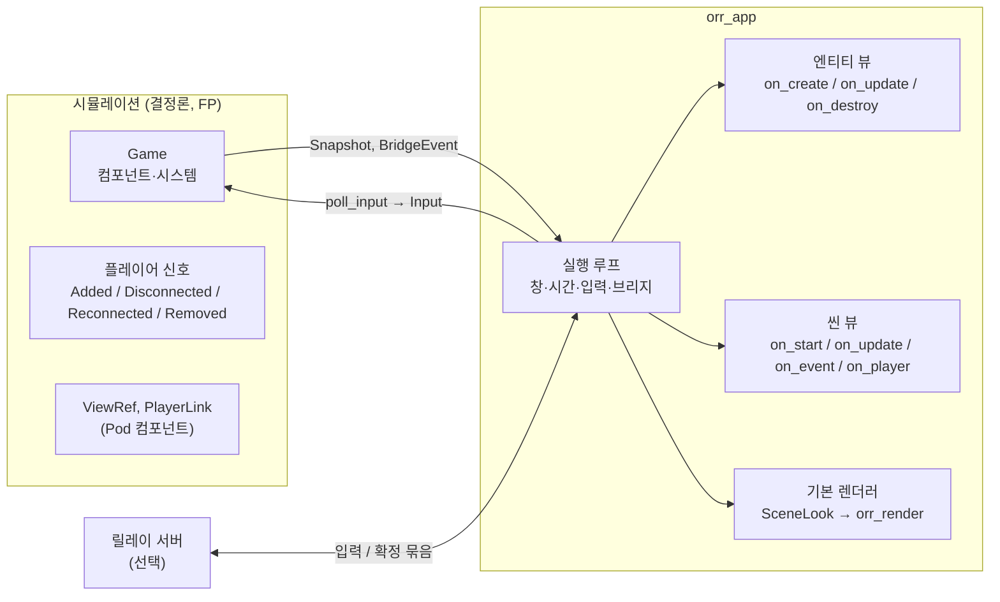
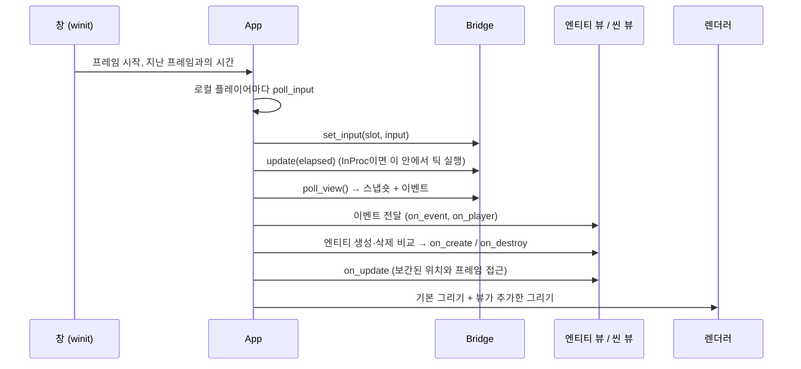
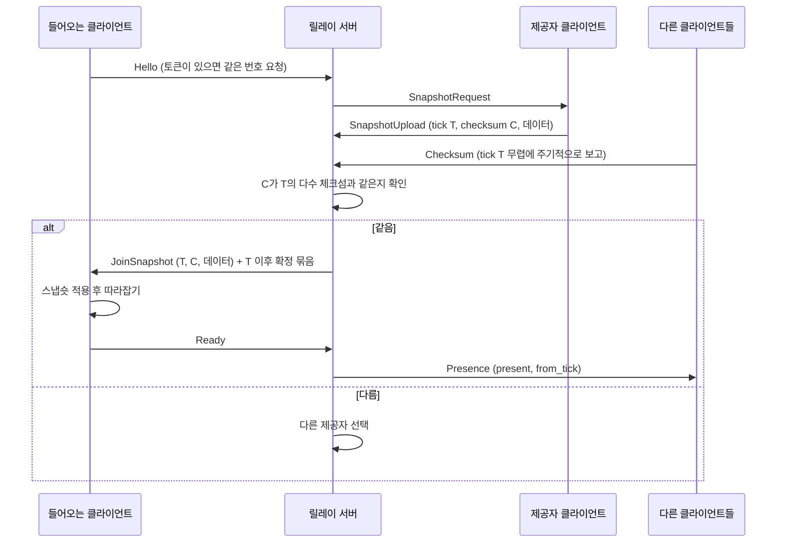

# 뷰 프레임워크 설계 (`orr_app`)

갱신: 2026-11-17 · 상태: 제안 (아직 구현 전) · 관련: [설계 v1](design-v1.md) 4~6장, [getting-started.md](getting-started.md)

## 1. 목표

사용자가 게임 규칙(시뮬레이션)과 화면 코드만 쓰면 창이 뜨고, 입력이 들어가고, 그림이 그려지게 한다. 유니티처럼 엔진이 실행 루프를 맡고, 퀀텀 3처럼 시뮬레이션과 화면을 나눠서 짠다.

지금은 이 층이 없다. 게임마다 창 생성, 입력 처리, 그리기 루프를 직접 짠다(`orr_sample`의 `physics_app.rs`, `defense_app.rs`, `collect_app.rs` 등, 각각 수백 줄). 그래서 처음 배우는 사람이 빈 프로젝트에서 시작해 창에 무언가를 띄우기까지가 길다.

이 문서가 정하는 것:

- 실행 함수와 실행 방식(서버 없이, 로컬 서버, 원격 서버)
- 화면 쪽 구성 단위: 엔티티 뷰, 씬 뷰
- 플레이어 번호, 플레이어 신호, 플레이어별 시작 데이터
- 재접속과 중간 입장, 스냅숏 검증
- 입력 전송 규칙과 비용
- 에디터에서 정하는 값(Authoring)과 프리팹

이 프레임워크가 생기면 [getting-started.md](getting-started.md)에 빈 프로젝트부터 따라 하는 튜토리얼을 더한다(10장).

## 2. 지금 있는 것

새 층은 아래 부품을 묶는다. 부품 자체는 바꾸지 않는 것이 원칙이고, 바꿔야 하는 곳은 각 장에 적는다.

| 부품 | 하는 일 | 위치 |
|---|---|---|
| `Game`, `Simulation` | 결정론 시뮬레이션. 입력은 `TickInputs`로만 들어간다 | `orr_sim` |
| `PlayerSlot(u8)` | 플레이어 번호. 세션 동안 바뀌지 않는다. 입력과 명령이 이 번호에 붙는다 | `orr_sim/src/input.rs` |
| `PlayerFlags` | 이번 틱 입력이 예측값인지(`predicted`), 연결이 끊겼는지(`disconnected`) | `orr_sim/src/input.rs` |
| 세션 | 입력 예측, 롤백, 리플레이, 중간 입장, 퇴장 처리 | `orr_session` |
| `Bridge` | 화면과 시뮬레이션 사이의 유일한 통로. 쓰기는 `set_input`, `send_command`뿐이다 | `orr_bridge` |
| `Snapshot` | `predicted`, `predicted_prev`, `verified` 프레임과 `verified_tick` | `orr_bridge/src/snapshot.rs` |
| `BridgeEvent` | 게임 이벤트(예측·확정·취소)와 세션 알림(`Rollback`, `Stalled`, `Desync`, `Disconnected` 등) | `orr_bridge/src/event.rs` |
| `ViewWorld` | 틱 사이 보간, 롤백으로 생긴 위치 튐 보정. 3가지 보간 방식(`Prediction`, `Snapshot`, `None`) | `orr_view` |
| 그리기 컴포넌트 | `Transform3`, `Material`, `Light`, `Camera`, `Terrain` 등과 그것을 렌더 데이터로 바꾸는 `SceneLook` | `orr_gfx`, `orr_gfx_view` |
| 릴레이 서버 | 시뮬레이션하지 않고 틱마다 입력을 모아 확정 묶음을 보낸다. 중간 입장 스냅숏 중계, 체크섬 비교 | `orr_server`, `orr_proto`, `orr_relay_net` |
| 씬 파일과 리플렉션 | 씬 파일의 엔티티가 곧 시뮬레이션 엔티티다. 에디터 인스펙터가 같은 경로를 쓴다 | `orr_reflect`, `orr_edit` |

## 3. 전체 구조



규칙은 설계 v1과 같다. 화면은 시뮬레이션을 읽기만 한다. 화면에서 시뮬레이션으로 가는 길은 입력과 명령뿐이다.

## 4. 실행 함수

### 4.1 사용 모습

```rust
fn main() -> Result<(), orr_app::Error> {
    orr_app::App::<Pong>::new()
        .scene("scenes/pong.scene.yaml")   // 시작 상태 (없으면 Game::setup만)
        .input(read_keys)                   // 키보드·패드 → Pong::Input
        .entity_view::<Paddle>(PaddleView::default) // Paddle 컴포넌트가 있는 엔티티마다 하나
        .scene_view(Scoreboard::default())  // 화면 전체에 하나
        .run()                              // 실행 방식은 명령줄 인자로 고른다 (4.3)
}
```

사용자가 쓰지 않아도 되는 것: 창, 그래픽 장치, 고정 틱 시계, 브리지 선택, 보간, 기본 조명·카메라·메시·모델 그리기, 창 크기 변경, 종료 처리.

### 4.2 한 프레임의 순서



### 4.3 실행 방식

게임 코드는 세 방식에서 같다. 방식은 `App`의 설정이나 명령줄 인자로 고른다.

| 방식 | 명령 예 | 브리지 | 용도 |
|---|---|---|---|
| 서버 없이 | `my_game` | `InProc` 또는 `Threaded` | 혼자 하기, 한 화면 여러 명 |
| 로컬 서버 | `my_game --host` (서버를 같은 프로세스에서 띄우고 접속), `my_game --connect 127.0.0.1:7777` | 릴레이 클라이언트 | 같은 PC 창 두 개, LAN |
| 원격 서버 | `my_game --connect <주소>` | 릴레이 클라이언트 | 인터넷 |

"한 화면 여러 명"은 서버 없이 실행하면서 로컬 플레이어를 둘 이상 두는 것이다(5장). 로컬 서버와는 다르다.

## 5. 입력

- 게임은 `fn poll_input(ctx: &InputContext, slot: PlayerSlot) -> G::Input`을 준다. `App`이 로컬 플레이어마다 매 프레임 부른다.
- `InputContext`는 키보드, 마우스, 패드 상태와 "이 로컬 플레이어에게 배정된 장치"를 준다. 한 화면 2인이면 1번은 키보드 왼쪽, 2번은 패드처럼 배정한다.
- `Bridge::set_input`은 지금 로컬 슬롯 하나만 받는다. 로컬 플레이어가 여러 명이면 이 제한을 "이 클라이언트에 배정된 슬롯들"로 넓혀야 한다. 바꿀 곳은 `orr_bridge`와 세션의 로컬 입력 경로다.
- 일회성 명령(구매, 건설)은 `ctx.send_command(cmd)`로 보낸다. 지금의 `Bridge::send_command`와 같다.

## 6. 엔티티 뷰

시뮬레이션 엔티티 하나에 화면 객체 하나가 붙는다. 퀀텀의 `EntityView`에 해당한다.

```rust
pub trait EntityView<G: Game> {
    fn on_create(&mut self, ctx: &mut ViewContext<G>, entity: Entity) {}
    fn on_update(&mut self, ctx: &mut ViewContext<G>, entity: Entity, pose: &Pose) {}
    fn on_destroy(&mut self, ctx: &mut ViewContext<G>, entity: Entity) {}
}
```

- **붙이는 기준:** 두 가지를 지원한다.
  - 컴포넌트 필터: `entity_view::<Paddle>(...)`은 `Paddle` 컴포넌트를 가진 엔티티마다 뷰를 만든다.
  - `ViewRef` 컴포넌트: 시뮬레이션에 뷰 에셋 번호를 넣는다(11장). 같은 컴포넌트 구성이라도 엔티티마다 다른 모델·소리를 붙일 때 쓴다. 퀀텀의 `View` 컴포넌트와 같다.
- **기준 프레임:** 생성과 삭제는 예측 프레임을 기준으로 판단한다. 반응이 즉각적이기 때문이다.
- **롤백 때:** 예측으로 생겼던 엔티티가 롤백으로 사라지면 `on_destroy`가 불린다. 엔티티 키는 `(번호, 버전)`이라 같은 번호가 재사용되어도 다른 엔티티로 다룬다(`ViewWorld`와 같은 규칙).
- **위치:** `pose`는 `ViewWorld`가 보간하고 롤백 튐을 보정한 값이다. 보간 방식은 뷰마다 고른다. 기본은 `Prediction`이다.
- **기본 뷰:** `Transform3`과 `Material`(또는 모델 참조)이 있는 엔티티는 사용자가 뷰를 붙이지 않아도 기본 렌더러가 그린다. 사용자 뷰는 그 위에 효과, 소리, UI를 더한다.

## 7. 씬 뷰

화면 전체에 하나씩 있는 객체다. 퀀텀의 `SystemView`, `QuantumCallback`에 해당한다.

```rust
pub trait SceneView<G: Game> {
    fn on_start(&mut self, ctx: &mut ViewContext<G>) {}
    fn on_update(&mut self, ctx: &mut ViewContext<G>) {}
    fn on_event(&mut self, ctx: &mut ViewContext<G>, event: &G::Event, state: EventState) {}
    fn on_player(&mut self, ctx: &mut ViewContext<G>, signal: PlayerSignal) {}
    fn on_session(&mut self, ctx: &mut ViewContext<G>, note: Lifecycle) {}
}
```

`ViewContext`가 주는 것:

| 메서드 | 내용 |
|---|---|
| `predicted()` | 예측 프레임(가장 최신). 그리기와 즉각 반응에 쓴다 |
| `verified()` | 확정 프레임. 점수, 승패처럼 되돌아가면 곤란한 표시에 쓴다 |
| `query::<(&A, &B)>()` | 예측 프레임에서 컴포넌트 조합으로 엔티티를 고른다 |
| `local_players()`, `is_local(slot)` | 이 클라이언트의 플레이어 번호들 |
| `tick()`, `verified_tick()` | 현재 예측 틱과 확정 틱 |
| `send_command(cmd)` | 일회성 명령 |
| `draw()` | 기본 렌더러에 선, 글자, 추가 메시를 더한다 |

`EventState`는 `Predicted`, `Verified`, `Canceled` 중 하나다(지금의 `EventStatus`와 같은 의미). 권장 사용법:

- 효과음, 파티클: `Predicted`에서 시작하고 `Canceled`면 멈춘다.
- 업적, 통계, 서버 보고: `Verified`에서만 처리한다.

## 8. 플레이어

### 8.1 플레이어 번호

`PlayerSlot`을 컴포넌트에 넣을 수 있게 바꾼다.

- `bytemuck::Pod`와 리플렉션 등록을 더한다. 씬 파일과 인스펙터에 번호로 보인다.
- "플레이어 없음"을 나타내는 값을 정한다. `0xFF`를 쓴다. 릴레이 프로토콜의 `NO_SLOT`과 같은 값이다.
- 표준 컴포넌트 `PlayerLink { player: PlayerSlot }`을 둔다. "이 엔티티는 몇 번 플레이어 것"을 나타낸다. 화면은 `ctx.is_local(link.player)`로 내 캐릭터를 안다.

### 8.2 플레이어 신호

지금 시뮬레이션은 틱마다 `PlayerFlags::disconnected`만 받는다. 게임이 상태가 바뀐 순간을 알려면 직접 비교해야 한다. 다음 네 신호를 시뮬레이션 입력에 더한다.

| 신호 | 언제 | 게임이 하는 일 예 |
|---|---|---|
| `PlayerAdded { slot, data }` | 처음 들어옴 | 프리팹으로 아바타 생성 |
| `PlayerDisconnected { slot }` | 서버가 끊김으로 판정함 | 캐릭터 멈춤, AI가 대신 조종 |
| `PlayerReconnected { slot }` | 같은 번호로 돌아옴 | 조종권 반환 |
| `PlayerRemoved { slot }` | 자리 보관 시간이 지나 완전히 나감 | 아바타 삭제, 소유물 넘기기 |

- 신호는 `TickInputs`에 틱 단위로 실린다. 모든 클라이언트가 같은 틱에 같은 신호를 받으므로 결정론이 유지된다.
- 릴레이 서버의 입장·퇴장 알림 `Presence { slot, present, from_tick }`는 지금 확정 묶음과 따로 신뢰 채널로 간다. 클라이언트는 이 알림을 `from_tick`의 `TickInputs`에 신호로 넣는다. 그 틱을 이미 예측으로 지나갔다면 일반 입력 오예측과 같이 롤백한다.
- `Disconnected`와 `Removed`의 구분은 서버의 자리 보관 기능을 쓴다. 지금 서버는 나간 플레이어의 자리를 토큰과 함께 `reserve_ticks` 동안 보관한다. 보관 중이면 `Disconnected`, 보관이 끝나면 `Removed`다.
- 서버 없이 실행하면 `App`이 시작할 때 로컬 플레이어마다 `PlayerAdded`를 넣는다.

### 8.3 플레이어별 시작 데이터

퀀텀의 `RuntimePlayer`에 해당한다. 이름, 고른 캐릭터, 색처럼 플레이어가 들어올 때 정해지는 값이다.

- 게임이 선택적으로 구현하는 트레이트에 연관 타입으로 둔다. 기존 `Game` 구현은 바꾸지 않아도 된다.

```rust
pub trait Players: Game {
    type Player: Pod + Default;   // 고정 크기. 문자열은 고정 길이 바이트로
    fn on_player(frame: &mut Frame, signal: PlayerSignal<Self::Player>);
}
```

- 값은 접속할 때 클라이언트가 서버로 보낸다. 서버는 `PlayerAdded` 신호에 실어 모두에게 보낸다. 시뮬레이션 안에서는 신호의 일부이므로 결정론 입력이다.
- 서버는 이 값의 내용을 검사하지 않는다(릴레이 방식). 검사가 필요한 게임은 시뮬레이션 안에서 범위를 확인한다.

## 9. 재접속과 중간 입장

### 9.1 정책

| 항목 | 결정 |
|---|---|
| 따라잡는 방법 | 확정 스냅숏을 받는다. 처음부터 다시 시뮬레이션하는 방법은 리플레이와 검증에만 쓴다 |
| 스냅숏을 주는 쪽 | 플레이 중인 클라이언트 한 명(제공자). 지금 서버의 방식 그대로다 |
| 스냅숏 검증 | 서버가 같은 틱에 다른 클라이언트들이 보고한 체크섬의 다수 값과 비교한다. 같을 때만 넘긴다 |
| 검증 실패 | 그 제공자를 제외하고 다른 제공자에게 다시 요청한다. `Desync` 알림을 남긴다 |
| 같은 번호로 복귀 | 자리 보관 토큰이 맞으면 같은 번호를 준다. 아바타는 그대로 남아 있다 |

처음부터 다시 시뮬레이션하는 방법은 경기가 길수록 느려지고, 서버가 입력 기록 전체를 보관해야 한다. 그래서 기본으로 쓰지 않는다.

### 9.2 흐름



바꿀 곳:

- **체크섬 틱 맞추기:** 클라이언트는 `checksum_interval` 틱마다 체크섬을 보고한다. 서버는 스냅숏 틱 `T`를 그 간격에 맞춘 틱으로 고른다. 그래야 비교할 체크섬이 있다.
- **비교 대상 부족:** 비교할 다른 클라이언트가 없으면(2인 게임에서 한 명이 재접속) 검증 없이 넘긴다. 이 경우는 결과에 "검증 안 됨"으로 남긴다.

## 10. 입력 전송

### 10.1 규칙

- 클라이언트는 매 틱 입력을 보낸다. 입력이 없으면 기본값을 보낸다. 아무것도 보내지 않으면 서버는 "가만히 있음"과 "연결 끊김"을 구분할 수 없다.
- 서버는 틱마다 마감 시각에 그 틱을 확정한다. 입력이 안 온 플레이어는 직전 입력을 쓰고 "반복됨" 표시를 붙인다. 빈자리는 `VacantPolicy`를 따른다.
- 클라이언트는 상대 입력이 오는지 판단하지 않는다. 확정 묶음이 오면 상대 입력은 정해진 것이다. 묶음이 끊기면 내 네트워크나 서버 문제다(`Ping`/`Pong`, `TimeSync`로 확인).
- 끊김은 서버가 판정한다. 한 클라이언트에게서 정해진 시간 동안 패킷이 오지 않으면 자리를 비우고 `Presence`를 보낸다(8.2). 이 시간은 `RoomConfig`에 둔다.

### 10.2 비용

이미 있는 장치:

- 클라이언트는 아직 확인받지 못한 최근 입력 K개를 패킷마다 함께 보낸다. 패킷 하나를 잃어도 다음 패킷이 메운다.
- 서버의 확정 묶음은 직전 묶음과 같은 입력이면 입력 바이트를 빼고 표시 1바이트만 보낸다. 묶음은 `bundle_redundancy` 번 반복해서 보낸다.

더할 것:

1. **클라이언트 입력의 "직전과 같음" 표시.** 확정 묶음과 같은 방식으로 클라이언트 입력 항목에도 넣는다. 입력이 자주 바뀌지 않는 게임에서 입력 바이트가 거의 사라진다. 프로토콜 버전을 올린다.
2. **두 틱 묶어 보내기(선택).** 패킷 수가 절반이 되고 입력 지연이 1틱 늘어난다. 게임이 고른다.

하지 않을 것: "변화 없음"을 가끔만 보내는 방식. 입력이 바뀐 패킷을 잃으면 서버가 옛 입력으로 확정해 실제 조작이 무시된다.

60틱 기준 예상치는 클라이언트당 올려 보내기 약 2~3 KB/s다. 대부분이 네트워크 헤더다. 구현 후 `orr_proto::netsim`으로 실제 바이트 수를 재서 이 절에 기록한다.

## 11. 에디터에서 정하는 값(Authoring)과 프리팹

퀀텀은 유니티 게임 오브젝트를 시뮬레이션 엔티티로 바꾸는 단계가 따로 있다. 이 엔진은 씬 파일의 엔티티가 곧 시뮬레이션 엔티티이고, 인스펙터가 리플렉션으로 같은 값을 고친다. 그래서 별도 변환 층은 만들지 않는다. 더할 것은 두 가지다.

- **`ViewRef` 컴포넌트:** 시뮬레이션에 들어가는 Pod 컴포넌트로, 뷰 에셋의 번호(`u64`)를 가진다. 인스펙터에서 프로젝트의 뷰 에셋 목록 중 하나를 고른다. 뷰 에셋은 모델, 머티리얼, 소리, 엔티티 뷰 종류를 묶은 파일이다. 시뮬레이션은 이 번호를 읽기만 하고 뜻은 모른다.
- **프리팹 생성:** 시뮬레이션 시스템이 프리팹 하나로 엔티티를 만드는 경로. 예: `PlayerAdded`를 받아 아바타 프리팹을 만든다. 프리팹은 씬 파일 조각을 미리 구워 둔 바이트로 저장한다. 그래서 시뮬레이션 안에서 파일을 읽지 않는다. 씬 파일의 연결 프리팹(`orr_reflect` scene `linked`)과 같은 데이터를 쓸 수 있는지 구현 단계에서 확인한다.

## 12. 작업 순서

| 단계 | 내용 | 끝났다는 기준 |
|---|---|---|
| 1 (완료) | `orr_app` 실행 함수, 기본 렌더러, 서버 없이 실행 | 2D 물리 데모 하나를 `orr_app` 위로 옮겨 같은 화면이 나온다. 쓰는 법과 정한 것은 [crates/orr_app/README.md](../crates/orr_app/README.md), 예제는 `orr_app/examples/physics2d.rs`. 같은 틱의 그림이 기존 물리 샘플의 그리기 경로와 바이트까지 같다 |
| 2 | 엔티티 뷰, 씬 뷰, 이벤트 상태, 예측·확정 프레임 접근 | 롤백이 나는 장면에서 `on_create`/`on_destroy`와 이벤트 취소가 맞게 불린다(테스트) |
| 3 | `PlayerSlot` Pod·리플렉션, `PlayerLink`, 로컬 플레이어 여러 명 | 한 화면 2인 예제가 돈다 |
| 4 | 플레이어 신호, `Players` 트레이트, 서버 `Presence` 연결 | 로컬 서버에 창 두 개가 접속하고, 한 창을 닫았다 다시 열면 `Disconnected` → `Reconnected` 순서로 신호가 온다 |
| 5 | 스냅숏 체크섬 다수 검증, 클라이언트 입력 "직전과 같음" 표시 | `netsim` 테스트로 조작된 스냅숏이 거부되고, 입력 바이트 감소량을 기록한다 |
| 6 | `ViewRef`, 뷰 에셋, 프리팹 생성 | 인스펙터에서 뷰 에셋을 고르면 그 모델이 그려진다. `PlayerAdded`로 아바타 프리팹이 생긴다 |
| 7 | 튜토리얼 | 빈 프로젝트 → 혼자 하기 → 한 화면 2인 → 로컬 서버 2창 → 재접속까지, 단계별 예제가 모두 빌드되고 테스트로 확인된다 |

각 단계는 짧은 브랜치 하나로 진행하고 끝나면 `main`에 합친다([AGENTS.md](../AGENTS.md)의 Delivery rules).

## 13. 아직 정하지 않은 것

- **이름:** `orr_app`, `EntityView`, `SceneView`, `ViewRef`, `PlayerLink`, `Players`는 가칭이다. 단계 1에서 확정한다.
- **2D와 3D 렌더러 묶기:** 기본 렌더러를 2D(지금의 2D 물리 화면)와 3D(`SceneLook`) 중 무엇부터 지원할지 정한다. 단계 1은 2D 데모로 시작한다.
- **웹과 모바일:** `orr_app`의 창 루프를 웹 워커와 안드로이드에서도 쓸지. 지금 `orr_web`, `orr_web_gpu`는 따로 루프를 가진다.
- **서버가 직접 시뮬레이션하는 모드:** `orr_server`의 Authoritative 모드가 있으면 스냅숏 제공자를 서버로 바꿀 수 있다. 이 문서는 릴레이 모드만 다룬다.
- **끊김 판정 시간:** 기본값(예: 2초)과 게임별 조정 범위.
